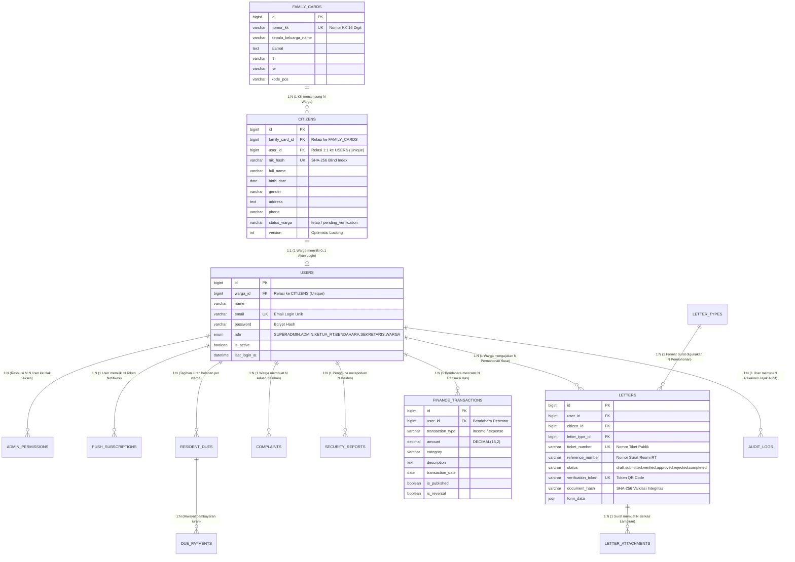
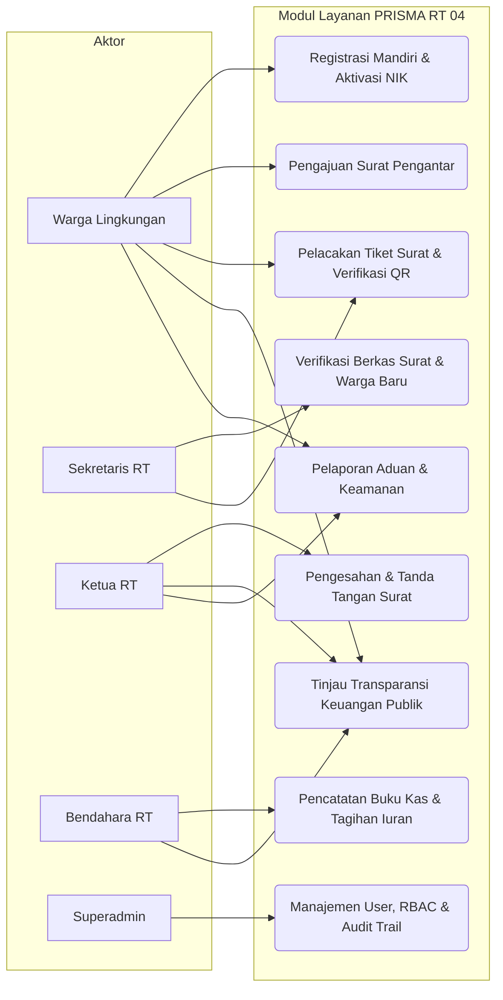
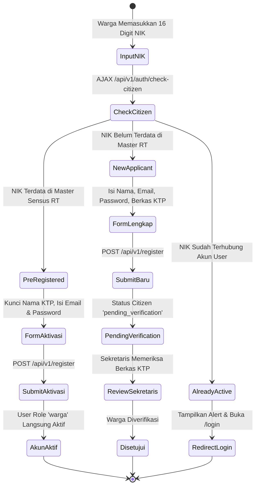
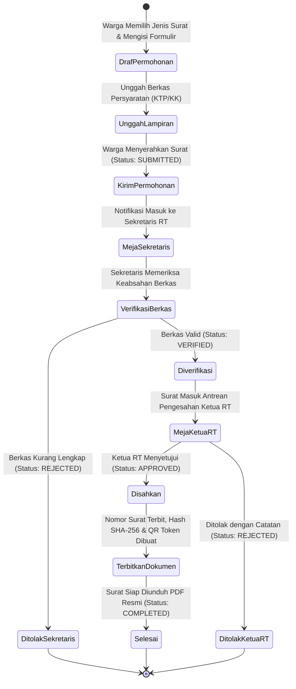
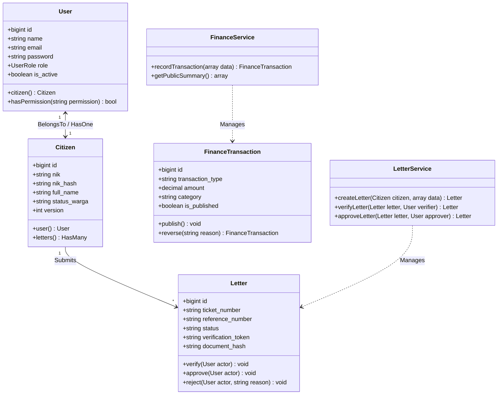
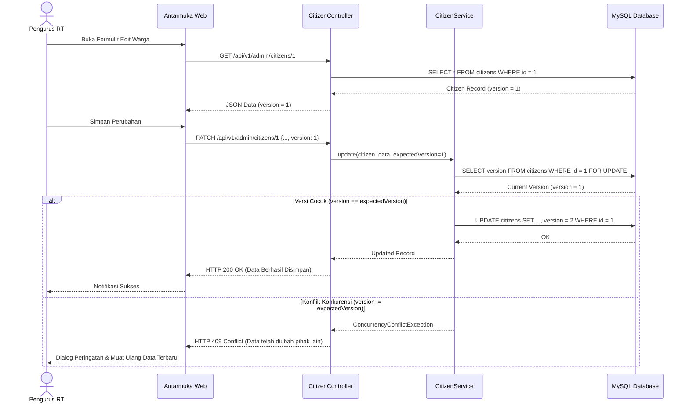

# Platform Layanan Publik Warga PRISMA RT 04 (Laravel 13)

> **PRISMA RT 04 Kemayoran**: Platform Realisasi Informasi, Sistem Manajemen & Administrasi Warga Berbasis Web & Progressive Web App (PWA).  
> **Visual Reference:** [https://prisma-rose.vercel.app/](https://prisma-rose.vercel.app/)  
> **Framework:** PHP 8.4+ & Laravel 13.x | **Database:** MySQL 8.x | **Styling:** Tailwind CSS v4 & Alpine.js | **Runtime:** FrankenPHP / Docker (Railway)

---

## Daftar Isi
1. [Tentang Proyek](#tentang-proyek)
2. [Identitas Komunitas & Referensi Desain](#identitas-komunitas--referensi-desain)
3. [Arsitektur Sistem & Tech Stack](#arsitektur-sistem--tech-stack)
4. [Daftar Akun & Kredensial Pengurus Default](#daftar-akun--kredensial-pengurus-default)
5. [Pemodelan Rekayasa Perangkat Lunak (5 Unsur Utama)](#pemodelan-rekayasa-perangkat-lunak-5-unsur-utama)
   - [1. Entity Relationship Diagram (ERD)](#1-entity-relationship-diagram-erd)
   - [2. Logical Record Structure (LRS)](#2-logical-record-structure-lrs)
   - [3. Use Case Diagram & Spesifikasi Aktor](#3-use-case-diagram--spesifikasi-aktor)
   - [4. Activity Diagram (Alur Verifikasi NIK & Persuratan)](#4-activity-diagram)
   - [5. Unified Modeling Language (UML) Diagrams](#5-unified-modeling-language-uml-diagrams)
6. [Fitur Unggulan Antarmuka & Layanan Publik](#fitur-unggulan-antarmuka--layanan-publik)
7. [Klasifikasi Dokumentasi Teknis (5 Pilar Subfolder `docs/`)](#klasifikasi-dokumentasi-teknis-5-pilar-subfolder-docs)
8. [Panduan Instalasi & Menjalankan Proyek](#panduan-instalasi--menjalankan-proyek)
9. [Pengujian Otomatis (Automated Testing)](#pengujian-otomatis-automated-testing)
10. [Keamanan & Perlindungan Data Pribadi (UU PDP)](#keamanan--perlindungan-data-pribadi-uu-pdp)

---

## Tentang Proyek

**PRISMA RT 04** (*Platform Realisasi Informasi, Sistem Manajemen & Administrasi*) adalah platform digital layanan publik warga RT 04 / RW 09 Kemayoran, Jakarta Pusat. Sistem ini mengintegrasikan seluruh administrasi lingkungan warga ke dalam satu ekosistem terpadu:

- **Pendaftaran Mandiri & Verifikasi NIK Real-Time**: Pencocokan 16 digit NIK secara instan dengan deteksi warga sensus terdaftar (*pre-registered*), pengajuan warga baru (*pending verification*), dan pencegahan duplikasi akun.
- **Birokrasi Surat Digital 2-Tier**: Verifikasi berkas administratif oleh **Sekretaris**, persetujuan/tanda tangan digital oleh **Ketua RT**, penomoran surat otomatis anti-bentrok, dan verifikasi keaslian via token QR Code.
- **Buku Kas Anti-Fraud (*Immutable Financial Ledger*)**: Setiap penerimaan dan pengeluaran dicatat dengan presisi `DECIMAL(15,2)`. Transaksi terbit bersifat *append-only* dengan mekanisme *reversal audit* jika terdapat koreksi.
- **Pengaduan Warga & Laporan Keamanan**: Penyampaian keluhan fasilitas lingkungan dan laporan darurat dengan bukti foto, pelacakan status tiket, dan koordinasi petugas keamanan pos ronda.
- **Transparansi Komunitas**: Publikasi warta pengumuman, agenda kegiatan kerja bakti, struktur pengurus RT, jadwal ronda kamling, dan kontak darurat 24 jam.
- **Progressive Web App (PWA)**: Akses cepat seperti aplikasi mobile asli dengan Web App Manifest, Service Worker caching cerdas, dan halaman *offline fallback*.

---

## Identitas Komunitas & Referensi Desain

- **Entitas Lingkungan:** Sekretariat PRISMA RT 04 / RW 09 Kemayoran
- **Alamat Sekretariat:** Rumah - Gg. Bugis No. 95, RT 04 / RW 09, Kebon Kosong, Kec. Kemayoran, Kota Jakarta Pusat, DKI Jakarta 10620
- **Koordinat Wilayah (GEO):** Latitude `-6.1618`, Longitude `106.8456`
- **Saluran Bantuan WhatsApp:** `+62 878-7200-4448`
- **Kontak IT & Pengurus:** Swandaru Tirta (`swandrax@gmail.com`)
- **Visual & Functional Reference:** [https://prisma-rose.vercel.app/](https://prisma-rose.vercel.app/)

---

## Arsitektur Sistem & Tech Stack

Platform dibangun secara murni menggunakan arsitektur monolitik modern **MVC + Service Layer + ViewModel** dengan backend PHP Laravel 13 dan frontend Blade Components:

| Lapisan Sistem | Teknologi | Keterangan & Rincian Implementasi |
|---|---|---|
| **Backend Framework** | **Laravel 13.x** (PHP 8.4.1+) | Native Laravel 13 dengan Eloquent ORM, Form Requests, Policies, dan Gates |
| **Frontend Templating** | **Laravel Blade + Components** | Komponen UI modular, semantic HTML5, WCAG accessible |
| **CSS Framework** | **Tailwind CSS v4** | Dikompilasi via `@tailwindcss/vite` dengan konfigurasi tema `@theme` modern |
| **Interaktivitas UI** | **Alpine.js v3** | Reaktivitas form, verifikasi NIK real-time, toggle password, modal dialog, animasi feedback |
| **Database Transaksional**| **MySQL 8.x** | Sumber kebenaran utama (*Single Source of Truth*), nilai moneter `DECIMAL(15,2)`, foreign keys |
| **Cache & Queue Engine** | **Redis 7.x** | Penanganan cache aplikasi, session driver, queue worker, dan API rate limiting |
| **Autentikasi & API** | **Session + Laravel Sanctum** | Stateful web session untuk browser dan Bearer Token untuk REST API `/api/v1` |
| **Dokumentasi API** | **OpenAPI 3.1 & Swagger UI** | Tersedia interaktif di rute `/docs/api` bersumber dari `docs/api_spec/openapi.yaml` |
| **Containerization** | **FrankenPHP & Docker** | Image `dunglas/frankenphp:1-php8.4-bookworm` dengan Caddy web server |
| **Hosting & Deploy** | **Railway-Compatible** | Konfigurasi deklaratif via `Dockerfile` dan `railway.json` |
| **Code Style & QA** | **Laravel Pint & PHPUnit** | PSR-12 standard formatting dan 150 Automated Feature Tests (100% Passed) |

---

## Daftar Akun & Kredensial Pengurus Default

Untuk keperluan pengujian lokal, demo, dan audit evaluasi sistem, database telah dilengkapi data seeder pengurus bawaan:

| Peran (*Role*) | Email Login | Password Default | Aksesibilitas & Wewenang Modul |
|---|---|---|---|
| **SUPERADMIN** | `superadmin@warga.local` | `password` | **Kontrol Penuh Sistem**:<br>• Manajemen pengguna & hak akses role.<br>• Inspeksi audit logs, konfigurasi modul, dan unduh backup terenkripsi. |
| **KETUA_RT** | `ketua_rt@warga.local` | `password` | **Pengesahan & Supervisi**:<br>• Persetujuan akhir surat pengantar warga (`letter.approve`).<br>• Pengesahan laporan kas berkala & tindak lanjut aduan warga.<br>• Supervisi kependudukan dan kegiatan RT. |
| **SEKRETARIS** | `sekretaris@warga.local` | `password` | **Verifikasi & Administrasi**:<br>• Verifikasi berkas warga baru & lampiran surat pengantar (`letter.verify`).<br>• Pengelolaan master sensus kependudukan RT (`citizen.manage`).<br>• Template surat, warta pengumuman, dan agenda kegiatan warga. |
| **BENDAHARA** | `bendahara@warga.local` | `password` | **Keuangan Lingkungan**:<br>• Pencatatan transaksi kas masuk & keluar (presisi desimal).<br>• Penagihan & verifikasi iuran kebersihan/keamanan warga.<br>• Rekapitulasi laporan kas bulanan/triwulanan dan snapshot backup kas. |
| **PETUGAS_KEAMANAN** | `keamanan@warga.local` | `password` | **Ketertiban & Keamanan**:<br>• Penanganan tiket laporan insiden lingkungan (`security.manage`).<br>• Pengelolaan jadwal ronda kamling & pemantauan pos satpam. |
| **WARGA** | *(Didaftarkan mandiri)* | *(Sesuai registrasi)* | **Layanan Mandiri Warga**:<br>• Permohonan surat pengantar digital & unduh dokumen ber-QR Code.<br>• Pelaporan aduan fasilitas dengan bukti foto.<br>• Tinjau transparansi kas RT & riwayat pembayaran iuran mandiri. |

---

## Pemodelan Rekayasa Perangkat Lunak (5 Unsur Utama)

Sebagai kepatuhan pada standar dokumentasi rekayasa perangkat lunak (*Software Engineering Documentation*), sistem ini didokumentasikan secara komprehensif melalui **5 Unsur Pemodelan Sistem**:

### 1. Entity Relationship Diagram (ERD)



---

### 2. Logical Record Structure (LRS)

Representasi tabel ternormalisasi bentuk ketiga (3NF) dengan foreign key eksplisit:
```
FAMILY_CARDS (id [PK], nomor_kk [UK], kepala_keluarga_name, alamat, rt, rw, kode_pos, created_at)
CITIZENS (id [PK], family_card_id [FK], user_id [FK, UK], nik_hash [UK], full_name, birth_date, gender, address, phone, status_warga, version, created_at)
USERS (id [PK], warga_id [FK, UK], name, email [UK], password, role, is_active, last_login_at, created_at)
LETTER_TYPES (id [PK], code [UK], name, description, required_attachments, is_active, created_at)
LETTERS (id [PK], user_id [FK], citizen_id [FK], letter_type_id [FK], ticket_number [UK], reference_number, status, verification_token [UK], document_hash, form_data, created_at)
LETTER_ATTACHMENTS (id [PK], letter_id [FK], file_path, original_name, mime_type, file_size, created_at)
FINANCE_TRANSACTIONS (id [PK], user_id [FK], transaction_type, amount, category, description, transaction_date, is_published, is_reversal, reversal_of_id [FK], created_at)
RESIDENT_DUES (id [PK], citizen_id [FK], due_month, due_year, amount, status, created_at)
DUE_PAYMENTS (id [PK], resident_due_id [FK], payment_reference [UK], amount, payment_method, payment_date, created_at)
COMPLAINTS (id [PK], user_id [FK], title, description, category, status, photo_path, created_at)
SECURITY_REPORTS (id [PK], user_id [FK], incident_type, location, description, incident_time, status, photo_path, created_at)
AUDIT_LOGS (id [PK], user_id [FK], event, auditable_type, auditable_id, old_values, new_values, ip_address, user_agent, created_at)
```

---

### 3. Use Case Diagram & Spesifikasi Aktor



---

### 4. Activity Diagram

#### Alur Pendaftaran Mandiri Warga & Validasi NIK Real-Time


#### Alur Birokrasi Surat Pengantar Digital 2-Tier


---

### 5. Unified Modeling Language (UML) Diagrams

#### 5.1. UML Class Diagram


#### 5.2. UML Sequence Diagram: Optimistic Concurrency Control


---

## Fitur Unggulan Antarmuka & Layanan Publik

1. **Aestetika Modern PRISMA RT 04:**
   - Navigasi responsif dengan logo gradien Blue-Cyan dan drawer mobile ramah layar sentuh.
   - Kartu tindakan cepat (*"Apa yang ingin Anda lakukan?"*): Urus Surat, Cek Kas RT, Lapor Masalah, Jadwal Kegiatan, Hubungi Pengurus via WhatsApp.
2. **Umpan Balik Validasi Interaktif:**
   - Animasi *shake* lembut saat input formulir tidak valid.
   - Notifikasi toast mengambang untuk status sukses dan peringatan sistem.
3. **Optimasi Core Web Vitals:**
   - *Preconnect* tipografi Google Fonts via Bunny Fonts untuk menghilangkan FOIT (*Flash of Invisible Text*).
   - *Zero Cumulative Layout Shift* (CLS = 0) dengan dimensi gambar eksplisit.
4. **Metadata SEO & GEO Wilayah:**
   - Tag OpenGraph dan Twitter Cards terpasang rapi.
   - Schema.org Structured Data (`GovernmentOrganization` dan `WebSite`) terindeks di wilayah Kemayoran, Jakarta Pusat.

---

## Klasifikasi Dokumentasi Teknis (5 Pilar Subfolder `docs/`)

Dokumentasi proyek diklasifikasikan ke dalam 5 subfolder tematik yang dapat ditinjau melalui [docs/README.md](docs/README.md):

1. **[`docs/api_spec/`](docs/api_spec/README.md)**:
   - [openapi.yaml](docs/api_spec/openapi.yaml): Spesifikasi OpenAPI 3.1 untuk Swagger UI interaktif (`/docs/api`).
   - [API_SPEC.md](docs/api_spec/API_SPEC.md): Katalog endpoint RESTful JSON v1.
   - [API_V1_1_CONTRACT.md](docs/api_spec/API_V1_1_CONTRACT.md): Kontrak penagihan iuran dan audit laporan keuangan.
2. **[`docs/business/`](docs/business/README.md)**:
   - [AUTH_REGISTER_AND_LOGIN_SPEC.md](docs/business/AUTH_REGISTER_AND_LOGIN_SPEC.md): **Spesifikasi mendalam alur registrasi, validasi NIK, aktivasi akun, dan login.**
   - [SRS.md](docs/business/SRS.md): Software Requirements Specification.
   - [LETTER_WORKFLOW.md](docs/business/LETTER_WORKFLOW.md): Alur kerja surat 2-tier dan QR verification token.
   - [FINANCIAL_REPORTS_AND_BACKUP_STORE.md](docs/business/FINANCIAL_REPORTS_AND_BACKUP_STORE.md): Regulasi buku kas anti-fraud & backup store.
   - [DATA_CLASSIFICATION.md](docs/business/DATA_CLASSIFICATION.md): Standar privasi UU PDP No. 27/2022.
3. **[`docs/design/`](docs/design/README.md)**:
   - [BRAND_GUIDE.md](docs/design/BRAND_GUIDE.md): Pedoman identitas visual resmi PRISMA RT 04.
   - [ERD.md](docs/design/ERD.md): Skema 24 tabel database relasional.
   - [DIAGRAMS.md](docs/design/DIAGRAMS.md): Sequence Diagram dan Activity Diagram.
   - [UI_PLAN.md](docs/design/UI_PLAN.md): Rencana antarmuka responsif ramah segala usia.
   - [WEB_PERFORMANCE_SEO_GEO.md](docs/design/WEB_PERFORMANCE_SEO_GEO.md): Optimasi Core Web Vitals dan SEO lokal.
   - [CIRCULAR_FRAMEWORK_METHODS_AND_ALGORITHMS.md](docs/design/CIRCULAR_FRAMEWORK_METHODS_AND_ALGORITHMS.md): **Metode, algoritma & standarisasi Kerangka Diagram Lingkaran Sistem.**
4. **[`docs/plan_project/`](docs/plan_project/README.md)**:
   - [PROJECT_PLAN.md](docs/plan_project/PROJECT_PLAN.md): Master rencana proyek dan ruang lingkup.
   - [SPRINT_PLAN.md](docs/plan_project/SPRINT_PLAN.md): Pembagian 6 sprint berkelanjutan.
5. **[`docs/project_management/`](docs/project_management/README.md)**:
   - [RBAC.md](docs/project_management/RBAC.md): Penegakan hak akses berbasis peran.
   - [RBAC_MATRIX.md](docs/project_management/RBAC_MATRIX.md): Matriks wewenang modular per tindakan.
   - [FIREBASE_FREE_TIER_SETUP.md](docs/project_management/FIREBASE_FREE_TIER_SETUP.md): Evaluasi cloud notification.

---

## Panduan Instalasi & Menjalankan Proyek (Laragon / XAMPP di Laptop Lain)

Aplikasi ini bersifat *self-contained* dan siap dijalankan di perangkat/laptop baru mana pun menggunakan stack lokal standar seperti **Laragon** atau **XAMPP**.

### 1. Kebutuhan Sistem & Prasyarat
- **PHP** versi **>= 8.4** *(Wajib PHP 8.4+ karena menggunakan Laravel 13)*
  - Ekstensi PHP yang aktif: `pdo_mysql`, `mbstring`, `openssl`, `curl`, `fileinfo`, `gd`, `zip`.
- **Composer** versi **>= 2.5**
- **Node.js** versi **>= 18** & **NPM**
- **MySQL Database Server** versi **8.x** (atau MariaDB bawaan Laragon/XAMPP)
- **Redis Server** *(Opsional — aplikasi telah dikonfigurasi otomatis menggunakan driver `database` untuk session, cache, dan queue jika Redis tidak terpasang).*

> 💡 **Tips Pengguna Laragon / XAMPP (Cara Memastikan PHP 8.4):**
> 1. Jika Laragon/XAMPP di laptop Anda masih menggunakan PHP 8.1 atau 8.2, unduh paket zip **PHP 8.4 VS17 x64 Thread Safe** dari [windows.php.net/download](https://windows.php.net/download/).
> 2. Ekstrak ke folder `C:\laragon\bin\php\php-8.4.x-Win32-x64`.
> 3. Buka Laragon ➡️ Klik Kanan di mana saja ➡️ **PHP** ➡️ **Version** ➡️ Pilih versi **8.4.x**.

---

### 2. Langkah demi Langkah Menjalankan di Laptop Baru (5 Menit)

#### Langkah 1: Clone Repositori dari GitHub
Buka terminal (Git Bash / PowerShell / Command Prompt):
```bash
git clone https://github.com/not162/platform-layanan-publik-warga.git
cd platform-layanan-publik-warga
```

#### Langkah 2: Instal Dependensi Backend & Frontend
```bash
# Instal dependensi PHP (Laravel 13):
composer install

# Instal dependensi Frontend (Vite & Tailwind CSS v4):
npm install
```

#### Langkah 3: Konfigurasi File Lingkungan (`.env`)
Salin file konfigurasi contoh dan buat kunci enkripsi aplikasi:
```bash
# Di Windows PowerShell / CMD:
copy .env.example .env

# Generate application encryption key:
php artisan key:generate
```

Buka file `.env` di teks editor, lalu sesuaikan koneksi database MySQL Laragon/XAMPP Anda:
```env
DB_CONNECTION=mysql
DB_HOST=127.0.0.1
DB_PORT=3306
DB_DATABASE=layanan_publik_warga
DB_USERNAME=root
DB_PASSWORD=
```
*(Driver session, queue, dan cache secara default sudah diset ke `database`, sehingga tidak memerlukan konfigurasi Redis tambahan di laptop lokal).*

#### Langkah 4: Buat Database & Jalankan Migrasi + Seeder
1. Buka **phpMyAdmin** (`http://localhost/phpmyadmin`) atau HeidiSQL bawaan Laragon.
2. Buat database baru dengan nama: **`layanan_publik_warga`** (Collation: `utf8mb4_unicode_ci`).
3. Jalankan migrasi dan pengisian data awal melalui terminal:
```bash
php artisan migrate --seed
```
*✨ Perintah ini akan otomatis menyusun 33 tabel relasional dan langsung menginjeksi akun pengurus (**Superadmin**, **Ketua RT**, **Sekretaris**, **Bendahara**, **Keamanan**) serta data sensus warga awal.*

#### Langkah 5: Kompilasi Aset & Jalankan Server Lokal
```bash
# Kompilasi aset Vite & Tailwind CSS:
npm run build

# Jalankan server aplikasi:
php artisan serve
```

Buka browser di laptop Anda:
🌐 **`http://localhost:8000`**

---

### 3. Pintasan Kredensial Pengujian Cepat
Setelah server berjalan, Anda dapat langsung masuk tanpa perlu repot mendaftar:
- **Ketua RT:** `ketua_rt@warga.local` | Password: `password`
- **Sekretaris:** `sekretaris@warga.local` | Password: `password`
- **Bendahara:** `bendahara@warga.local` | Password: `password`
- **Petugas Keamanan:** `keamanan@warga.local` | Password: `password`
- **Superadmin:** `superadmin@warga.local` | Password: `password`

*(Pada antarmuka `/login`, tersedia juga komponen interaktif **"Pintasan Akun Demo"** yang dapat diklik 1 kali untuk otomatis mengisi kredensial).*

---

## Pengujian Otomatis (Automated Testing)

Pengujian fitur (*Feature Tests*) dan unit (*Unit Tests*) dijalankan menggunakan **PHPUnit 12**:

```bash
# Eksekusi ringkas pengujian:
php artisan test --compact
```

### Bukti Hasil Pengujian Terkini:
```text
   PASS  Tests\Unit\ExampleTest
   PASS  Tests\Feature\ArchitectureAndRbacNormalizationTest
   PASS  Tests\Feature\AuthSelfRegistrationTest
   PASS  Tests\Feature\CitizenModuleTest
   PASS  Tests\Feature\CitizenServiceRoleMatrixTest
   PASS  Tests\Feature\ComplaintCameraPermissionTest
   PASS  Tests\Feature\ComplaintModuleTest
   PASS  Tests\Feature\DocumentWorkflowAndGenerationTest
   PASS  Tests\Feature\ExampleTest
   PASS  Tests\Feature\FinanceLedgerSprint2Test
   PASS  Tests\Feature\FinanceModuleTest
   PASS  Tests\Feature\FinanceReportBackupTest
   PASS  Tests\Feature\KepengurusanLoginTest
   PASS  Tests\Feature\LetterModuleTest
   PASS  Tests\Feature\NotificationModuleTest
   PASS  Tests\Feature\PublicContentModuleTest
   PASS  Tests\Feature\PurchaseAndQuarterlyReportSprint4Test
   PASS  Tests\Feature\PwaModuleTest
   PASS  Tests\Feature\ResidentDuePersonalLedgerSprint3Test
   PASS  Tests\Feature\RoleAndAuthorizationTest
   PASS  Tests\Feature\SecurityReportModuleTest

   Tests:    150 passed (645 assertions)
   Duration: 30.33s
   Status:   100% OK
```

---

## Keamanan & Perlindungan Data Pribadi (UU PDP)

Sistem mematuhi standar Undang-Undang Perlindungan Data Pribadi (UU PDP No. 27/2022):
1. **Blind Indexing SHA-256:** NIK mentah di-hash secara satu arah untuk indeks pencarian tanpa mengekspos angka NIK pada query log.
2. **Penyamaran Data Publik:** NIK yang ditampilkan di antarmuka publik atau pencarian kesamaan nama selalu disamarkan (contoh: `317103********0001`).
3. **Isolasi Rahasia:** Kredensial database dan API keys tidak di-hardcode ke dalam kode sumber, melainkan diatur melalui *Environment Variables* terenkripsi di server produksi.
4. **Audit Trail Komprehensif:** Setiap tindakan login, modifikasi berkas, persetujuan surat, dan posting kas tercatat permanen di tabel `audit_logs`.

---

## Lisensi
Proyek ini dikembangkan di bawah lisensi [MIT License](LICENSE).  
Hak Cipta &copy; 2026 **Pengurus PRISMA RT 04 / RW 09 Kemayoran** & Pengembang Sistem.
