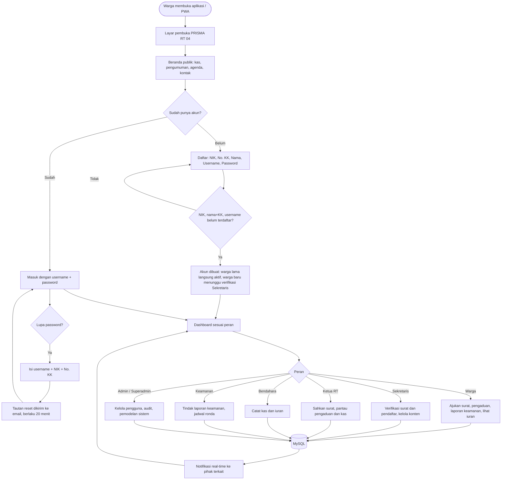
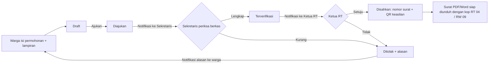
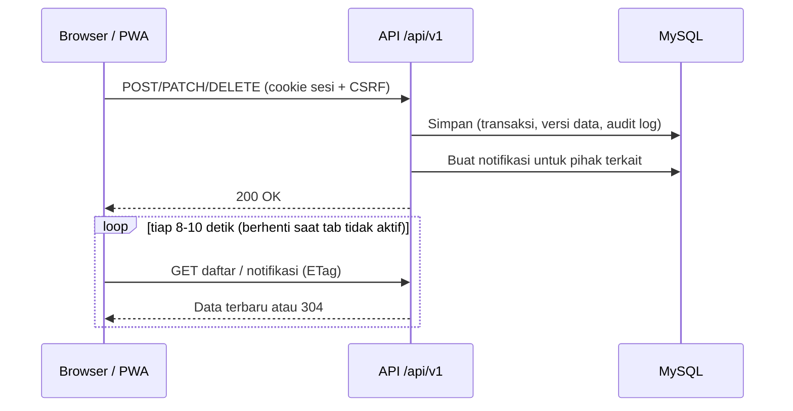
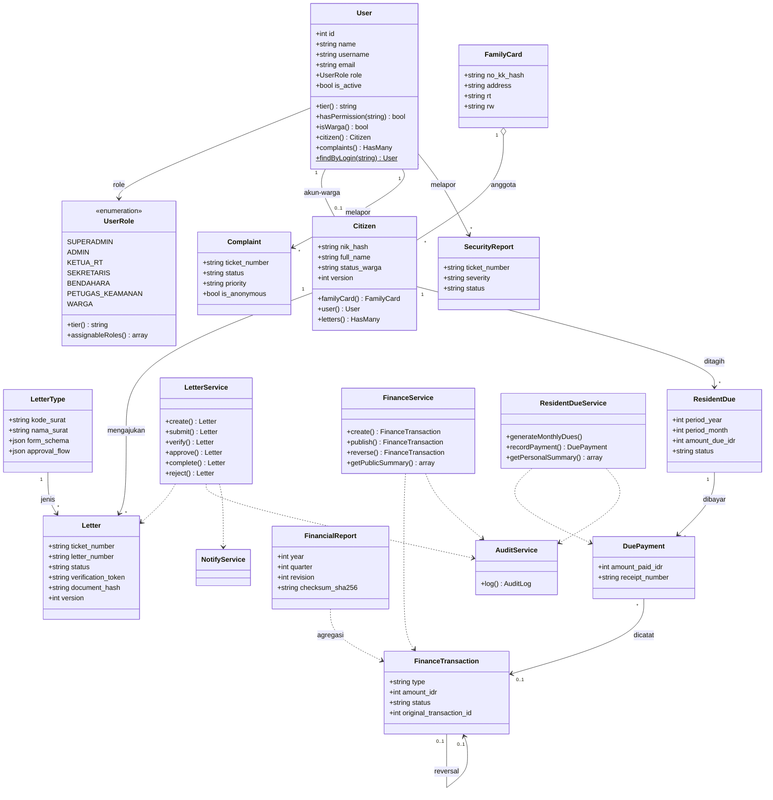

<p align="center"></p>

# Platform Layanan Publik Warga PRISMA RT 04 (Laravel 13)

> **Urus surat, cek kas, lapor masalah — semua dari HP.**

> **PRISMA RT 04 Kemayoran**: Platform Realisasi Informasi, Sistem Manajemen & Administrasi Warga Berbasis Web & Progressive Web App (PWA).  
> **Visual Reference:** [https://prisma-rose.vercel.app/](https://prisma-rose.vercel.app/)  
> **Framework:** PHP 8.4+ & Laravel 13.x | **Database:** MySQL 8.x | **UI:** CSS & JavaScript native (PWA) | **Runtime:** FrankenPHP / Docker (Railway)

---

## Mulai Cepat (3 Langkah)

> Butuh **PHP 8.4+**, **Composer**, dan **MySQL** (Laragon/XAMPP). Node.js **tidak** diperlukan.

```bash
# 1. Pasang dependensi & siapkan konfigurasi
composer install
copy .env.example .env          # Linux/Mac: cp .env.example .env
php artisan key:generate

# 2. Buat database di phpMyAdmin / HeidiSQL: layanan_publik_warga (utf8mb4_unicode_ci), lalu isi tabel + data demo
php artisan migrate --seed

# 3. Jalankan
php artisan serve               # buka http://localhost:8000
```

### Akun Default (khusus lokal / testing)

Dibuat otomatis oleh `php artisan migrate --seed` (**tidak** dibuat di `APP_ENV=production`). Masuk di `/login` dengan **username** dan password berikut:

| Peran | Tingkat | Username | Password |
|---|---|---|---|
| Superadmin | superadmin | `superadmin` | `password` |
| Admin | admin | `admin` | `password` |
| Ketua RT (Raden Erry Adu Sundaru) | admin | `ketua_rt` | `password` |
| Sekretaris (Melly) | admin | `sekretaris` | `password` |
| Bendahara (Retno Fellyanti) | admin | `bendahara` | `password` |
| Petugas Keamanan | admin | `keamanan` | `password` |
| Warga (Budi Santoso) | user | `warga` | `password` |

> ⚠️ Ganti atau hapus akun-akun ini sebelum dipakai sungguhan. Untuk production buat Superadmin dengan `php artisan app:create-superadmin` (lihat bagian Deploy).
Pengaturan MySQL ada di `.env` (`DB_DATABASE`, `DB_USERNAME`, `DB_PASSWORD`); zona waktu default `Asia/Jakarta`.

### Peta Singkat: apa ada di mana?

| Ingin mengubah... | Buka |
|---|---|
| Tampilan / warna / navbar | `public/css/prisma.css`, `resources/views/layouts/*.blade.php` |
| Kolom tabel & form tiap halaman CRUD | `public/js/pages.js` |
| Aturan validasi, hak akses, notifikasi tiap modul | `app/Support/ManagedRegistry.php` |
| Menu & halaman per peran | `app/Support/Navigation.php`, `app/Models/User.php` (`hasPermission`) |
| Registrasi, login, lupa password | `app/Http/Controllers/Api/V1/AuthController.php`, `public/js/auth.js` |
| Notifikasi | `app/Services/NotifyService.php`, `public/js/prisma.js` |
| **Kop surat, wilayah, kontak sekretariat, nama Ketua/Sekretaris/Bendahara** | `config/rt.php` (atau variabel `RT_*` di `.env`) |
| Diagram 5 unsur | `resources/views/app/system.blade.php` (menu *Pemodelan Sistem*) |

### Pemecahan Masalah

| Gejala | Solusi |
|---|---|
| `could not find driver` / `Connection refused` | Nyalakan MySQL di Laragon/XAMPP; pastikan ekstensi `pdo_mysql` aktif dan `.env` benar |
| `Unknown database 'layanan_publik_warga'` | Buat database dulu (langkah 2), lalu `php artisan migrate --seed` |
| Halaman putih / `No application encryption key` | Jalankan `php artisan key:generate` |
| Data lama / error setelah `git pull` | `php artisan migrate` lalu `php artisan optimize:clear` |
| Ingin mengulang data demo dari nol | `php artisan migrate:fresh --seed` (**menghapus semua data** di database itu) |
| Install PWA tidak muncul | PWA butuh HTTPS atau `localhost`; di iPhone: Share → Add to Home Screen |
| Tes gagal | `php artisan test` memakai SQLite memori, tidak menyentuh database MySQL Anda |

---

## Alur Aplikasi

### 1. Alur pengguna secara keseluruhan


### 2. Alur surat pengantar (2 tingkat)


### 3. Alur data real-time


---

## Daftar Isi
0. [Mulai Cepat](#mulai-cepat-3-langkah) · [Alur Aplikasi](#alur-aplikasi)
1. [Tentang Proyek](#tentang-proyek)
2. [Identitas Komunitas & Referensi Desain](#identitas-komunitas--referensi-desain)
3. [Arsitektur Sistem & Tech Stack](#arsitektur-sistem--tech-stack)
4. [Hak Akses: 3 Tingkat & 7 Peran](#hak-akses-3-tingkat--7-peran)
5. [Pemodelan Rekayasa Perangkat Lunak (5 Unsur Utama)](#pemodelan-rekayasa-perangkat-lunak-5-unsur-utama)
   - [1. Entity Relationship Diagram (ERD)](#1-entity-relationship-diagram-erd)
   - [2. Logical Record Structure (LRS)](#2-logical-record-structure-lrs)
   - [3. Use Case Diagram & Spesifikasi Aktor](#3-use-case-diagram--spesifikasi-aktor)
   - [4. Activity Diagram (Alur Verifikasi NIK & Persuratan)](#4-activity-diagram)
   - [5. Unified Modeling Language (UML) Diagrams](#5-unified-modeling-language-uml-diagrams)
6. [Fitur Unggulan Antarmuka & Layanan Publik](#fitur-unggulan-antarmuka--layanan-publik)
7. [Klasifikasi Dokumentasi Teknis (5 Pilar Subfolder `docs/`)](#klasifikasi-dokumentasi-teknis-5-pilar-subfolder-docs)
8. [Panduan Instalasi & Menjalankan Proyek](#panduan-instalasi--menjalankan-proyek)
9. [Pengujian Otomatis (Automated Testing)](#pengujian-otomatis-automated-testing)
10. [Keamanan & Perlindungan Data Pribadi (UU PDP)](#keamanan--perlindungan-data-pribadi-uu-pdp)

---

## Tentang Proyek

**PRISMA RT 04** (*Platform Realisasi Informasi, Sistem Manajemen & Administrasi*) adalah platform digital layanan publik warga RT 04 / RW 09 Kemayoran, Jakarta Pusat. Sistem ini mengintegrasikan seluruh administrasi lingkungan warga ke dalam satu ekosistem terpadu:

- **Pendaftaran Mandiri & Verifikasi NIK Real-Time**: Pencocokan 16 digit NIK secara instan dengan deteksi warga sensus terdaftar (*pre-registered*), pengajuan warga baru (*pending verification*), dan pencegahan duplikasi akun.
- **Birokrasi Surat Digital 2-Tier**: Verifikasi berkas administratif oleh **Sekretaris**, persetujuan/tanda tangan digital oleh **Ketua RT**, penomoran surat otomatis anti-bentrok, dan verifikasi keaslian via token QR Code.
- **Buku Kas Anti-Fraud (*Immutable Financial Ledger*)**: Setiap penerimaan dan pengeluaran dicatat dengan presisi `DECIMAL(15,2)`. Transaksi terbit bersifat *append-only* dengan mekanisme *reversal audit* jika terdapat koreksi.
- **Pengaduan Warga & Laporan Keamanan**: Penyampaian keluhan fasilitas lingkungan dan laporan darurat dengan bukti foto, pelacakan status tiket, dan koordinasi petugas keamanan pos ronda.
- **Transparansi Komunitas**: Publikasi warta pengumuman, agenda kegiatan kerja bakti, struktur pengurus RT, jadwal ronda kamling, dan kontak darurat 24 jam.
- **Progressive Web App (PWA)**: Akses cepat seperti aplikasi mobile asli dengan Web App Manifest, Service Worker caching cerdas, dan halaman *offline fallback*.

---

## Identitas Komunitas & Referensi Desain

- **Entitas Lingkungan:** Sekretariat PRISMA RT 04 / RW 09 Kemayoran
- **Alamat Sekretariat:** Rumah - Gg. Bugis No. 95, RT 04 / RW 09, Kebon Kosong, Kec. Kemayoran, Kota Jakarta Pusat, DKI Jakarta 10620
- **Koordinat Wilayah (GEO):** Latitude `-6.1618`, Longitude `106.8456`
- **Saluran Bantuan WhatsApp:** `+62 878-7200-4448`
- **Kontak IT & Pengurus:** Swandaru Tirta (`swandrax@gmail.com`)
- **Visual & Functional Reference:** [https://prisma-rose.vercel.app/](https://prisma-rose.vercel.app/)

---

## Arsitektur Sistem & Tech Stack

Platform dibangun secara murni menggunakan arsitektur monolitik modern **MVC + Service Layer + ViewModel** dengan backend PHP Laravel 13 dan frontend Blade Components:

| Lapisan Sistem | Teknologi | Keterangan & Rincian Implementasi |
|---|---|---|
| **Backend Framework** | **Laravel 13.x** (PHP 8.4.1+) | Native Laravel 13 dengan Eloquent ORM, Form Requests, Policies, dan Gates |
| **Frontend Templating** | **Laravel Blade + Components** | Komponen UI modular, semantic HTML5, WCAG accessible |
| **CSS / Design System** | **CSS native (`public/css/prisma.css`)** | Tema gelap/terang, token warna, navbar desktop + bottom-nav mobile; tanpa langkah build |
| **Interaktivitas UI** | **JavaScript native (`public/js/*.js`)** | `fetch` + polling real-time, validasi registrasi langsung ke MySQL, modal CRUD, toast notifikasi |
| **Database Transaksional**| **MySQL 8.x** | Sumber kebenaran utama (*Single Source of Truth*), nilai moneter `DECIMAL(15,2)`, foreign keys |
| **Cache & Queue Engine** | **Redis 7.x** | Penanganan cache aplikasi, session driver, queue worker, dan API rate limiting |
| **Autentikasi & API** | **Session + Laravel Sanctum** | Stateful web session untuk browser dan Bearer Token untuk REST API `/api/v1` |
| **Dokumentasi API** | **OpenAPI 3.1 & Swagger UI** | Tersedia interaktif di rute `/docs/api` bersumber dari `docs/api_spec/openapi.yaml` |
| **Containerization** | **FrankenPHP & Docker** | Image `dunglas/frankenphp:1-php8.4-bookworm` dengan Caddy web server |
| **Hosting & Deploy** | **Railway-Compatible** | Konfigurasi deklaratif via `Dockerfile` dan `railway.json` |
| **Code Style & QA** | **Laravel Pint & PHPUnit** | PSR-12 standard formatting dan 150 Automated Feature Tests (100% Passed) |

---

## Hak Akses: 3 Tingkat & 7 Peran

| Tingkat akses | Peran (`role`) | Username demo | Wewenang utama |
|---|---|---|---|
| **Superadmin** | `SUPERADMIN` | `superadmin` | Kontrol penuh: semua modul, manajemen semua peran, audit log, halaman Pemodelan Sistem |
| **Admin** | `ADMIN` | `admin` | Kelola pengguna (selain Superadmin/Admin), data warga, pengumuman, agenda, pengurus, ronda, kontak, audit |
| **Admin** | `KETUA_RT` | `ketua_rt` | Pengesahan surat (tahap akhir), supervisi pengaduan, keamanan, dan kas |
| **Admin** | `SEKRETARIS` | `sekretaris` | Verifikasi surat & pendaftar baru, data warga, pengumuman, agenda, struktur pengurus |
| **Admin** | `BENDAHARA` | `bendahara` | Catat/terbitkan/koreksi transaksi kas |
| **Admin** | `PETUGAS_KEAMANAN` | `keamanan` | Tindak lanjut laporan keamanan, jadwal ronda, kontak darurat |
| **User** | `WARGA` | `warga` | Hanya data sendiri: ajukan surat, pengaduan, laporan keamanan |

Semua akun demo berpassword `password` (hanya environment `local`/`testing`). Matriks hak akses lengkap yang dihitung langsung dari kode tersedia di menu **Pemodelan Sistem → Matriks Hak Akses**.

**Registrasi warga** memakai **NIK (16 digit), No. KK (16 digit), Nama, dan Username**. Aturan yang ditegakkan di API *dan* di database MySQL:
- satu NIK hanya satu akun;
- kombinasi **nama + No. KK** hanya boleh terdaftar sekali (indeks unik `citizens_kk_name_unique`);
- username unik (tidak peka huruf besar/kecil);
- password sengaja **tidak** dibuat unik antar-pengguna (itu akan membocorkan password pengguna lain); yang ditegakkan adalah password minimal 8 karakter yang di-hash bcrypt.

**Lupa password**: `/forgot-password` memverifikasi username + NIK + No. KK terhadap database, lalu **mengirim tautan reset sekali pakai (20 menit) ke email akun**. Akun tanpa email, atau bila SMTP belum diatur, memakai cadangan: tautan ditampilkan di layar. Token disimpan ter-hash di `password_reset_requests`. Login dikunci sementara 5 menit setelah 5 kali gagal per username. Akun pengurus tidak memakai jalur ini; Superadmin mengatur ulang lewat Manajemen Pengguna.

---

## Pemodelan Rekayasa Perangkat Lunak (5 Unsur Utama)

Sebagai kepatuhan pada standar dokumentasi rekayasa perangkat lunak (*Software Engineering Documentation*), sistem ini didokumentasikan secara komprehensif melalui **5 Unsur Pemodelan Sistem**:

### 1. Entity Relationship Diagram (ERD)

Dibangkitkan dari skema hasil migrasi (`php artisan migrate`), 27 tabel domain dipecah menjadi enam modul agar terbaca. Kolom `created_at` dan `updated_at` ada di semua tabel dan tidak digambar. Tabel framework (`cache`, `jobs`, `sessions`) tidak ditampilkan.

**Cara membaca:** kotak berheader warna adalah tabel modul tersebut; kotak abu-abu hanya penanda tabel dari modul lain (hanya PK). `+id` tebal adalah primary key, nama miring adalah foreign key, `{UK}` adalah kolom unik. Garis putus-putus berarti FK boleh kosong (*nullable*), garis utuh berarti FK wajib terisi. Ujung garis memakai notasi *crow's foot*: ‖ tepat satu, ○| nol atau satu, ○< nol atau banyak.

**1.1. Akun dan Akses**


**1.2. Kependudukan**


**1.3. Surat Pengantar**


**1.4. Keuangan dan Iuran**


**1.5. Pengaduan dan Keamanan**


**1.6. Informasi RT dan Audit**


`notifications` dan `personal_access_tokens` terhubung ke `users` secara polimorfik (`notifiable_id`, `tokenable_id`), bukan lewat foreign key database.

---

### 2. Logical Record Structure (LRS)

Format: `TABEL (kolom [PK | FK→tabel_induk | UK])`. Kolom `created_at` dan `updated_at` ada di semua tabel dan tidak ditulis ulang.

```
USERS (id [PK], warga_id [UK], name, email [UK], password, role, is_active, email_verified_at, last_login_at, remember_token, avatar_url, username [UK])
ADMIN_PERMISSIONS (id [PK], user_id [FK→users], permission)
PERSONAL_ACCESS_TOKENS (id [PK], tokenable_type, tokenable_id, name, token [UK], abilities, last_used_at, expires_at)
PASSWORD_RESET_REQUESTS (id [PK], user_id [FK→users], token_hash [UK], ip_address, expires_at, used_at)
NOTIFICATIONS (id [PK], type, notifiable_type, notifiable_id, data, read_at)
PUSH_SUBSCRIPTIONS (id [PK], user_id [FK→users], endpoint, endpoint_hash, public_key, auth_token, content_encoding)
FAMILY_CARDS (id [PK], no_kk, no_kk_hash [UK], address, rt, rw, province, city, district, village, postal_code, version)
CITIZENS (id [PK], family_card_id [FK→family_cards], user_id [FK→users, UK], nik, nik_hash [UK], full_name, gender, place_of_birth, date_of_birth, religion, blood_type, occupation, phone, email, status_warga, is_active, version, phone_verified_at, ktp_file_path, verification_notes, full_name_key)
JENIS_SURAT (id [PK], kode_surat [UK], nama_surat, format_penomoran, syarat_dokumen, is_active, template_key, template_version, form_schema, approval_flow, estimated_process_hours)
LETTERS (id [PK], citizen_id [FK→citizens], jenis_surat_id [FK→jenis_surat], type, ticket_number [UK], keperluan, data_tambahan, status, letter_number [UK], catatan_admin, rejection_reason, verified_by [FK→users], verified_at, approved_by [FK→users], approved_at, verification_token [UK], file_path, attachment_path, version, document_hash, generated_at)
LETTER_ATTACHMENTS (id [PK], letter_id [FK→letters], judul_lampiran, file_path, mime_type, file_size)
DOCUMENT_SEQUENCES (id [PK], document_type, year, month, last_number)
COMPLAINTS (id [PK], ticket_number [UK], citizen_id [FK→citizens], user_id [FK→users], kategori, title, description, lokasi, is_anonymous, status, priority, assigned_admin_id [FK→users], admin_response, attachment_path, version)
SECURITY_REPORTS (id [PK], ticket_number [UK], citizen_id [FK→citizens], reporter_user_id [FK→users], category, severity, title, description, location, incident_at, is_anonymous, status, assigned_to [FK→users], resolution, resolved_at, version)
RESIDENT_DUES (id [PK], citizen_id [FK→citizens], period_year, period_month, amount_due_idr, due_date, status, notes)
DUE_PAYMENTS (id [PK], resident_due_id [FK→resident_dues], amount_paid_idr, paid_at, payment_method, receipt_number [UK], proof_path, received_by [FK→users], notes, status, finance_transaction_id [FK→finance_transactions])
FINANCE_TRANSACTIONS (id [PK], type, category, amount, description, transaction_date, receipt_path, status, created_by [FK→users], published_at, original_transaction_id [FK→finance_transactions], reversal_reason, version, transaction_number [UK], source, amount_idr)
PURCHASES (id [PK], finance_transaction_id [FK→finance_transactions], vendor_name, purchase_date, invoice_number, purpose, notes, receipt_path, created_by [FK→users], version)
PURCHASE_ITEMS (id [PK], purchase_id [FK→purchases], item_name, description, quantity, unit, unit_price_idr, subtotal_idr)
FINANCIAL_REPORTS (id [PK], year, quarter, revision, period_start, period_end, opening_balance_idr, income_idr, expense_idr, closing_balance_idr, dues_assessed_idr, dues_collected_idr, dues_outstanding_idr, status, generated_at, published_at, published_by [FK→users], checksum_sha256, version)
DOWNLOAD_AUDITS (id [PK], actor_user_id [FK→users], resource_type, resource_id, file_type, period_year, period_quarter, action, result, ip_hash, user_agent_hash)
AUDIT_LOGS (id [PK], user_id [FK→users], action, entity_type, entity_id, old_values, new_values, ip_address)
ANNOUNCEMENTS (id [PK], title, category, content, is_pinned, is_published, published_at, version)
COMMUNITY_EVENTS (id [PK], title, description, location, event_date, start_time, end_time, is_published, version)
RT_OFFICERS (id [PK], name, position, phone, order_index, photo_url, is_active)
EMERGENCY_CONTACTS (id [PK], name, category, phone_number, description, order_index, is_active)
ROUND_SCHEDULES (id [PK], day_of_week, shift_name, officer_names, pos_location, notes, is_active)
```

Aturan integritas penting: `citizens.user_id` dan `users.warga_id` satu-ke-satu; `resident_dues` unik per (citizen, tahun, bulan); `financial_reports` unik per (tahun, triwulan, revisi); `document_sequences` unik per (jenis, tahun, bulan); transaksi kas yang sudah terbit tidak dihapus, hanya di-*reverse*.

---

### 3. Use Case Diagram & Spesifikasi Aktor

Use case dipecah per modul agar terbaca. Notasi mengikuti UML: aktor di luar batas sistem, use case berupa elips berawalan kata kerja, `«include»` untuk langkah yang selalu dijalankan, `«extend»` untuk perilaku opsional, dan panah segitiga kosong untuk pewarisan aktor (Superadmin mewarisi seluruh wewenang Admin). Pengunjung adalah pengguna publik tanpa login; hak akses tiap peran diambil dari `User::hasPermission()`.

**3.1. Akun dan Registrasi Warga**


**3.2. Layanan Surat Pengantar**


**3.3. Keuangan dan Iuran RT**


**3.4. Pengaduan dan Keamanan Lingkungan**


*Pengurus RT* pada diagram ini mewakili peran yang memiliki izin `complaint.manage`: Ketua RT, Sekretaris RT, dan Admin.

**3.5. Informasi RT dan Administrasi Sistem**


**Spesifikasi aktor**

| Aktor | Peran sistem | Wewenang utama |
|---|---|---|
| Pengunjung | tanpa login | Melihat kas publik, warta, agenda, struktur pengurus, ronda, dan kontak darurat; mendaftar akun; melacak surat dengan nomor tiket; memeriksa keaslian surat lewat QR |
| Warga | `WARGA` | Mengajukan dan memantau surat, melihat iuran, mengirim pengaduan dan laporan keamanan, mengelola profil |
| Sekretaris RT | `SEKRETARIS` | Memverifikasi surat dan pendaftar baru, menerbitkan dokumen, mengelola data warga, templat surat, pengumuman, agenda, dan struktur pengurus |
| Ketua RT | `KETUA_RT` | Mengesahkan atau menolak surat, menanggapi pengaduan, menerbitkan laporan triwulan, meninjau kas dan audit unduhan (kas hanya dibaca) |
| Bendahara RT | `BENDAHARA` | Membuat tagihan iuran, mencatat pembayaran, transaksi, dan pembelian, menerbitkan atau mengoreksi transaksi, menyusun laporan triwulan |
| Petugas Keamanan | `PETUGAS_KEAMANAN` | Menindaklanjuti laporan keamanan, mengelola jadwal ronda dan kontak darurat |
| Admin | `ADMIN` | Mengelola akun pengguna, data warga, pengumuman, agenda, struktur pengurus, pengaduan, dan melihat audit log |
| Superadmin | `SUPERADMIN` | Seluruh wewenang Admin, ditambah mengelola semua peran dan izin |

---

### 4. Activity Diagram

Setiap diagram memakai swimlane per pelaku. Notasi: lingkaran hitam adalah awal, lingkaran bertanda target adalah akhir, belah ketupat oranye adalah keputusan atau penggabungan, bar hitam adalah fork/join (aksi paralel), dan kotak hijau adalah objek data. Alur ditulis dari kode (`AuthController`, `LetterService`, `ResidentDueService`, `FinanceService`, `ComplaintController`).

**4.1. Registrasi Mandiri & Verifikasi Warga**


**4.2. Login & Penguncian Percobaan**


**4.3. Lupa & Atur Ulang Kata Sandi**


**4.4. Birokrasi Surat Pengantar 2-Tier**


**4.5. Pembayaran Iuran ke Buku Kas**


**4.6. Transaksi Kas, Koreksi, & Laporan Triwulan**


**4.7. Pengaduan Lingkungan**


---

### 5. Unified Modeling Language (UML) Diagrams

#### 5.1. UML Class Diagram


#### 5.2. UML Sequence Diagram

Notasi mengikuti template UML: kotak peserta berwarna, garis hidup putus-putus, bar aktivasi, panah penuh untuk pemanggilan, panah putus-putus untuk balasan, serta fragmen `alt`, `opt`, dan `loop` dengan kondisi penjaga. Urutan pesan ditulis dari kode (`AuthController`, `LetterService`, `ResidentDueService`, `prisma.js`), bukan dari rancangan awal.

**5.2.1. Registrasi Mandiri Warga**


**5.2.2. Login dan Penguncian Percobaan**


**5.2.3. Lupa dan Atur Ulang Kata Sandi**


**5.2.4. Pengesahan Surat dengan Optimistic Locking**


**5.2.5. Pencatatan Pembayaran Iuran ke Buku Kas**


**5.2.6. Pembaruan Dashboard Real-Time (Polling)**


Dashboard memakai polling 8 detik (dashboard) dan 10 detik (notifikasi) yang berhenti saat tab tersembunyi. Endpoint `GET /api/v1/sync` untuk sinkronisasi inkremental disediakan bagi klien lain (mis. aplikasi Android) dan tidak dipanggil oleh PWA web.

---

## Fitur Unggulan Antarmuka & Layanan Publik

1. **Aestetika Modern PRISMA RT 04:**
   - Navigasi responsif dengan logo gradien Blue-Cyan dan drawer mobile ramah layar sentuh.
   - Kartu tindakan cepat (*"Apa yang ingin Anda lakukan?"*): Urus Surat, Cek Kas RT, Lapor Masalah, Jadwal Kegiatan, Hubungi Pengurus via WhatsApp.
2. **Umpan Balik Validasi Interaktif:**
   - Animasi *shake* lembut saat input formulir tidak valid.
   - Notifikasi toast mengambang untuk status sukses dan peringatan sistem.
3. **Optimasi Core Web Vitals:**
   - *Preconnect* tipografi Google Fonts via Bunny Fonts untuk menghilangkan FOIT (*Flash of Invisible Text*).
   - *Zero Cumulative Layout Shift* (CLS = 0) dengan dimensi gambar eksplisit.
4. **Metadata SEO & GEO Wilayah:**
   - Tag OpenGraph dan Twitter Cards terpasang rapi.
   - Schema.org Structured Data (`GovernmentOrganization` dan `WebSite`) terindeks di wilayah Kemayoran, Jakarta Pusat.

---

## API CRUD Real-Time (MySQL)

Seluruh data dibaca/ditulis langsung ke MySQL lewat `/api/v1` (autentikasi: sesi browser, atau Bearer token Sanctum dari `POST /api/v1/login`).

| Method | Endpoint | Keterangan |
|---|---|---|
| `GET` | `/api/v1/manage/{resource}?q=&page=&per_page=&status=&mine=1` | Daftar (cari, filter, paginasi, `updated_since`) |
| `GET` | `/api/v1/manage/{resource}/{id}` | Detail |
| `POST` | `/api/v1/manage/{resource}` | Tambah |
| `PATCH` / `PUT` | `/api/v1/manage/{resource}/{id}` | Ubah (kirim `version` → `409 Conflict` bila basi) |
| `DELETE` | `/api/v1/manage/{resource}/{id}` | Hapus |
| `POST` | `/api/v1/manage/{resource}/{id}/{aksi}` | Aksi alur kerja: `letters`: `submit`, `verify`, `approve`, `complete`, `reject`; `finance`: `publish`, `reverse`; `citizens`: `verify`, `reject` |

`{resource}`: `users`, `citizens`, `announcements`, `events`, `officers`, `schedules`, `contacts`, `letters`, `complaints`, `security-reports`, `finance`, `dues` (iuran: `POST` = buat tagihan bulanan, aksi `pay` = catat pembayaran), `audit-logs`. Hak akses tiap resource ditegakkan per peran (lihat matriks di menu *Pemodelan Sistem*); warga hanya dapat melihat datanya sendiri.

Berkas privat disajikan setelah otorisasi: `GET /api/v1/files/letter-attachments/{id}`, `/files/complaints/{id}`, `/files/ktp/{id}`; surat sah diunduh lewat `GET /api/v1/letters/{id}/download?format=pdf|docx` (setelah disahkan).

**Ekspor CSV** (Excel-ready, UTF-8 BOM, aman dari formula injection, maks. 5.000 baris, tercatat di audit log): `GET /api/v1/manage/{resource}/export?status=&q=` — tombol *Ekspor CSV* ada di halaman Warga, Kas, Iuran, Surat, Pengaduan, dan Audit. **Foto profil:** `POST|DELETE /api/v1/me/photo`.

Endpoint pendukung: `GET /api/v1/portal` (beranda publik tanpa cache), `GET /api/v1/dashboard/summary`, `GET|POST|DELETE /api/v1/notifications`, `PATCH /api/v1/me/account`, `POST /api/v1/me/password`, `POST /api/v1/auth/check-citizen`, `POST /api/v1/auth/forgot-password`, `POST /api/v1/auth/reset-password`.

**Real-time:** UI memakai polling `fetch` (8 detik untuk tabel/dashboard, 10 detik untuk notifikasi, 20 detik untuk beranda publik) yang berhenti otomatis saat tab tidak aktif; respons API dilengkapi `ETag`. Setiap perubahan memicu notifikasi database (`notifications`) + toast/alert, badge lonceng, dan notifikasi browser bila diizinkan.

---

## Klasifikasi Dokumentasi Teknis (5 Pilar Subfolder `docs/`)

Dokumentasi proyek diklasifikasikan ke dalam 5 subfolder tematik yang dapat ditinjau melalui [docs/README.md](docs/README.md):

1. **[`docs/api_spec/`](docs/api_spec/README.md)**:
   - [openapi.yaml](docs/api_spec/openapi.yaml): Spesifikasi OpenAPI 3.1 untuk Swagger UI interaktif (`/docs/api`).
   - [API_SPEC.md](docs/api_spec/API_SPEC.md): Katalog endpoint RESTful JSON v1.
   - [API_V1_1_CONTRACT.md](docs/api_spec/API_V1_1_CONTRACT.md): Kontrak penagihan iuran dan audit laporan keuangan.
2. **[`docs/business/`](docs/business/README.md)**:
   - [AUTH_REGISTER_AND_LOGIN_SPEC.md](docs/business/AUTH_REGISTER_AND_LOGIN_SPEC.md): **Spesifikasi mendalam alur registrasi, validasi NIK, aktivasi akun, dan login.**
   - [SRS.md](docs/business/SRS.md): Software Requirements Specification.
   - [LETTER_WORKFLOW.md](docs/business/LETTER_WORKFLOW.md): Alur kerja surat 2-tier dan QR verification token.
   - [FINANCIAL_REPORTS_AND_BACKUP_STORE.md](docs/business/FINANCIAL_REPORTS_AND_BACKUP_STORE.md): Regulasi buku kas anti-fraud & backup store.
   - [DATA_CLASSIFICATION.md](docs/business/DATA_CLASSIFICATION.md): Standar privasi UU PDP No. 27/2022.
3. **[`docs/design/`](docs/design/README.md)**:
   - [BRAND_GUIDE.md](docs/design/BRAND_GUIDE.md): Pedoman identitas visual resmi PRISMA RT 04.
   - [ERD.md](docs/design/ERD.md): Skema 24 tabel database relasional.
   - [DIAGRAMS.md](docs/design/DIAGRAMS.md): Sequence Diagram dan Activity Diagram.
   - [UI_PLAN.md](docs/design/UI_PLAN.md): Rencana antarmuka responsif ramah segala usia.
   - [WEB_PERFORMANCE_SEO_GEO.md](docs/design/WEB_PERFORMANCE_SEO_GEO.md): Optimasi Core Web Vitals dan SEO lokal.
   - [CIRCULAR_FRAMEWORK_METHODS_AND_ALGORITHMS.md](docs/design/CIRCULAR_FRAMEWORK_METHODS_AND_ALGORITHMS.md): **Metode, algoritma & standarisasi Kerangka Diagram Lingkaran Sistem.**
4. **[`docs/plan_project/`](docs/plan_project/README.md)**:
   - [PROJECT_PLAN.md](docs/plan_project/PROJECT_PLAN.md): Master rencana proyek dan ruang lingkup.
   - [SPRINT_PLAN.md](docs/plan_project/SPRINT_PLAN.md): Pembagian 6 sprint berkelanjutan.
5. **[`docs/project_management/`](docs/project_management/README.md)**:
   - [RBAC.md](docs/project_management/RBAC.md): Penegakan hak akses berbasis peran.
   - [RBAC_MATRIX.md](docs/project_management/RBAC_MATRIX.md): Matriks wewenang modular per tindakan.
   - [FIREBASE_FREE_TIER_SETUP.md](docs/project_management/FIREBASE_FREE_TIER_SETUP.md): Evaluasi cloud notification.

---

## Panduan Instalasi & Menjalankan Proyek (Laragon / XAMPP di Laptop Lain)

Aplikasi ini bersifat *self-contained* dan siap dijalankan di perangkat/laptop baru mana pun menggunakan stack lokal standar seperti **Laragon** atau **XAMPP**.

### 1. Kebutuhan Sistem & Prasyarat
- **PHP** versi **>= 8.4** *(Wajib PHP 8.4+ karena menggunakan Laravel 13)*
  - Ekstensi PHP yang aktif: `pdo_mysql`, `mbstring`, `openssl`, `curl`, `fileinfo`, `gd`, `zip`.
- **Composer** versi **>= 2.5**
- *(Node.js/NPM tidak diperlukan — UI memakai CSS & JavaScript native tanpa langkah build.)*
- **MySQL Database Server** versi **8.x** (atau MariaDB bawaan Laragon/XAMPP)
- **Redis Server** *(Opsional — aplikasi telah dikonfigurasi otomatis menggunakan driver `database` untuk session, cache, dan queue jika Redis tidak terpasang).*

> 💡 **Tips Pengguna Laragon / XAMPP (Cara Memastikan PHP 8.4):**
> 1. Jika Laragon/XAMPP di laptop Anda masih menggunakan PHP 8.1 atau 8.2, unduh paket zip **PHP 8.4 VS17 x64 Thread Safe** dari [windows.php.net/download](https://windows.php.net/download/).
> 2. Ekstrak ke folder `C:\laragon\bin\php\php-8.4.x-Win32-x64`.
> 3. Buka Laragon ➡️ Klik Kanan di mana saja ➡️ **PHP** ➡️ **Version** ➡️ Pilih versi **8.4.x**.

---

### 2. Langkah demi Langkah Menjalankan di Laptop Baru (5 Menit)

#### Langkah 1: Clone Repositori dari GitHub
Buka terminal (Git Bash / PowerShell / Command Prompt):
```bash
git clone https://github.com/not162/platform-layanan-publik-warga.git
cd platform-layanan-publik-warga
```

#### Langkah 2: Instal Dependensi Backend
```bash
composer install
```

#### Langkah 3: Konfigurasi File Lingkungan (`.env`)
Salin file konfigurasi contoh dan buat kunci enkripsi aplikasi:
```bash
# Di Windows PowerShell / CMD:
copy .env.example .env

# Generate application encryption key:
php artisan key:generate
```

Buka file `.env` di teks editor, lalu sesuaikan koneksi database MySQL Laragon/XAMPP Anda:
```env
DB_CONNECTION=mysql
DB_HOST=127.0.0.1
DB_PORT=3306
DB_DATABASE=layanan_publik_warga
DB_USERNAME=root
DB_PASSWORD=
```
*(Driver session, queue, dan cache secara default sudah diset ke `database`, sehingga tidak memerlukan konfigurasi Redis tambahan di laptop lokal).*

#### Langkah 4: Buat Database & Jalankan Migrasi + Seeder
1. Buka **phpMyAdmin** (`http://localhost/phpmyadmin`) atau HeidiSQL bawaan Laragon.
2. Buat database baru dengan nama: **`layanan_publik_warga`** (Collation: `utf8mb4_unicode_ci`).
3. Jalankan migrasi dan pengisian data awal melalui terminal:
```bash
php artisan migrate --seed
```
*✨ Perintah ini menyusun seluruh tabel relasional dan menginjeksi akun demo (**Superadmin**, **Admin**, **Ketua RT**, **Sekretaris**, **Bendahara**, **Keamanan**, **Warga**) beserta data contoh beranda, kas, surat, dan pengaduan.*

#### Langkah 5: Jalankan Server Lokal
```bash
php artisan serve
```
Atau gunakan Laragon: arahkan *document root* ke folder `public/`.

Buka browser di laptop Anda:
🌐 **`http://localhost:8000`**

---

### 3. Pintasan Kredensial Pengujian Cepat
Daftar akun default (username + password) ada di bagian **Mulai Cepat → Akun Default** di atas. Halaman login tidak lagi menampilkan pintasan akun apa pun.

Untuk mencoba aktivasi akun dari master RT: buka `/register`, isi NIK `3171045505920002`, No. KK `3171040409950001`, nama `Siti Aminah`, lalu pilih username.

### 4. Mengirim Email (reset password)
Default `MAIL_MAILER=log` (email ditulis ke `storage/logs/laravel.log`). Untuk email sungguhan, isi `.env`, contoh Gmail (gunakan *App Password*):
```env
MAIL_MAILER=smtp
MAIL_HOST=smtp.gmail.com
MAIL_PORT=587
MAIL_USERNAME=akun@gmail.com
MAIL_PASSWORD=app-password-16-karakter
MAIL_FROM_ADDRESS=akun@gmail.com
```

### 5. Kop Surat & Pejabat Penandatangan
Semua dokumen resmi (surat HTML/PDF/DOCX, laporan keamanan, laporan kas & rekap iuran) memakai satu sumber identitas di `config/rt.php`:

| Data | Nilai default | Variabel `.env` |
|---|---|---|
| Wilayah | RT 04 / RW 09, Kelurahan Kemayoran, Kecamatan Kemayoran, Jakarta Pusat | `RT_NUMBER`, `RW_NUMBER`, `RT_KELURAHAN`, `RT_KECAMATAN`, `RT_KOTA` |
| Kontak sekretariat | Gg. Bugis No. 95 · +62 878-7200-4448 · swandrax@gmail.com | `RT_ADDRESS`, `RT_PHONE`, `RT_EMAIL` |
| Ketua RT (penandatangan surat) | Raden Erry Adu Sundaru | `RT_KETUA` |
| Sekretaris (pemeriksa berkas) | Melly | `RT_SEKRETARIS` |
| Bendahara (laporan kas) | Retno Fellyanti | `RT_BENDAHARA` |

Nama penandatangan selalu mengikuti konfigurasi ini, bukan akun yang kebetulan menekan tombol *Sahkan*, sehingga surat tetap sah bila pengurus berganti akun. Jika jabatan berganti, cukup ubah `.env` lalu `php artisan config:clear`. Penomoran surat memakai `RT04`.

### 6. Deploy ke Production
Seeder demo **tidak berjalan** di `APP_ENV=production` (tidak ada akun/password bawaan). Urutan:
```bash
# .env production: APP_ENV=production, APP_DEBUG=false, APP_URL=https://domain-anda, DB_*, SESSION_SECURE_COOKIE=true, MAIL_* (SMTP)
composer install --no-dev --optimize-autoloader
php artisan key:generate --force
php artisan migrate --force
php artisan app:create-superadmin admin.rt --name="Nama Anda" --email=anda@domain.com   # password diminta interaktif
php artisan storage:link   # hanya bila memakai disk public
php artisan config:cache && php artisan route:cache && php artisan view:cache
```
Catatan: login web memakai cookie sesi + CSRF (host dari `APP_URL` otomatis terdaftar sebagai domain stateful Sanctum; domain tambahan: `SANCTUM_STATEFUL_DOMAINS`). Backup rutin database MySQL dan folder `storage/app/private` (KTP, lampiran). PWA mensyaratkan HTTPS.

### 7. Membuka Data Langsung di phpMyAdmin
Setiap aksi CRUD di UI/API langsung ditulis ke MySQL. Buka `http://localhost/phpmyadmin` → database `layanan_publik_warga` → tabel `users`, `citizens`, `letters`, `finance_transactions`, `announcements`, `notifications`, `audit_logs`, dst. Halaman akan menampilkan perubahan tanpa perlu cache apa pun.

---

## Pengujian Otomatis (Automated Testing)

Pengujian fitur (*Feature Tests*) dan unit (*Unit Tests*) dijalankan menggunakan **PHPUnit 12**:

```bash
# Eksekusi ringkas pengujian:
php artisan test --compact
```

### Bukti Hasil Pengujian Terkini:
```text
   Tests:    194 passed (1011 assertions)
   Status:   100% OK
```
Cakupan baru: iuran, lampiran & foto, unduh PDF, email reset, penguncian login, registrasi (NIK/KK/nama/username unik), lupa & reset password, akses per peran (3 tingkat), CRUD `/api/v1/manage/*`, alur surat 2-tier + notifikasi, buku kas, manajemen pengguna, dan PWA (manifest, service worker, offline).

---

## Keamanan & Perlindungan Data Pribadi (UU PDP)

Sistem mematuhi standar Undang-Undang Perlindungan Data Pribadi (UU PDP No. 27/2022):
1. **Blind Indexing SHA-256:** NIK mentah di-hash secara satu arah untuk indeks pencarian tanpa mengekspos angka NIK pada query log.
2. **Penyamaran Data Publik:** NIK yang ditampilkan di antarmuka publik atau pencarian kesamaan nama selalu disamarkan (contoh: `317103********0001`).
3. **Isolasi Rahasia:** Kredensial database dan API keys tidak di-hardcode ke dalam kode sumber, melainkan diatur melalui *Environment Variables* terenkripsi di server produksi.
4. **Audit Trail Komprehensif:** Setiap tindakan login, modifikasi berkas, persetujuan surat, dan posting kas tercatat permanen di tabel `audit_logs`.

---

## Lisensi
Proyek ini dikembangkan di bawah lisensi [MIT License](LICENSE).  
Hak Cipta &copy; 2026 **Pengurus PRISMA RT 04 / RW 09 Kemayoran** & Pengembang Sistem.
