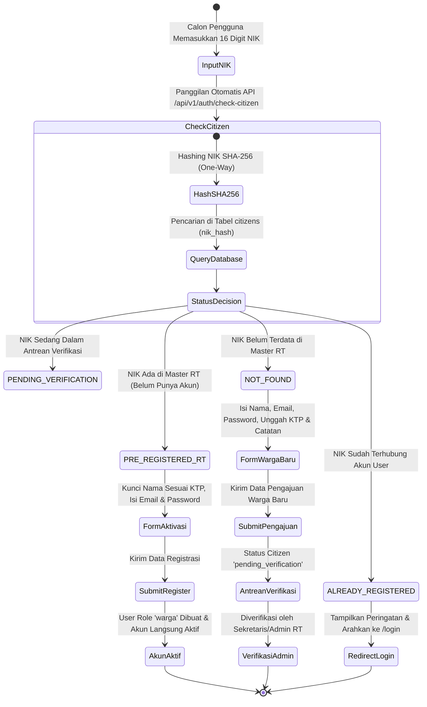
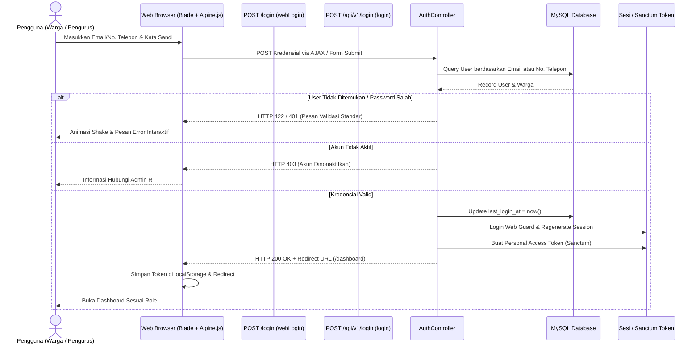

# Spesifikasi Alur Registrasi & Autentikasi Warga (PRISMA RT 04)

Dokumen ini menjelaskan implementasi menyeluruh dari subsistem autentikasi (*Login*), pendaftaran mandiri warga (*Self-Registration*), deteksi NIK real-time, dan manajemen hak akses berbasis peran (*Role-Based Access Control*) pada **PRISMA RT 04 Kemayoran**.

---

## 1. Ikhtisar Arsitektur Autentikasi

Platform menggunakan sistem autentikasi hibrida yang mendukung dua mode akses:
1. **Web Session Authentication (Stateful)**: Digunakan oleh antarmuka web peramban (Blade + Alpine.js) menggunakan cookie sesi terenkripsi Laravel, proteksi CSRF token, dan *session fixation protection* via `session()->regenerate()`.
2. **REST API Token Authentication (Stateless)**: Digunakan oleh integrasi mobile/PWA dan panggilan AJAX headless menggunakan **Laravel Sanctum** (`PersonalAccessToken`) yang menghasilkan Bearer token bertipe cryptographically secure.

---

## 2. Diagram Alur Registrasi Warga (Activity Diagram)

---

## 3. Alur Pendaftaran Mandiri Warga (*Registration Workflow*)

Sistem pendaftaran dirancang dengan pendekatan **2-Tier Intake** untuk memastikan fleksibilitas warga sembari menjaga integritas data sensus RT:

### 3.1. Jalur 1: Aktivasi Akun Warga Terdata (*Pre-Registered Sensus*)
- **Kondisi:** NIK calon pengguna sudah tercatat sebelumnya di basis data kependudukan RT 04 (misal: hasil sensus manual atau pendataan berkala pengurus).
- **Perilaku UI:**
  - Nama lengkap otomatis terkunci sesuai data resmi sensus untuk mencegah manipulasi nama.
  - Pengguna hanya perlu melengkapi alamat email aktif dan kata sandi baru.
  - Tombol aksi berlabel **"Aktivasi Akun Warga"**.
- **Hasil:** Akun langsung aktif dengan `role: warga` tanpa memerlukan verifikasi ulang oleh pengurus RT.

### 3.2. Jalur 2: Pengajuan Warga Baru (*New Resident Intake*)
- **Kondisi:** NIK calon pengguna belum ada di basis data kependudukan RT 04.
- **Perilaku UI:**
  - Menampilkan informasi transparan bahwa NIK belum tercatat di data RT.
  - Menampilkan tombol **"Ajukan Pendaftaran Warga Baru"**.
  - Membuka formulir lanjutan: Nama Lengkap, Email, Kata Sandi, Unggah Berkas KTP (opsional, maks 5MB, format JPG/PNG/PDF), dan Catatan Domisili/Alamat rumah.
- **Perilaku Sistem:**
  - NIK di-parse secara otomatis untuk mendeteksi tanggal lahir dan jenis kelamin (menggunakan algoritma 16 digit NIK Dukcapil: digit ke-7-8 untuk tanggal lahir, offset +40 untuk perempuan).
  - Data `Citizen` disimpan dengan `status_warga: 'pending_verification'`.
  - Akun `User` dibuat dengan status menunggu verifikasi.
  - Event `CitizenRegistered` disiarkan secara real-time ke meja kerja Sekretaris/Ketua RT.

### 3.3. Pencegahan Duplikasi & Serangan Brute-Force
- **Pencegahan Akun Ganda:** Jika NIK sudah memiliki `user_id`, sistem mengembalikan status `ALREADY_REGISTERED`. Tombol pengajuan disembunyikan secara dinamis untuk mencegah spam registrasi.
- **Deteksi Nama Serupa (*Similarity Check*):** Jika calon pengguna memasukkan nama yang mirip dengan warga lain, sistem menampilkan daftar nama warga serupa yang disamarkan (*masked NIK*, misal: `317101********0001`) agar pengguna tidak salah memasukkan data identitas.

---

## 4. Alur Autentikasi Pengguna (*Login Workflow*)

### 4.1. Fitur Utama Formulir Login
1. **Multi-Identifier Login**: Pengguna dapat masuk menggunakan **Alamat Email** maupun **Nomor Telepon WhatsApp** yang terdaftar pada profil kependudukan.
2. **Toleransi Huruf Kapital Email**: Pencarian email dilakukan secara case-insensitive (`LOWER(email) = LOWER(?)`).
3. **Password Visibility Toggle**: Fitur pratinjau kata sandi menggunakan ikon interaktif mata (`eye` / `eye-off`).
4. **Pemberitahuan Otomatis & Shake Feedback**: Jika autentikasi gagal, input formulir menerapkan efek animasi getar (*shake animation*) dengan border merah lembut dan fokus otomatis pada kolom yang keliru.
5. **Dukungan Remember Me**: Mengaktifkan cookie sesi permanen berdurasi 120 menit atau sesuai masa aktif sesi yang ditentukan.

---

## 5. Matriks Peran Pengguna (*Role-Based Redirect*)

Setelah proses login berhasil, pengguna secara otomatis diarahkan ke antarmuka yang sesuai dengan perannya:

| Peran (*Role*) | Akses Dashboard | Hak Wewenang Utama |
|---|---|---|
| **Superadmin** | `/dashboard` (Superadmin View) | Manajemen pengguna, konfigurasi modul, inspeksi audit trail, audit backup |
| **Admin / Ketua RT** | `/dashboard` (Ketua RT View) | Pengesahan akhir surat pengantar, pengumuman, monitoring keamanan |
| **Sekretaris** | `/dashboard` (Sekretaris View) | Verifikasi berkas warga baru, verifikasi lampiran surat pengantar, penerbitan draf |
| **Bendahara** | `/dashboard` (Bendahara View) | Pencatatan transaksi kas, verifikasi iuran warga, rekapitulasi laporan keuangan |
| **Petugas Keamanan** | `/dashboard` (Keamanan View) | Penerimaan laporan insiden, jadwal ronda kamling, koordinasi pos satpam |
| **Warga** | `/dashboard` (Warga View) | Pengajuan surat pengantar, pemantauan tiket surat, pelaporan aduan, riwayat iuran |

---

## 6. Standar Keamanan & Perlindungan Data Pribadi (UU PDP)

1. **Enkripsi NIK:** Nilai NIK mentah disimpan dalam bentuk terenkripsi pada level basis data. Pencarian kesamaan NIK dilakukan menggunakan kolom indeks digest satu arah `nik_hash = SHA256(nik)`.
2. **Masking Identitas:** Pada respons JSON publik dan deteksi nama serupa, digit tengah NIK selalu disamarkan (contoh: `317103********0001`).
3. **Password Hashing:** Menggunakan algoritma **Bcrypt** dengan konfigurasi `rounds = 12`.
4. **Rate Limiting:** Proteksi *brute force* membatasi percobaan masuk maksimal 5 kali per menit per alamat IP.
5. **Audit Logging:** Setiap keberhasilan dan kegagalan login tercatat dalam tabel `audit_logs` dengan informasi timestamp, user agent, dan alamat IP tanpa mencatat kata sandi pengguna.
