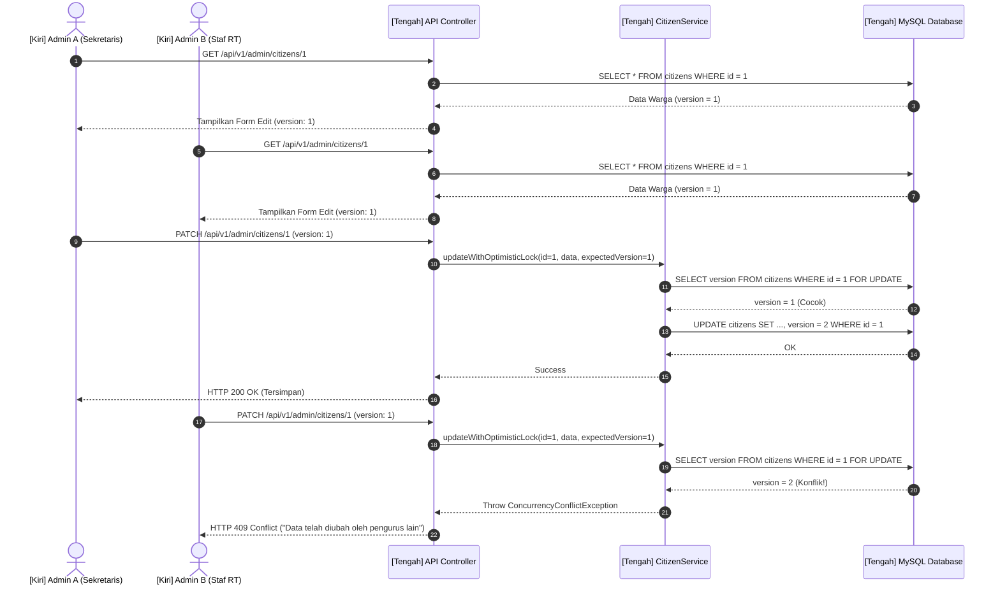
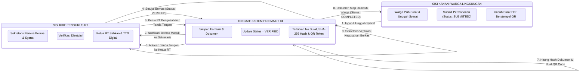

# Architecture and Flow Diagrams

> Rujukan Pemodelan Lengkap 5 Unsur Sistem: **[SYSTEM_MODELING_5_ELEMENTS.md](SYSTEM_MODELING_5_ELEMENTS.md)**  
> Dokumentasi ini memetakan diagram alur dan arsitektur dengan pemisahan peran: **Superadmin & Admin di sisi kiri**, **Sistem PRISMA di tengah**, dan **User & Warga di sisi kanan**.

---

## 1. Sequence Diagram: Optimistic Concurrency Control

Diagram urutan penanganan proteksi tabrakan data kependudukan saat diedit bersamaan:

---

## 2. Activity Diagram: Alur Birokrasi Surat Pengantar Digital 2-Tier

> **Untuk rincian langkah demi langkah dalam Format Kotak Tabel Berpetak**, lihat:  
> [docs/design/SYSTEM_MODELING_5_ELEMENTS.md (Bagian 4: Activity Diagram)](SYSTEM_MODELING_5_ELEMENTS.md#unsur-4-activity-diagram-format-kotak-tabel-step-by-step)
