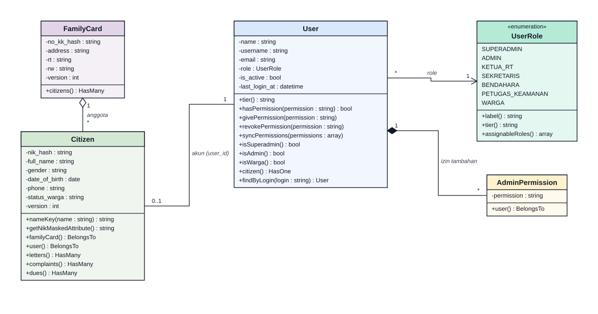
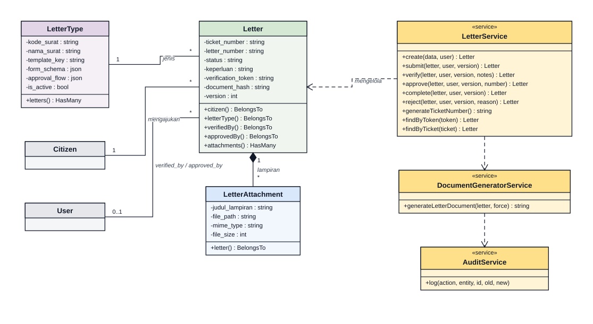
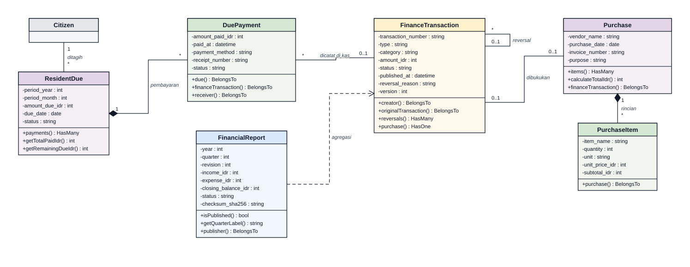
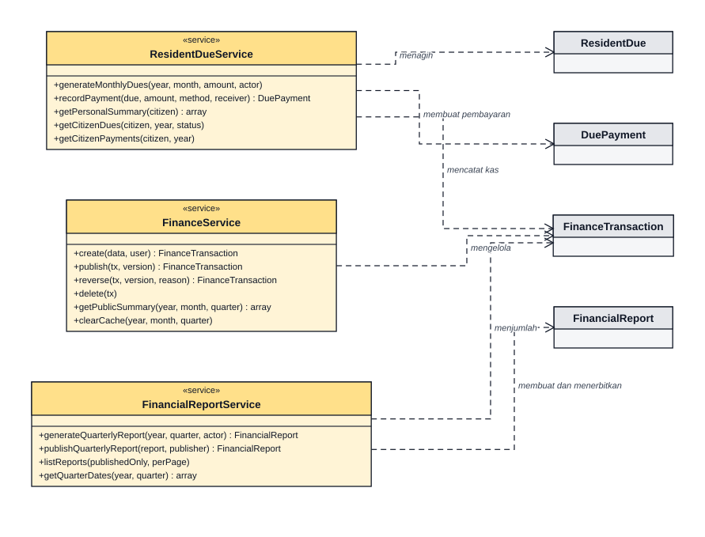
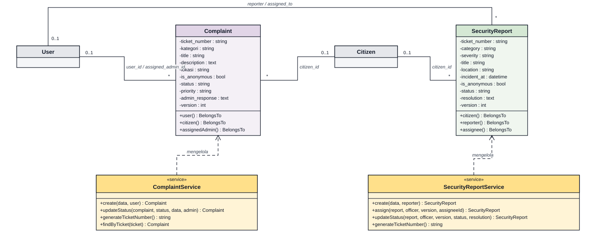
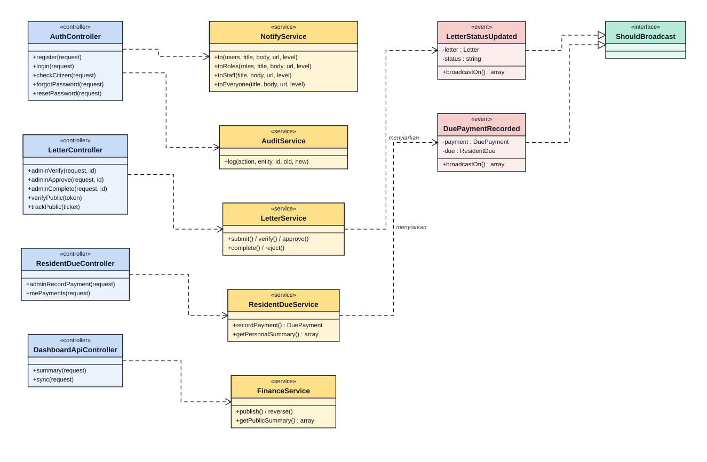
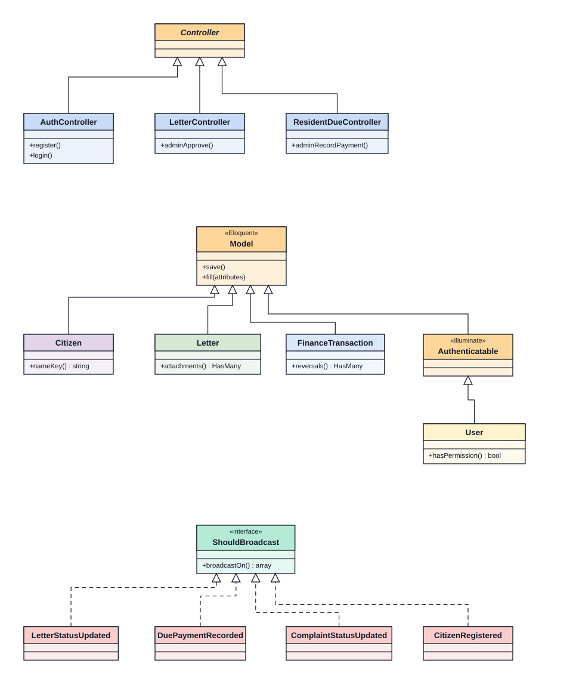

# Diagram Sistem PRISMA RT 04

Kumpulan diagram (ERD, use case, activity, UML; LRS ada di dokumen terpisah) yang selaras dengan kode dan skema database pada rilis redesign PWA. Ringkasan alur aplikasi ada di [README](../../README.md#alur-aplikasi).

> ERD dan LRS dibangkitkan dari migrasi. Penelusuran diagram ke fase Waterfall, kode, dan tes ada di [SYSTEM_MODELING_5_ELEMENTS.md](SYSTEM_MODELING_5_ELEMENTS.md). Jika skema berubah, perbarui ERD, LRS, dan README bersama-sama.

> **Konvensi penamaan:** nama use case, aksi pada activity diagram, pesan pada sequence diagram, dan label relasi pada ERD, LRS, dan class diagram ditulis sebagai kalimat kata kerja (contoh: *Mengajukan Permohonan Surat*, *Periksa berkas surat*, *memiliki izin*). Objek data pada activity diagram (contoh: *Surat [approved]*) dan nama operasi yang sama dengan nama method di kode (contoh: `citizen()`) tetap berupa kata benda.

### 1. Entity Relationship Diagram (ERD)

Dibangkitkan dari skema hasil migrasi (`php artisan migrate`), 27 tabel domain dipecah menjadi enam modul agar terbaca. Kolom `created_at` dan `updated_at` ada di semua tabel dan tidak digambar. Tabel framework (`cache`, `jobs`, `sessions`) tidak ditampilkan.

**Cara membaca:** kotak berheader warna adalah tabel modul tersebut; kotak abu-abu hanya penanda tabel dari modul lain (hanya PK). `+id` tebal adalah primary key, nama miring adalah foreign key, `{UK}` adalah kolom unik. Garis putus-putus berarti FK boleh kosong (*nullable*), garis utuh berarti FK wajib terisi. Ujung garis memakai notasi *crow's foot*: ‖ tepat satu, ○| nol atau satu, ○< nol atau banyak.

**1.1. Akun dan Akses**

**1.2. Kependudukan**

**1.3. Surat Pengantar**

**1.4. Keuangan dan Iuran**

**1.5. Pengaduan dan Keamanan**

**1.6. Informasi RT dan Audit**

`notifications` dan `personal_access_tokens` terhubung ke `users` secara polimorfik (`notifiable_id`, `tokenable_id`), bukan lewat foreign key database.

---

### 2. Logical Record Structure (LRS)

LRS dibahas sebagai dokumen tersendiri: **[LRS.md](LRS.md)**. Isinya diagram LRS per modul (kotak tabel dengan PK bergaris bawah, FK miring, dan panah FK ke PK), aturan transformasi ERD ke LRS, matriks 28 relasi beserta aturan `ON DELETE`, daftar LRS dalam bentuk teks untuk 27 tabel, dan catatan normalisasi 3NF.

| Modul | Diagram LRS |
|---|---|
| Akun dan akses | [lrs-1-akun-akses.svg](diagrams/lrs-1-akun-akses.svg) |
| Kependudukan | [lrs-2-kependudukan.svg](diagrams/lrs-2-kependudukan.svg) |
| Surat pengantar | [lrs-3-surat.svg](diagrams/lrs-3-surat.svg) |
| Keuangan dan iuran | [lrs-4-keuangan.svg](diagrams/lrs-4-keuangan.svg) |
| Pengaduan dan keamanan | [lrs-5-pengaduan-keamanan.svg](diagrams/lrs-5-pengaduan-keamanan.svg) |
| Informasi RT dan audit | [lrs-6-informasi-audit.svg](diagrams/lrs-6-informasi-audit.svg) |

---

### 3. Use Case Diagram & Spesifikasi Aktor

Use case dipecah per modul agar terbaca. Notasi mengikuti UML: aktor di luar batas sistem, use case berupa elips berawalan kata kerja, `«include»` untuk langkah yang selalu dijalankan, `«extend»` untuk perilaku opsional, dan panah segitiga kosong untuk pewarisan aktor (Superadmin mewarisi seluruh wewenang Admin). Pengunjung adalah pengguna publik tanpa login; hak akses tiap peran diambil dari `User::hasPermission()`.

**3.1. Akun dan Registrasi Warga**

**3.2. Layanan Surat Pengantar**

**3.3. Keuangan dan Iuran RT**

**3.4. Pengaduan dan Keamanan Lingkungan**

*Pengurus RT* pada diagram ini mewakili peran yang memiliki izin `complaint.manage`: Ketua RT, Sekretaris RT, dan Admin.

**3.5. Informasi RT dan Administrasi Sistem**

**Spesifikasi aktor**

| Aktor | Peran sistem | Wewenang utama |
|---|---|---|
| Pengunjung | tanpa login | Melihat kas publik, warta, agenda, struktur pengurus, ronda, dan kontak darurat; mendaftar akun; melacak surat dengan nomor tiket; memeriksa keaslian surat lewat QR |
| Warga | `WARGA` | Mengajukan dan memantau surat, melihat iuran, mengirim pengaduan dan laporan keamanan, mengelola profil |
| Sekretaris RT | `SEKRETARIS` | Memverifikasi surat dan pendaftar baru, menerbitkan dokumen, mengelola data warga, templat surat, pengumuman, agenda, dan struktur pengurus |
| Ketua RT | `KETUA_RT` | Mengesahkan atau menolak surat, menanggapi pengaduan, menerbitkan laporan triwulan, meninjau kas dan audit unduhan (kas hanya dibaca) |
| Bendahara RT | `BENDAHARA` | Membuat tagihan iuran, mencatat pembayaran, transaksi, dan pembelian, menerbitkan atau mengoreksi transaksi, menyusun laporan triwulan |
| Petugas Keamanan | `PETUGAS_KEAMANAN` | Menindaklanjuti laporan keamanan, mengelola jadwal ronda dan kontak darurat |
| Admin | `ADMIN` | Mengelola akun pengguna, data warga, pengumuman, agenda, struktur pengurus, pengaduan, dan melihat audit log |
| Superadmin | `SUPERADMIN` | Seluruh wewenang Admin, ditambah mengelola semua peran dan izin |

---

### 4. Activity Diagram

Setiap diagram memakai swimlane per pelaku. Notasi: lingkaran hitam adalah awal, lingkaran bertanda target adalah akhir, belah ketupat oranye adalah keputusan atau penggabungan, bar hitam adalah fork/join (aksi paralel), dan kotak hijau adalah objek data. Alur ditulis dari kode (`AuthController`, `LetterService`, `ResidentDueService`, `FinanceService`, `ComplaintController`).

**4.1. Registrasi Mandiri & Verifikasi Warga**

**4.2. Login & Penguncian Percobaan**

**4.3. Lupa & Atur Ulang Kata Sandi**

**4.4. Birokrasi Surat Pengantar 2-Tier**

**4.5. Pembayaran Iuran ke Buku Kas**

**4.6. Transaksi Kas, Koreksi, & Laporan Triwulan**

**4.7. Pengaduan Lingkungan**

---

### 5. Unified Modeling Language (UML) Diagrams

#### 5.1. UML Class Diagram

Notasi mengikuti template UML: tiga kompartemen (nama, atribut, operasi), `-` atribut/kolom, `+` operasi publik, panah segitiga kosong untuk pewarisan atau realisasi, belah ketupat penuh untuk komposisi, belah ketupat kosong untuk agregasi, garis putus-putus untuk dependensi. Atribut dan operasi diambil dari model dan service di `app/`; atribut yang ditampilkan adalah kolom utama (daftar lengkap ada di ERD), dan `created_at`/`updated_at` tidak digambar. Kotak abu-abu hanyalah penanda kelas dari diagram lain.

**5.1.1. Akun dan Kependudukan**

**5.1.2. Surat Pengantar**

**5.1.3. Model Keuangan**

**5.1.4. Layanan Keuangan**

**5.1.5. Pengaduan dan Keamanan**

**5.1.6. Lapisan Aplikasi (Controller, Service, Event)**

**5.1.7. Hierarki Kelas Dasar**

#### 5.2. UML Sequence Diagram

Notasi mengikuti template UML: kotak peserta berwarna, garis hidup putus-putus, bar aktivasi, panah penuh untuk pemanggilan, panah putus-putus untuk balasan, serta fragmen `alt`, `opt`, dan `loop` dengan kondisi penjaga. Urutan pesan ditulis dari kode (`AuthController`, `LetterService`, `ResidentDueService`, `prisma.js`), bukan dari rancangan awal.

**5.2.1. Registrasi Mandiri Warga**

**5.2.2. Login dan Penguncian Percobaan**

**5.2.3. Lupa dan Atur Ulang Kata Sandi**

**5.2.4. Pengesahan Surat dengan Optimistic Locking**

**5.2.5. Pencatatan Pembayaran Iuran ke Buku Kas**

**5.2.6. Pembaruan Dashboard Real-Time (Polling)**

Dashboard memakai polling 8 detik (dashboard) dan 10 detik (notifikasi) yang berhenti saat tab tersembunyi. Endpoint `GET /api/v1/sync` untuk sinkronisasi inkremental disediakan bagi klien lain (mis. aplikasi Android) dan tidak dipanggil oleh PWA web.
