# Entity-Relationship Diagram (ERD) & Kamus Arsitektur Data
## TOGAF ADM: Phase C — Data Architecture (Sprint 2 Baseline)
**Platform Layanan Publik Warga — MySQL Laragon Architecture**  
**Versi:** 1.1.0-snapshot | **Tanggal Pemutakhiran:** 16 Oktober 2026

---

## 1. Visual Entity-Relationship Diagram (Mermaid)

Pemodelan diagram relasi entitas berikut mencerminkan skema fisik aktual basis data MySQL `layanan_warga` di lingkungan Laragon, mematuhi prinsip *single source of truth* untuk akun-warga (`citizens.user_id`), nama fisik tabel jenis surat (`jenis_surat`), serta integritas buku kas (`due_payments.finance_transaction_id`):

```mermaid
erDiagram
    USERS {
        int id PK
        int warga_id UK
        string name
        string email UK
        string password
        string role
        bool is_active
        datetime email_verified_at
        datetime last_login_at
        string remember_token
        string avatar_url
        string username UK
    }
    ADMIN_PERMISSIONS {
        int id PK
        int user_id FK
        string permission
    }
    PERSONAL_ACCESS_TOKENS {
        int id PK
        string tokenable_type
        int tokenable_id
        text name
        string token UK
        text abilities
        datetime last_used_at
        datetime expires_at
    }
    PASSWORD_RESET_REQUESTS {
        int id PK
        int user_id FK
        string token_hash UK
        string ip_address
        datetime expires_at
        datetime used_at
    }
    NOTIFICATIONS {
        string id PK
        string type
        string notifiable_type
        int notifiable_id
        text data
        datetime read_at
    }
    PUSH_SUBSCRIPTIONS {
        int id PK
        int user_id FK
        text endpoint
        string endpoint_hash
        text public_key
        text auth_token
        string content_encoding
    }
    FAMILY_CARDS {
        int id PK
        text no_kk
        string no_kk_hash UK
        string address
        string rt
        string rw
        string province
        string city
        string district
        string village
        string postal_code
        int version
    }
    CITIZENS {
        int id PK
        int family_card_id FK
        int user_id FK, UK
        text nik
        string nik_hash UK
        string full_name
        string gender
        string place_of_birth
        date date_of_birth
        string religion
        string blood_type
        string occupation
        string phone
        string email
        string status_warga
        bool is_active
        int version
        datetime phone_verified_at
        string ktp_file_path
        text verification_notes
        string full_name_key
    }
    JENIS_SURAT {
        int id PK
        string kode_surat UK
        string nama_surat
        string format_penomoran
        text syarat_dokumen
        bool is_active
        string template_key
        int template_version
        text form_schema
        text approval_flow
        int estimated_process_hours
    }
    LETTERS {
        int id PK
        int citizen_id FK
        int jenis_surat_id FK
        string type
        string ticket_number UK
        string keperluan
        text data_tambahan
        string status
        string letter_number UK
        text catatan_admin
        text rejection_reason
        int verified_by FK
        datetime verified_at
        int approved_by FK
        datetime approved_at
        string verification_token UK
        string file_path
        string attachment_path
        int version
        string document_hash
        datetime generated_at
    }
    LETTER_ATTACHMENTS {
        int id PK
        int letter_id FK
        string judul_lampiran
        string file_path
        string mime_type
        int file_size
    }
    DOCUMENT_SEQUENCES {
        int id PK
        string document_type
        int year
        int month
        int last_number
    }
    COMPLAINTS {
        int id PK
        string ticket_number UK
        int citizen_id FK
        int user_id FK
        string kategori
        string title
        text description
        string lokasi
        bool is_anonymous
        string status
        string priority
        int assigned_admin_id FK
        text admin_response
        string attachment_path
        int version
    }
    SECURITY_REPORTS {
        int id PK
        string ticket_number UK
        int citizen_id FK
        int reporter_user_id FK
        string category
        string severity
        string title
        text description
        string location
        datetime incident_at
        bool is_anonymous
        string status
        int assigned_to FK
        text resolution
        datetime resolved_at
        int version
    }
    RESIDENT_DUES {
        int id PK
        int citizen_id FK
        int period_year
        int period_month
        int amount_due_idr
        date due_date
        string status
        text notes
    }
    DUE_PAYMENTS {
        int id PK
        int resident_due_id FK
        int amount_paid_idr
        datetime paid_at
        string payment_method
        string receipt_number UK
        string proof_path
        int received_by FK
        text notes
        string status
        int finance_transaction_id FK
    }
    FINANCE_TRANSACTIONS {
        int id PK
        string type
        string category
        decimal amount
        string description
        date transaction_date
        string receipt_path
        string status
        int created_by FK
        datetime published_at
        int original_transaction_id FK
        text reversal_reason
        int version
        string transaction_number UK
        string source
        int amount_idr
    }
    PURCHASES {
        int id PK
        int finance_transaction_id FK
        string vendor_name
        date purchase_date
        string invoice_number
        string purpose
        text notes
        string receipt_path
        int created_by FK
        int version
    }
    PURCHASE_ITEMS {
        int id PK
        int purchase_id FK
        string item_name
        string description
        int quantity
        string unit
        int unit_price_idr
        int subtotal_idr
    }
    FINANCIAL_REPORTS {
        int id PK
        int year
        int quarter
        int revision
        date period_start
        date period_end
        int opening_balance_idr
        int income_idr
        int expense_idr
        int closing_balance_idr
        int dues_assessed_idr
        int dues_collected_idr
        int dues_outstanding_idr
        string status
        datetime generated_at
        datetime published_at
        int published_by FK
        string checksum_sha256
        int version
    }
    DOWNLOAD_AUDITS {
        string id PK
        int actor_user_id FK
        string resource_type
        string resource_id
        string file_type
        int period_year
        int period_quarter
        string action
        string result
        string ip_hash
        string user_agent_hash
    }
    AUDIT_LOGS {
        int id PK
        int user_id FK
        string action
        string entity_type
        int entity_id
        text old_values
        text new_values
        string ip_address
    }
    ANNOUNCEMENTS {
        int id PK
        string title
        string category
        text content
        bool is_pinned
        bool is_published
        datetime published_at
        int version
    }
    COMMUNITY_EVENTS {
        int id PK
        string title
        text description
        string location
        date event_date
        time start_time
        time end_time
        bool is_published
        int version
    }
    RT_OFFICERS {
        int id PK
        string name
        string position
        string phone
        int order_index
        string photo_url
        bool is_active
    }
    EMERGENCY_CONTACTS {
        int id PK
        string name
        string category
        string phone_number
        string description
        int order_index
        bool is_active
    }
    ROUND_SCHEDULES {
        int id PK
        string day_of_week
        string shift_name
        text officer_names
        string pos_location
        text notes
        bool is_active
    }

    USERS ||--o{ ADMIN_PERMISSIONS : "user_id"
    USERS ||--o{ PASSWORD_RESET_REQUESTS : "user_id"
    USERS o|--o{ PUSH_SUBSCRIPTIONS : "user_id"
    USERS o|--o| CITIZENS : "user_id"
    FAMILY_CARDS o|--o{ CITIZENS : "family_card_id"
    USERS o|--o{ LETTERS : "approved_by"
    USERS o|--o{ LETTERS : "verified_by"
    JENIS_SURAT o|--o{ LETTERS : "jenis_surat_id"
    CITIZENS ||--o{ LETTERS : "citizen_id"
    LETTERS ||--o{ LETTER_ATTACHMENTS : "letter_id"
    USERS o|--o{ COMPLAINTS : "assigned_admin_id"
    USERS o|--o{ COMPLAINTS : "user_id"
    CITIZENS o|--o{ COMPLAINTS : "citizen_id"
    USERS o|--o{ SECURITY_REPORTS : "assigned_to"
    USERS o|--o{ SECURITY_REPORTS : "reporter_user_id"
    CITIZENS o|--o{ SECURITY_REPORTS : "citizen_id"
    CITIZENS ||--o{ RESIDENT_DUES : "citizen_id"
    FINANCE_TRANSACTIONS o|--o{ DUE_PAYMENTS : "finance_transaction_id"
    RESIDENT_DUES ||--o{ DUE_PAYMENTS : "resident_due_id"
    USERS o|--o{ DUE_PAYMENTS : "received_by"
    FINANCE_TRANSACTIONS o|--o{ FINANCE_TRANSACTIONS : "original_transaction_id"
    USERS o|--o{ FINANCE_TRANSACTIONS : "created_by"
    USERS o|--o{ PURCHASES : "created_by"
    FINANCE_TRANSACTIONS o|--o{ PURCHASES : "finance_transaction_id"
    PURCHASES ||--o{ PURCHASE_ITEMS : "purchase_id"
    USERS o|--o{ FINANCIAL_REPORTS : "published_by"
    USERS o|--o{ DOWNLOAD_AUDITS : "actor_user_id"
    USERS o|--o{ AUDIT_LOGS : "user_id"
    USERS ||--o{ NOTIFICATIONS : "notifiable (polimorfik)"
    USERS ||--o{ PERSONAL_ACCESS_TOKENS : "tokenable (polimorfik)"
```

---

## 2. Inventarisasi Tabel Operasional Basis Data (MySQL `layanan_warga`)

Berikut adalah spesifikasi teknis lengkap dari 18 tabel operasional inti sistem:

| No | Nama Tabel Fisik | Primary Key (PK) | Foreign Keys (FK) & Relasi | Kolom Nullable | Kunci Unik (Unique Constraints) | Kardinalitas | Aturan Hapus (Delete Rules) |
|:--:|---|---|---|---|---|:---:|---|
| **1** | `users` | `id` (Bigint Unsigned Auto-Increment) | *Tidak ada* | `email_verified_at`, `phone`, `last_login_at`, `warga_id` | `email` (UK), `warga_id` (Legacy UK) | 1 : 0..1 ke `citizens` | - |
| **2** | `family_cards` | `id` (Bigint Unsigned Auto-Increment) | *Tidak ada* | `postal_code` | `no_kk_hash` (UK) | 1 : N ke `citizens` | - |
| **3** | `citizens` | `id` (Bigint Unsigned Auto-Increment) | `family_card_id` -> `family_cards.id` `user_id` -> `users.id` | `user_id`, `education`, `occupation`, `marital_status`, `address`, `rt`, `rw`, `phone` | `nik_hash` (UK), `user_id` (UK) | N : 1 ke `family_cards` 0..1 : 1 ke `users` | `family_card_id`: **CASCADE** `user_id`: **SET NULL** |
| **4** | `jenis_surat` | `id` (Bigint Unsigned Auto-Increment) | *Tidak ada* | `deskripsi`, `template_fields`, `required_attachments` | `kode_surat` (UK) | 1 : N ke `letters` | - |
| **5** | `letters` | `id` (Bigint Unsigned Auto-Increment) | `citizen_id` -> `citizens.id` `jenis_surat_id` -> `jenis_surat.id` `verified_by` -> `users.id` `approved_by` -> `users.id` | `letter_number`, `rejection_reason`, `submitted_at`, `verified_at`, `verified_by`, `approved_at`, `approved_by`, `completed_at`, `verification_token`, `document_hash`, `pdf_path` | `ticket_number` (UK), `letter_number` (UK), `verification_token` (UK) | N : 1 ke `citizens` N : 1 ke `jenis_surat` | `citizen_id`: **CASCADE** `jenis_surat_id`: **SET NULL** `verified_by`: **SET NULL** `approved_by`: **SET NULL** |
| **6** | `letter_attachments` | `id` (Bigint Unsigned Auto-Increment) | `letter_id` -> `letters.id` | *Tidak ada* | *Tidak ada* | N : 1 ke `letters` | `letter_id`: **CASCADE** |
| **7** | `resident_dues` | `id` (Bigint Unsigned Auto-Increment) | `citizen_id` -> `citizens.id` | `notes` | Composite `(citizen_id, period_year, period_month)` (UK) | 1 : N ke `due_payments` | `citizen_id`: **CASCADE** |
| **8** | `due_payments` | `id` (Bigint Unsigned Auto-Increment) | `resident_due_id` -> `resident_dues.id` `finance_transaction_id` -> `finance_transactions.id` `received_by` -> `users.id` | `proof_path`, `received_by`, `notes` | `receipt_number` (UK) | N : 1 ke `resident_dues` N : 1 ke `finance_transactions` | `resident_due_id`: **CASCADE** `finance_transaction_id`: **RESTRICT** `received_by`: **SET NULL** |
| **9** | `finance_transactions` | `id` (Bigint Unsigned Auto-Increment) | `created_by` -> `users.id` `original_transaction_id` -> `finance_transactions.id` | `created_by`, `original_transaction_id` | `transaction_number` (UK) | 1 : N ke `due_payments` 1 : N ke `purchases` | `created_by`: **SET NULL** `original_transaction_id`: **SET NULL** |
| **10** | `purchases` | `id` (Bigint Unsigned Auto-Increment) | `finance_transaction_id` -> `finance_transactions.id` `created_by` -> `users.id` | `proof_invoice_path`, `finance_transaction_id`, `created_by` | `purchase_number` (UK) | 1 : N ke `purchase_items` | `finance_transaction_id`: **SET NULL** `created_by`: **SET NULL** |
| **11** | `purchase_items` | `id` (Bigint Unsigned Auto-Increment) | `purchase_id` -> `purchases.id` | *Tidak ada* | *Tidak ada* | N : 1 ke `purchases` | `purchase_id`: **CASCADE** |
| **12** | `financial_reports` | `id` (Bigint Unsigned Auto-Increment) | `published_by` -> `users.id` | `published_by`, `published_at` | Composite `(year, quarter, revision)` (UK) | 1 : 1 per Triwulan Revisi | `published_by`: **SET NULL** |
| **13** | `complaints` | `id` (Bigint Unsigned Auto-Increment) | `citizen_id` -> `citizens.id` `user_id` -> `users.id` `assigned_admin_id` -> `users.id` | `citizen_id`, `user_id`, `assigned_admin_id`, `admin_response`, `resolved_at`, `attachment_path` | `ticket_number` (UK) | N : 1 ke `citizens` N : 1 ke `users` | `citizen_id`: **SET NULL** `user_id`: **SET NULL** `assigned_admin_id`: **SET NULL** |
| **14** | `security_reports` | `id` (Bigint Unsigned Auto-Increment) | `reporter_user_id` -> `users.id` `citizen_id` -> `citizens.id` `assigned_to` -> `users.id` | `reporter_user_id`, `citizen_id`, `assigned_to`, `incident_action_notes`, `resolved_at` | `ticket_number` (UK) | N : 1 ke `users` | `reporter_user_id`: **SET NULL** `citizen_id`: **SET NULL** `assigned_to`: **SET NULL** |
| **15** | `audit_logs` | `id` (Bigint Unsigned Auto-Increment) | `user_id` -> `users.id` | `user_id`, `old_values`, `new_values`, `ip_address`, `user_agent` | *Tidak ada* | N : 1 ke `users` | `user_id`: **SET NULL** |
| **16** | `admin_permissions` | `id` (Bigint Unsigned Auto-Increment) | `user_id` -> `users.id` | *Tidak ada* | Composite `(user_id, permission)` (UK) | N : 1 ke `users` | `user_id`: **CASCADE** |
| **17** | `document_sequences`| `id` (Bigint Unsigned Auto-Increment) | *Tidak ada* | *Tidak ada* | Composite `(document_type, year, month)` (UK) | Singleton Generator | - |
| **18** | `download_audits` | `id` (Bigint Unsigned Auto-Increment) | `actor_user_id` -> `users.id` | `actor_user_id`, `ip_address` | *Tidak ada* | N : 1 ke `users` | `actor_user_id`: **SET NULL** |

---

## 3. Resolusi Keputusan Desain Data Kritis (Sprint 2 Architectural Gates)

### 3.1 Penetapan Hubungan Tunggal Akun–Warga (*Single Source of Truth*)
1. **Aturan Utama:** Relasi antara akun otentikasi (`users`) dan profil kependudukan (`citizens`) diatur secara satu arah melalui kolom `citizens.user_id` (Bigint Unsigned, Nullable, Unique).
2. **Kardinalitas:** `users` 1 ke 0..1 `citizens`. Satu akun pengguna hanya dapat mengklaim satu data warga, dan satu data warga maksimal dihubungkan ke satu akun.
3. **Pemisahan Identifier:** Nilai `users.id` **TIDAK HARUS SAMA** dengan `citizens.id`. Sebagai contoh, Warga dengan `citizens.id = 15` dapat memiliki akun login dengan `users.id = 3`.
4. **Deprekasi `users.warga_id`:**
   - Kolom `users.warga_id` yang ada pada baseline awal telah ditandai sebagai **DEPRECATED**.
   - Model `User` menggunakan relasi `public function citizen(): HasOne { return $this->hasOne(Citizen::class, 'user_id'); }`.
   - Sebelum kolom `warga_id` dihapus fisik di Sprint 6, seluruh data pasangan lama diaudit guna menjamin tidak ada inkonsistensi pasangan (`users.warga_id != citizens.id`).
5. **Hubungan Kartu Keluarga:** `citizens.family_card_id` tetap dipertahankan mengacu ke `family_cards.id` dengan relasi N:1 dan delete rule `CASCADE`.

### 3.2 Standardisasi Nama Fisik Tabel `jenis_surat`
- Sesuai keputusan **ADR-02**, basis data fisik MySQL menggunakan nama tabel `jenis_surat`.
- Dokumentasi teknis, ERD, dan diagram UML wajib menggunakan label `jenis_surat` (bukan istilah rekaan seperti `letter_types`) guna mencegah miskomunikasi antara perancang dan pengembang basis data.
- Model Eloquent mengonfigurasi properti: `protected $table = 'jenis_surat';`.

### 3.3 Penjaminan Integritas Buku Kas Transparan (*Financial Ledger Integrity*)
1. **Relasi Foreign Key:** Kolom `due_payments.finance_transaction_id` berelasi langsung ke `finance_transactions.id`.
2. **Aturan Hapus (Delete Rule) `RESTRICT`:**
   - Aturan penghapusan disetel ke `RESTRICT` (`ON DELETE RESTRICT`).
   - Apabila seorang pengurus mencoba menghapus transaksi kas yang menjadi dasar pembukuan kwitansi iuran warga, MySQL akan menolak transaksi tersebut (*foreign key constraint fails*).
3. **Mekanisme Reversal (Anti-Fraud):**
   - Transaksi kas yang berstatus `published` bersifat *immutable* (tidak dapat diubah/dihapus).
   - Koreksi salah input nominal wajib dilakukan melalui penerbitan transaksi pembalik bertanda `is_reversal = true` dengan referensi `original_transaction_id`.
   - Hal ini menjamin audit keuangan warga tetap 100% transparan dan tidak ada transaksi "hilang secara gaib".

### 3.4 Perlindungan Privasi Data Pribadi (UU PDP No. 27/2022)
- Kolom NIK (`citizens.nik`) dan Nomor KK (`family_cards.no_kk`) disimpan terenkripsi menggunakan algoritma simetris `AES-256-CBC`.
- Kolom pencarian cepat menggunakan hash deterministik non-reversibel `SHA-256` (`nik_hash`, `no_kk_hash`) berindeks unik (*Unique Index*).
- Respons JSON publik dilarang keras mengembalikan plaintext NIK; data hanya dikembalikan dalam format tersamar (`nik_masked`, contoh: `3201************`).
