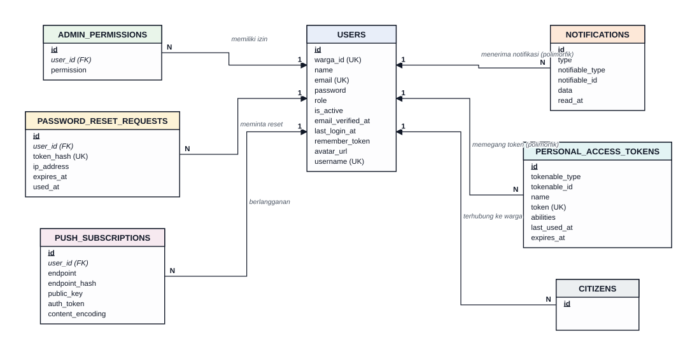
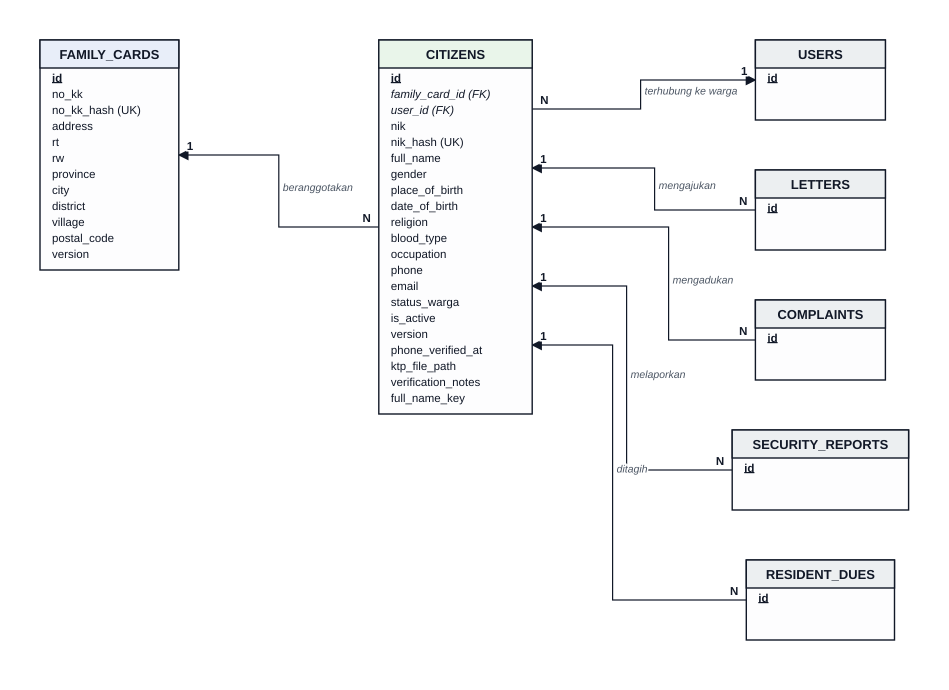
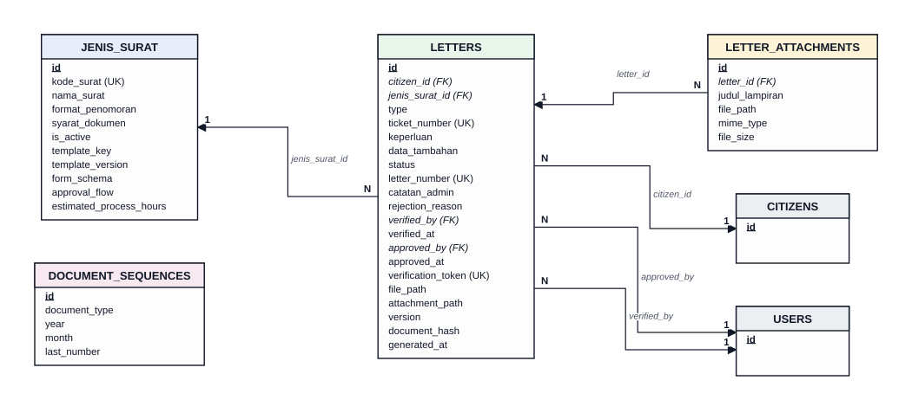
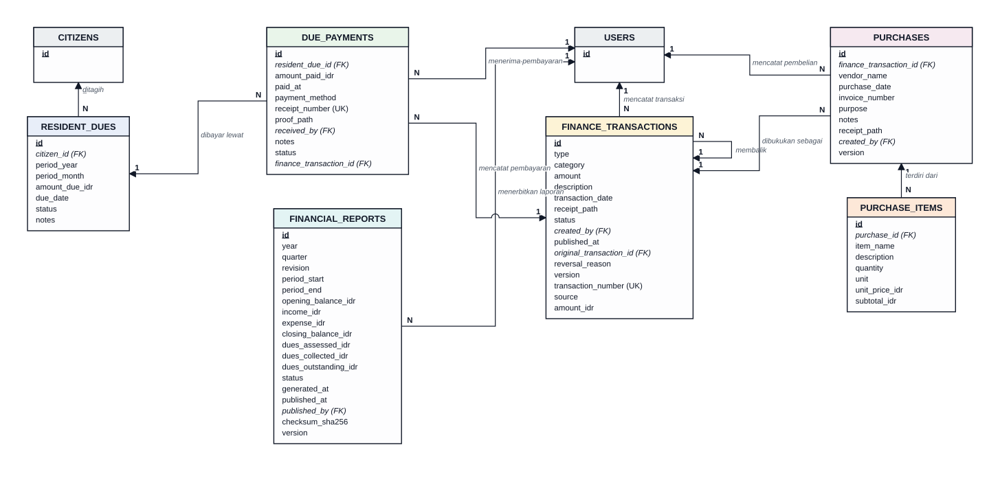
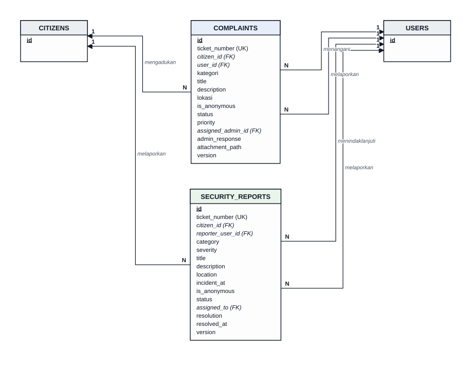
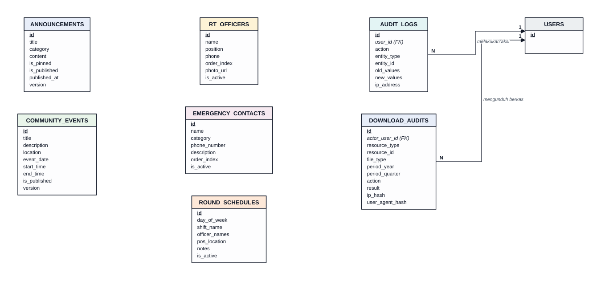

# Logical Record Structure (LRS) PRISMA RT 04

> Unsur 2 dari 5 unsur pemodelan. Fase Waterfall: **Perancangan (Design)**, perancangan data logis. LRS diturunkan dari ERD ([ERD.md](ERD.md)) dan menjadi dasar langsung skrip migrasi di `database/migrations/`. Ringkasan pemetaan 5 unsur ke fase Waterfall ada di [SYSTEM_MODELING_5_ELEMENTS.md](SYSTEM_MODELING_5_ELEMENTS.md).

Seluruh isi dokumen ini dibangkitkan dari skema hasil `php artisan migrate` (39 berkas migrasi, 27 tabel domain), bukan ditulis tangan, sehingga nama tabel, kolom, kunci unik, dan aturan `ON DELETE` sama dengan yang ada di database.

---

## 1. Cara membaca diagram

| Simbol | Arti |
|---|---|
| Kotak dengan nama tabel (huruf kapital) di kepala | Satu relasi (tabel) |
| **<u>id</u>** (tebal, bergaris bawah) | Primary key (PK) |
| *kolom (FK)* (miring) | Foreign key ke PK tabel induk |
| kolom (UK) | Kolom dengan indeks unik |
| Kotak berkepala abu-abu, hanya berisi PK | Tabel dari modul lain, ditampilkan agar relasinya terlihat |
| Panah ke tabel induk | Relasi FK → PK. `N` di sisi anak, `1` di sisi induk |
| Teks miring di garis | Kalimat kata kerja dari sisi induk, contoh `memiliki izin` (users → admin_permissions) |
| Garis menyilang dengan busur kecil | Dua garis saling melintas tanpa terhubung |

Kolom `created_at` dan `updated_at` ada di semua tabel dan tidak digambar. Tabel framework (`cache`, `jobs`, `sessions`) tidak ditampilkan.

## 2. Aturan transformasi ERD ke LRS

| Kasus pada ERD | Hasil pada LRS | Contoh di sistem |
|---|---|---|
| Entitas | Satu tabel dengan PK `id` | semua tabel domain |
| Relasi 1:N | FK di sisi N | `letters.citizen_id` → `citizens.id` |
| Relasi 1:1 | FK ditambah indeks unik | `citizens.user_id` (unik) dan `users.warga_id` (unik) |
| Relasi opsional | FK boleh kosong, biasanya `ON DELETE SET NULL` | `letters.verified_by`, `complaints.assigned_admin_id` |
| Entitas yang tidak berdiri sendiri (komposisi) | FK wajib terisi dengan `ON DELETE CASCADE` | `letter_attachments.letter_id`, `purchase_items.purchase_id`, `due_payments.resident_due_id` |
| Relasi polimorfik | Pasangan `*_type` dan `*_id` tanpa FK database | `notifications.notifiable_*`, `personal_access_tokens.tokenable_*` |
| Data sensitif | Kolom terenkripsi ditambah kolom hash untuk pencarian dan keunikan | `citizens.nik` dan `nik_hash`, `family_cards.no_kk` dan `no_kk_hash` |
| Relasi ke diri sendiri | FK ke tabel yang sama | `finance_transactions.original_transaction_id` (reversal) |

---

## 3. Diagram LRS per modul

### 3.1. Akun dan Akses



### 3.2. Kependudukan



### 3.3. Surat Pengantar



### 3.4. Keuangan dan Iuran



### 3.5. Pengaduan dan Keamanan



### 3.6. Informasi RT dan Audit



---

## 4. Matriks relasi dan aturan integritas

Satu baris per foreign key database (28 relasi). Kolom "kardinalitas" menyatakan banyaknya baris induk dibanding anak.

| Induk (PK) | Anak (FK) | Kolom FK | Kardinalitas induk : anak | FK boleh kosong | ON DELETE |
|---|---|---|---|---|---|
| `citizens` | `complaints` | `citizen_id` | 0..1 : N | ya | SET NULL |
| `citizens` | `letters` | `citizen_id` | 1 : N | tidak | CASCADE |
| `citizens` | `resident_dues` | `citizen_id` | 1 : N | tidak | CASCADE |
| `citizens` | `security_reports` | `citizen_id` | 0..1 : N | ya | SET NULL |
| `family_cards` | `citizens` | `family_card_id` | 0..1 : N | ya | CASCADE |
| `finance_transactions` | `due_payments` | `finance_transaction_id` | 0..1 : N | ya | RESTRICT |
| `finance_transactions` | `finance_transactions` | `original_transaction_id` | 0..1 : N | ya | SET NULL |
| `finance_transactions` | `purchases` | `finance_transaction_id` | 0..1 : N | ya | SET NULL |
| `jenis_surat` | `letters` | `jenis_surat_id` | 0..1 : N | ya | SET NULL |
| `letters` | `letter_attachments` | `letter_id` | 1 : N | tidak | CASCADE |
| `purchases` | `purchase_items` | `purchase_id` | 1 : N | tidak | CASCADE |
| `resident_dues` | `due_payments` | `resident_due_id` | 1 : N | tidak | CASCADE |
| `users` | `admin_permissions` | `user_id` | 1 : N | tidak | CASCADE |
| `users` | `audit_logs` | `user_id` | 0..1 : N | ya | SET NULL |
| `users` | `citizens` | `user_id` | 0..1 : 0..1 | ya | SET NULL |
| `users` | `complaints` | `assigned_admin_id` | 0..1 : N | ya | SET NULL |
| `users` | `complaints` | `user_id` | 0..1 : N | ya | SET NULL |
| `users` | `download_audits` | `actor_user_id` | 0..1 : N | ya | SET NULL |
| `users` | `due_payments` | `received_by` | 0..1 : N | ya | SET NULL |
| `users` | `finance_transactions` | `created_by` | 0..1 : N | ya | SET NULL |
| `users` | `financial_reports` | `published_by` | 0..1 : N | ya | SET NULL |
| `users` | `letters` | `approved_by` | 0..1 : N | ya | SET NULL |
| `users` | `letters` | `verified_by` | 0..1 : N | ya | SET NULL |
| `users` | `password_reset_requests` | `user_id` | 1 : N | tidak | CASCADE |
| `users` | `purchases` | `created_by` | 0..1 : N | ya | SET NULL |
| `users` | `push_subscriptions` | `user_id` | 0..1 : N | ya | SET NULL |
| `users` | `security_reports` | `assigned_to` | 0..1 : N | ya | SET NULL |
| `users` | `security_reports` | `reporter_user_id` | 0..1 : N | ya | SET NULL |

## 5. Daftar LRS (bentuk teks)

Format: `TABEL (kolom [PK | FK→tabel_induk | UK])`.

```
USERS (id [PK], warga_id [UK], name, email [UK], password, role, is_active, email_verified_at, last_login_at, remember_token, avatar_url, username [UK])
ADMIN_PERMISSIONS (id [PK], user_id [FK→users], permission)
PERSONAL_ACCESS_TOKENS (id [PK], tokenable_type, tokenable_id, name, token [UK], abilities, last_used_at, expires_at)
PASSWORD_RESET_REQUESTS (id [PK], user_id [FK→users], token_hash [UK], ip_address, expires_at, used_at)
NOTIFICATIONS (id [PK], type, notifiable_type, notifiable_id, data, read_at)
PUSH_SUBSCRIPTIONS (id [PK], user_id [FK→users], endpoint, endpoint_hash, public_key, auth_token, content_encoding)
FAMILY_CARDS (id [PK], no_kk, no_kk_hash [UK], address, rt, rw, province, city, district, village, postal_code, version)
CITIZENS (id [PK], family_card_id [FK→family_cards], user_id [FK→users, UK], nik, nik_hash [UK], full_name, gender, place_of_birth, date_of_birth, religion, blood_type, occupation, phone, email, status_warga, is_active, version, phone_verified_at, ktp_file_path, verification_notes, full_name_key)
JENIS_SURAT (id [PK], kode_surat [UK], nama_surat, format_penomoran, syarat_dokumen, is_active, template_key, template_version, form_schema, approval_flow, estimated_process_hours)
LETTERS (id [PK], citizen_id [FK→citizens], jenis_surat_id [FK→jenis_surat], type, ticket_number [UK], keperluan, data_tambahan, status, letter_number [UK], catatan_admin, rejection_reason, verified_by [FK→users], verified_at, approved_by [FK→users], approved_at, verification_token [UK], file_path, attachment_path, version, document_hash, generated_at)
LETTER_ATTACHMENTS (id [PK], letter_id [FK→letters], judul_lampiran, file_path, mime_type, file_size)
DOCUMENT_SEQUENCES (id [PK], document_type, year, month, last_number)
COMPLAINTS (id [PK], ticket_number [UK], citizen_id [FK→citizens], user_id [FK→users], kategori, title, description, lokasi, is_anonymous, status, priority, assigned_admin_id [FK→users], admin_response, attachment_path, version)
SECURITY_REPORTS (id [PK], ticket_number [UK], citizen_id [FK→citizens], reporter_user_id [FK→users], category, severity, title, description, location, incident_at, is_anonymous, status, assigned_to [FK→users], resolution, resolved_at, version)
RESIDENT_DUES (id [PK], citizen_id [FK→citizens], period_year, period_month, amount_due_idr, due_date, status, notes)
DUE_PAYMENTS (id [PK], resident_due_id [FK→resident_dues], amount_paid_idr, paid_at, payment_method, receipt_number [UK], proof_path, received_by [FK→users], notes, status, finance_transaction_id [FK→finance_transactions])
FINANCE_TRANSACTIONS (id [PK], type, category, amount, description, transaction_date, receipt_path, status, created_by [FK→users], published_at, original_transaction_id [FK→finance_transactions], reversal_reason, version, transaction_number [UK], source, amount_idr)
PURCHASES (id [PK], finance_transaction_id [FK→finance_transactions], vendor_name, purchase_date, invoice_number, purpose, notes, receipt_path, created_by [FK→users], version)
PURCHASE_ITEMS (id [PK], purchase_id [FK→purchases], item_name, description, quantity, unit, unit_price_idr, subtotal_idr)
FINANCIAL_REPORTS (id [PK], year, quarter, revision, period_start, period_end, opening_balance_idr, income_idr, expense_idr, closing_balance_idr, dues_assessed_idr, dues_collected_idr, dues_outstanding_idr, status, generated_at, published_at, published_by [FK→users], checksum_sha256, version)
DOWNLOAD_AUDITS (id [PK], actor_user_id [FK→users], resource_type, resource_id, file_type, period_year, period_quarter, action, result, ip_hash, user_agent_hash)
AUDIT_LOGS (id [PK], user_id [FK→users], action, entity_type, entity_id, old_values, new_values, ip_address)
ANNOUNCEMENTS (id [PK], title, category, content, is_pinned, is_published, published_at, version)
COMMUNITY_EVENTS (id [PK], title, description, location, event_date, start_time, end_time, is_published, version)
RT_OFFICERS (id [PK], name, position, phone, order_index, photo_url, is_active)
EMERGENCY_CONTACTS (id [PK], name, category, phone_number, description, order_index, is_active)
ROUND_SCHEDULES (id [PK], day_of_week, shift_name, officer_names, pos_location, notes, is_active)
```

Relasi yang tidak memakai FK database: `notifications` dan `personal_access_tokens` (polimorfik), serta `users.warga_id` yang unik tetapi tidak berupa FK (arah sebaliknya dijaga oleh `citizens.user_id`).

## 6. Normalisasi dan pengecualian terkendali

Rancangan mengikuti bentuk normal ketiga (3NF): setiap atribut non-kunci bergantung pada kunci, seluruh kunci, dan tidak ada yang lain. Ada beberapa pengecualian yang disengaja atau warisan dari tahap sebelumnya. Semuanya tercatat di sini agar tidak dianggap kesalahan desain.

| Tabel dan kolom | Sifat pengecualian | Alasan |
|---|---|---|
| `citizens.nik` dan `nik_hash`; `family_cards.no_kk` dan `no_kk_hash` | Nilai yang sama disimpan dua kali | Nilai asli terenkripsi sehingga tidak bisa dicari atau dijadikan unik. Hash SHA-256 dipakai untuk pencarian dan keunikan (NFR-01). |
| `citizens.full_name_key` | Kolom turunan dari `full_name` | Kunci normalisasi nama untuk indeks unik gabungan nama dan No. KK saat registrasi mandiri. |
| `financial_reports.income_idr`, `expense_idr`, `closing_balance_idr`, dst. | Agregat turunan dari `finance_transactions` | Laporan triwulan adalah *snapshot* yang tidak boleh berubah setelah terbit. Integritasnya dijaga `checksum_sha256` dan nomor `revision`. |
| `finance_transactions.amount` dan `amount_idr` | Dua kolom nominal | `amount_idr` (bilangan bulat rupiah) adalah kolom kanonik yang ditambahkan lewat migrasi `add_canonical_fields_to_finance_transactions_table`. `amount` dipertahankan sebagai warisan dan diisi ulang ke `amount_idr` oleh migrasi yang sama. |
| `letters.type` dan `letters.jenis_surat_id` | Dua cara mengacu jenis surat | `type` adalah kolom asal sebelum `jenis_surat_id` ditambahkan. Keduanya dipertahankan demi kompatibilitas; kandidat penyederhanaan pada rilis berikutnya. |
| `complaints.citizen_id` dan `complaints.user_id` | `citizen_id` dapat diturunkan dari `user_id` (ketergantungan transitif) | Keduanya diisi saat pengaduan dibuat. `citizen_id` disimpan agar kueri per warga tidak perlu join ke `users`, dan boleh kosong untuk pelapor tanpa data warga. |

## 7. Keterkaitan dengan fase Waterfall berikutnya

| Artefak LRS | Dipakai pada | Berkas |
|---|---|---|
| Daftar tabel dan kolom | Implementasi: skrip migrasi | `database/migrations/*.php` |
| Aturan `ON DELETE` dan indeks unik | Implementasi dan pengujian integritas | `Sprint3AccountCitizenFamilyCardTest`, `Sprint1CitizenFamilyCardTest`, `FinanceLedgerSprint2Test` |
| Data uji | Pengujian | `database/factories/*.php`, `database/seeders/*.php` |
