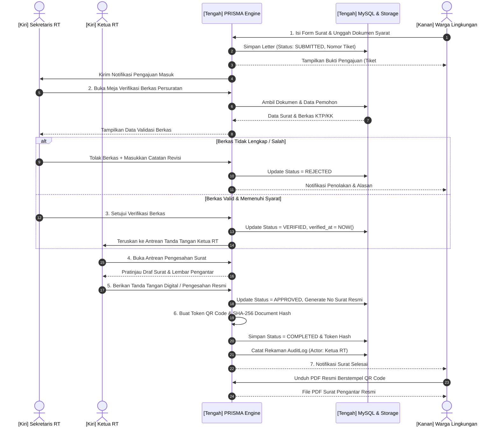
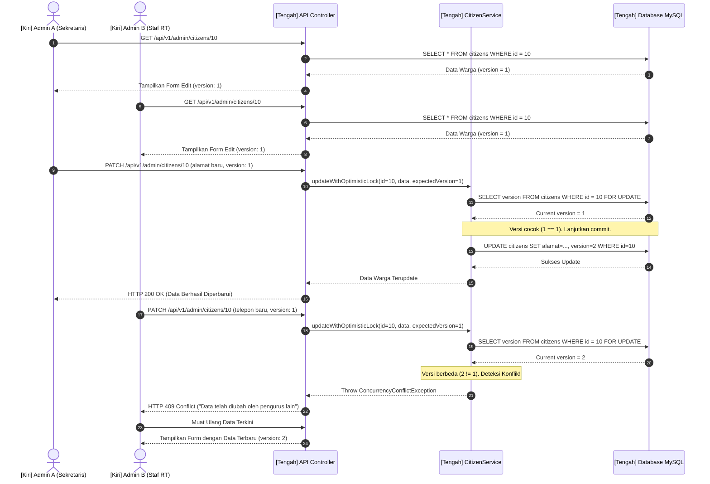
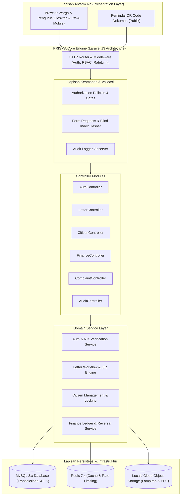
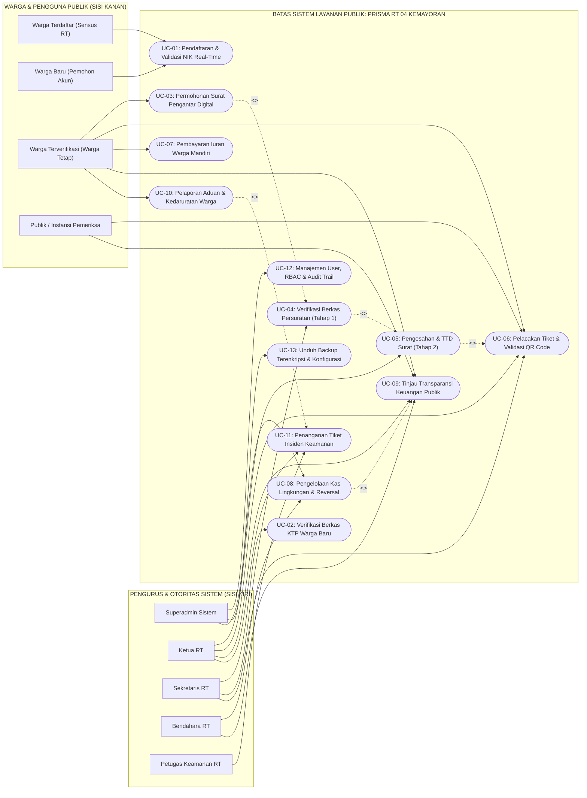

# Pemodelan Rekayasa Perangkat Lunak PRISMA RT 04 (5 Unsur Utama)

> **PRISMA RT 04 Kemayoran** (*Platform Realisasi Informasi, Sistem Manajemen & Administrasi Warga*)  
> Standar Dokumentasi Rekayasa Perangkat Lunak (*Software Engineering Specification*)  
> Pemetaan Keterkaitan Aktor: **Superadmin & Admin (Sisi Kiri)** dengan **User & Warga (Sisi Kanan)**

---

## Daftar Isi
1. [Arsitektur Keterkaitan Aktor & Pembagian Peran](#1-arsitektur-keterkaitan-aktor--pembagian-peran)
2. [Unsur 1: Unified Modeling Language (UML)](#unsur-1-unified-modeling-language-uml)
   - [1.1 UML Class Diagram](#11-uml-class-diagram)
   - [1.2 UML Sequence Diagram (Birokrasi Persuratan 2-Tier)](#12-uml-sequence-diagram-birokrasi-persuratan-2-tier)
   - [1.3 UML Sequence Diagram (Optimistic Concurrency Control)](#13-uml-sequence-diagram-optimistic-concurrency-control)
   - [1.4 UML Component Diagram](#14-uml-component-diagram)
3. [Unsur 2: Entity Relationship Diagram (ERD)](#unsur-2-entity-relationship-diagram-erd)
   - [2.1 Visual Mermaid ERD](#21-visual-mermaid-erd)
   - [2.2 Kamus Data & Integritas Kardinalitas](#22-kamus-data--integritas-kardinalitas)
4. [Unsur 3: Logical Record Structure (LRS)](#unsur-3-logical-record-structure-lrs)
   - [3.1 Skema Baris Rekaman Relasional (3NF)](#31-skema-baris-rekaman-relasional-3nf)
   - [3.2 Diagram Visual Relasi LRS](#32-diagram-visual-relasi-lrs)
   - [3.3 Matriks Relasi Antar-Entitas & Integritas Kunci](#33-matriks-relasi-antar-entitas--integritas-kunci)
5. [Unsur 4: Activity Diagram (Format Kotak Tabel Step-by-Step)](#unsur-4-activity-diagram-format-kotak-tabel-step-by-step)
   - [4.1 Alur Registrasi Mandiri Warga & Validasi NIK Real-Time](#41-alur-registrasi-mandiri-warga--validasi-nik-real-time)
   - [4.2 Alur Birokrasi Pengajuan & Pengesahan Surat Pengantar Digital 2-Tier](#42-alur-birokrasi-pengajuan--pengesahan-surat-pengantar-digital-2-tier)
   - [4.3 Alur Pengaduan Keluhan & Penanganan Laporan Insiden Keamanan](#43-alur-pengaduan-keluhan--penanganan-laporan-insiden-keamanan)
   - [4.4 Alur Penagihan Iuran Warga & Pembukuan Kas Anti-Fraud](#44-alur-penagihan-iuran-warga--pembukuan-kas-anti-fraud)
   - [4.5 Alur Manajemen Pengguna, RBAC & Audit Trail oleh Superadmin](#45-alur-manajemen-pengguna-rbac--audit-trail-oleh-superadmin)
6. [Unsur 5: Use Case Diagram & Spesifikasi Aktor](#unsur-5-use-case-diagram--spesifikasi-aktor)
   - [5.1 Visual Mermaid Use Case Diagram (Kiri: Superadmin/Admin, Kanan: User/Warga)](#51-visual-mermaid-use-case-diagram)
   - [5.2 Matriks Wewenang & Interaksi Aktor](#52-matriks-wewenang--interaksi-aktor)
   - [5.3 Spesifikasi Naratif Use Case Utama](#53-spesifikasi-naratif-use-case-utama)

---

## 1. Arsitektur Keterkaitan Aktor & Pembagian Peran

Seluruh pemodelan sistem diatur dengan pemisahan tegas antara kelompok **Pengelola / Otoritas Sistem (Sisi Kiri)** dan kelompok **Penerima Layanan Publik / Komunitas (Sisi Kanan)**:

```
┌──────────────────────────────────────────────────┐      ┌─────────────────────────┐      ┌──────────────────────────────────────────────────┐
│             SISI KIRI: PENGURUS & OTORITAS       │      │      SISTEM PUSAT       │      │            SISI KANAN: WARGA & PENGGUNA          │
├──────────────────────────────────────────────────┤      ├─────────────────────────┤      ├──────────────────────────────────────────────────┤
│ 1. SUPERADMIN                                    │      │                         │      │ 1. WARGA TERDAFTAR (SENSUS AKTIF)                │
│    - Akses penuh konfigurasi sistem & database   │      │                         │      │    - Verifikasi instan NIK 16 digit              │
│    - Manajemen akun pengurus & RBAC              │      │      PLATFORM PRISMA    │      │    - Permohonan surat pengantar digital          │
│    - Pelacakan jejak audit (Audit Logs)          │◄────►│         RT 04 / RW 09   │◄────►│    - Transparansi kas & riwayat iuran mandiri    │
│ 2. ADMIN / PENGURUS RT                           │      │                         │      │ 2. WARGA BARU / PENDUDUK BARU                    │
│    - KETUA RT: Pengesahan surat & supervisi      │      │  • Laravel 13 MVC       │      │    - Pengajuan akun mandiri + foto KTP/KK        │
│    - SEKRETARIS: Verifikasi NIK & kelengkapan    │      │  • MySQL 8.x + Redis    │      │    - Menunggu verifikasi berkas oleh pengurus    │
│    - BENDAHARA: Kas RT, penagihan iuran bulanan  │      │  • SHA-256 QR Engine    │      │ 3. PENGGUNA PUBLIK (TAMU / WARGA TAMU)           │
│    - PETUGAS KEAMANAN: Tindak lanjut aduan       │      │                         │      │    - Informasi jadwal ronda & kontak darurat     │
└──────────────────────────────────────────────────┘      └─────────────────────────┘      └──────────────────────────────────────────────────┘
```

---

## Unsur 1: Unified Modeling Language (UML)

### 1.1 UML Class Diagram

Class diagram menggambarkan struktur kelas domain, dependensi antar-objek, dan lapisan layanan (*Service Layer*) di Laravel 13:

```mermaid
classDiagram
    direction TB

    %% ENUMS
    class UserRole {
        <<enumeration>>
        SUPERADMIN
        ADMIN
        KETUA_RT
        SEKRETARIS
        BENDAHARA
        PETUGAS_KEAMANAN
        WARGA
        +label() string
    }

    class LetterStatus {
        <<enumeration>>
        DRAFT
        SUBMITTED
        VERIFIED
        APPROVED
        REJECTED
        COMPLETED
    }

    class TransactionType {
        <<enumeration>>
        INCOME
        EXPENSE
    }

    %% MODELS ENTITY
    class User {
        +bigint id
        +bigint warga_id
        +string name
        +string email
        +string password
        +UserRole role
        +boolean is_active
        +datetime last_login_at
        +citizen() Citizen
        +auditLogs() HasMany
        +hasPermission(string permission) bool
        +isSuperAdmin() bool
        +isAdmin() bool
    }

    class Citizen {
        +bigint id
        +bigint family_card_id
        +bigint user_id
        +string nik_hash
        +string encrypted_nik
        +string full_name
        +date birth_date
        +string gender
        +text address
        +string phone
        +string status_warga
        +int version
        +familyCard() FamilyCard
        +user() User
        +letters() HasMany
        +residentDues() HasMany
    }

    class FamilyCard {
        +bigint id
        +string nomor_kk
        +string kepala_keluarga_name
        +text alamat
        +string rt
        +string rw
        +int version
        +citizens() HasMany
    }

    class Letter {
        +bigint id
        +bigint user_id
        +bigint citizen_id
        +bigint letter_type_id
        +string ticket_number
        +string reference_number
        +LetterStatus status
        +string verification_token
        +string document_hash
        +json form_data
        +text rejection_reason
        +datetime verified_at
        +datetime approved_at
        +attachments() HasMany
        +citizen() Citizen
        +type() LetterType
    }

    class LetterType {
        +bigint id
        +string code
        +string name
        +text description
        +json required_fields
        +boolean is_active
    }

    class LetterAttachment {
        +bigint id
        +bigint letter_id
        +string file_path
        +string original_name
        +string mime_type
        +int file_size
    }

    class FinanceTransaction {
        +bigint id
        +bigint user_id
        +TransactionType transaction_type
        +decimal amount
        +string category
        +text description
        +date transaction_date
        +boolean is_published
        +boolean is_reversal
        +bigint reversal_of_id
        +user() User
        +reversalOf() FinanceTransaction
    }

    class ResidentDue {
        +bigint id
        +bigint citizen_id
        +int due_month
        +int due_year
        +decimal amount
        +string status
        +payments() HasMany
    }

    class DuePayment {
        +bigint id
        +bigint resident_due_id
        +string payment_reference
        +decimal amount
        +string payment_method
        +datetime payment_date
        +string proof_path
    }

    class Complaint {
        +bigint id
        +bigint user_id
        +string title
        +text description
        +string category
        +string status
        +string photo_path
        +text response_notes
        +user() User
    }

    class SecurityReport {
        +bigint id
        +bigint user_id
        +string incident_type
        +string location
        +text description
        +datetime incident_time
        +string status
        +photo_path
        +assigned_officer_id
    }

    class AuditLog {
        +bigint id
        +bigint user_id
        +string event
        +string auditable_type
        +bigint auditable_id
        +json old_values
        +json new_values
        +string ip_address
        +string user_agent
    }

    %% SERVICE LAYER
    class LetterService {
        +submitLetter(Citizen citizen, array data, array files) Letter
        +verifyLetter(Letter letter, User verifier) Letter
        +approveLetter(Letter letter, User approver) Letter
        +rejectLetter(Letter letter, User actor, string reason) Letter
        +generateQrVerification(Letter letter) string
    }

    class CitizenService {
        +verifyNik(string nik) array
        +activateWarga(string nik, array credentials) User
        +registerPendingCitizen(array data, file ktp) Citizen
        +updateWithOptimisticLock(Citizen citizen, array data, int expectedVersion) Citizen
    }

    class FinanceService {
        +recordTransaction(array data, User author) FinanceTransaction
        +createReversal(FinanceTransaction original, string reason, User author) FinanceTransaction
        +getPublicBalance() array
    }

    %% RELATIONSHIPS
    User "1" <--> "0..1" Citizen : Hubungan Akun & Profil
    FamilyCard "1" o-- "*" Citizen : Menampung Anggota
    Citizen "1" o-- "*" Letter : Mengajukan Permohonan
    LetterType "1" o-- "*" Letter : Definisi Template
    Letter "1" *-- "*" LetterAttachment : Berkas Syarat
    Citizen "1" o-- "*" ResidentDue : Kewajiban Iuran
    ResidentDue "1" *-- "*" DuePayment : Riwayat Bayar
    User "1" o-- "*" FinanceTransaction : Dicatat Bendahara
    User "1" o-- "*" Complaint : Laporan Warga
    User "1" o-- "*" SecurityReport : Insiden Warga
    User "1" o-- "*" AuditLog : Jejak Perubahan

    LetterService ..> Letter : Orchestrates
    CitizenService ..> Citizen : Manages
    FinanceService ..> FinanceTransaction : Calculates
```



---

### 1.2 UML Sequence Diagram (Birokrasi Persuratan 2-Tier)

Diagram ini menggambarkan interaksi sekuensial lengkap dengan memposisikan **Pengurus RT (Sekretaris & Ketua RT) di sisi kiri**, **Sistem PRISMA di tengah**, dan **User / Warga di sisi kanan**:



---

### 1.3 UML Sequence Diagram (Optimistic Concurrency Control)



---

### 1.4 UML Component Diagram



---

## Unsur 2: Entity Relationship Diagram (ERD)

### 2.1 Visual Mermaid ERD

```mermaid
erDiagram
    FAMILY_CARDS ||--o{ CITIZENS : "1:N (1 KK memuat banyak Anggota)"
    CITIZENS ||--o| USERS : "1:1 (1 Warga memiliki 0..1 Akun Login)"
    
    USERS ||--o{ ADMIN_PERMISSIONS : "1:N (Resolusi M:N Hak Akses Pengurus)"
    USERS ||--o{ PUSH_SUBSCRIPTIONS : "1:N (Notifikasi PWA per Akun)"
    USERS ||--o{ LETTERS : "1:N (Akun pengaju surat)"
    CITIZENS ||--o{ LETTERS : "1:N (Identitas subjek surat)"
    LETTER_TYPES ||--o{ LETTERS : "1:N (Template jenis surat)"
    LETTERS ||--o{ LETTER_ATTACHMENTS : "1:N (Berkas lampiran persyaratan)"
    
    USERS ||--o{ FINANCE_TRANSACTIONS : "1:N (Bendahara pencatat transaksi)"
    CITIZENS ||--o{ RESIDENT_DUES : "1:N (Tagihan iuran bulanan warga)"
    RESIDENT_DUES ||--o{ DUE_PAYMENTS : "1:N (Riwayat pembayaran iuran)"
    FINANCE_TRANSACTIONS ||--o{ DUE_PAYMENTS : "1:N (Buku kas pencatat setoran)"
    
    USERS ||--o{ COMPLAINTS : "1:N (Warga pengaju keluhan)"
    USERS ||--o{ SECURITY_REPORTS : "1:N (Warga pelapor insiden)"
    USERS ||--o{ AUDIT_LOGS : "1:N (Aktor pemicu log sistem)"
    ANNOUNCEMENTS }o--|| USERS : "N:1 (Pengurus pembuat warta)"

    FAMILY_CARDS {
        bigint id PK
        varchar nomor_kk UK "Nomor KK 16 Digit"
        varchar kepala_keluarga_name "Nama Kepala Keluarga"
        text alamat "Alamat Rumah Lengkap"
        varchar rt "Nomor RT (04)"
        varchar rw "Nomor RW (09)"
        varchar kode_pos "10620"
        int version "Optimistic Locking"
        datetime created_at
        datetime updated_at
    }

    CITIZENS {
        bigint id PK
        bigint family_card_id FK "Relasi ke FAMILY_CARDS"
        bigint user_id FK "Relasi 1:1 ke USERS (Unique, Nullable)"
        varchar nik_hash UK "SHA-256 Blind Index Pencarian Cepat"
        text nik_encrypted "Kunci Enkripsi AES-256-CBC"
        varchar full_name "Nama Lengkap KTP"
        date birth_date "Tanggal Lahir"
        enum gender "L, P"
        text address "Alamat Domisili"
        varchar phone "Nomor WhatsApp"
        enum status_warga "tetap, pending_verification"
        int version "Optimistic Locking"
        datetime created_at
        datetime updated_at
    }

    USERS {
        bigint id PK
        bigint warga_id FK "Relasi ke CITIZENS (Unique, Nullable)"
        varchar name "Nama Tampilan"
        varchar email UK "Email Login Unik"
        varchar password "Bcrypt Hash"
        enum role "SUPERADMIN,ADMIN,KETUA_RT,BENDAHARA,SEKRETARIS,PETUGAS_KEAMANAN,WARGA"
        boolean is_active "Status Akun Aktif/Diblokir"
        datetime last_login_at "Waktu Login Terakhir"
        datetime created_at
        datetime updated_at
    }

    LETTER_TYPES {
        bigint id PK
        varchar code UK "SKD, SKU, SKTM, dll"
        varchar name "Nama Jenis Surat Pengantar"
        text description "Keterangan & Kegunaan"
        json required_attachments "Daftar Berkas Syarat"
        boolean is_active "Status Tersedia"
    }

    LETTERS {
        bigint id PK
        bigint user_id FK "User Akun Pengaju"
        bigint citizen_id FK "Warga Pemohon"
        bigint letter_type_id FK "Jenis Surat Pengantar"
        varchar ticket_number UK "Nomor Tiket Publik (PRISMA-SRT-xxx)"
        varchar reference_number "Nomor Surat Resmi Pengurus RT"
        enum status "draft,submitted,verified,approved,rejected,completed"
        varchar verification_token UK "Token Validasi Publik QR"
        varchar document_hash "SHA-256 Integritas Berkas"
        json form_data "Payload Isian Form Dinamis"
        text rejection_reason "Catatan Revisi / Penolakan"
        datetime verified_at "Waktu Verifikasi Sekretaris"
        datetime approved_at "Waktu Pengesahan Ketua RT"
        datetime created_at
        datetime updated_at
    }

    LETTER_ATTACHMENTS {
        bigint id PK
        bigint letter_id FK "Relasi ke LETTERS"
        varchar file_path "Lokasi Penyimpanan Berkas"
        varchar original_name "Nama Asli File Unggahan"
        varchar mime_type "image/jpeg, application/pdf"
        int file_size "Ukuran Byte"
        datetime created_at
    }

    FINANCE_TRANSACTIONS {
        bigint id PK
        bigint user_id FK "Bendahara Pencatat"
        enum transaction_type "income, expense"
        decimal amount "DECIMAL(15,2) Presisi Moneter"
        varchar category "Iuran, Kas Operasional, dll"
        text description "Uraian Penggunaan Dana"
        date transaction_date "Tanggal Transaksi"
        boolean is_published "Visibilitas Transparansi Warga"
        boolean is_reversal "Penanda Transaksi Pembatalan"
        bigint reversal_of_id FK "Self-Reference Transaksi Asal"
        datetime created_at
    }

    RESIDENT_DUES {
        bigint id PK
        bigint citizen_id FK "Warga Wajib Iuran"
        int due_month "Bulan Tagihan (1-12)"
        int due_year "Tahun Tagihan"
        decimal amount "DECIMAL(15,2)"
        enum status "unpaid, paid, overdue"
        datetime created_at
    }

    DUE_PAYMENTS {
        bigint id PK
        bigint resident_due_id FK "Relasi Tagihan"
        bigint finance_transaction_id FK "Relasi ke FINANCE_TRANSACTIONS (Buku Kas)"
        varchar payment_reference UK "Kode Referensi Pembayaran"
        decimal amount "Nominal Dibayarkan"
        varchar payment_method "transfer_bank, qris, cash"
        datetime payment_date "Tanggal Pembayaran"
        varchar proof_path "Foto Bukti Transfer"
        datetime created_at
    }

    COMPLAINTS {
        bigint id PK
        bigint user_id FK "Pengirim Aduan"
        varchar title "Judul Keluhan / Masalah"
        text description "Rincian Permasalahan"
        varchar category "kebersihan, fasilitas, keamanan"
        enum status "submitted, in_progress, resolved, rejected"
        varchar photo_path "Foto Bukti Kejadian"
        text response_notes "Tanggapan Pengurus"
        datetime created_at
    }

    SECURITY_REPORTS {
        bigint id PK
        bigint user_id FK "Pelapor Insiden"
        varchar incident_type "Pencurian, Keributan, Tamu Asing"
        varchar location "Lokasi Kejadian di RT 04"
        text description "Kronologi Kejadian"
        datetime incident_time "Waktu Kejadian"
        enum status "reported, investigating, resolved"
        varchar photo_path "Foto Bukti"
        datetime created_at
    }

    AUDIT_LOGS {
        bigint id PK
        bigint user_id FK "Aktor Pengubah Data"
        varchar event "created, updated, deleted, verified, approved"
        varchar auditable_type "Nama Model Terkait"
        bigint auditable_id "ID Record Terkait"
        json old_values "Nilai Sebelum Diubah"
        json new_values "Nilai Sesudah Diubah"
        varchar ip_address "Alamat IP Client"
        text user_agent "Perangkat Pengakses"
        datetime created_at
    }

    ADMIN_PERMISSIONS {
        bigint id PK
        bigint user_id FK "Pengurus RT"
        varchar permission_name "letter.verify, letter.approve, kas.manage"
        datetime created_at
    }

    ANNOUNCEMENTS {
        bigint id PK
        bigint user_id FK "Pengurus Pembuat"
        varchar title "Judul Pengumuman"
        text content "Isi Warta Warga"
        boolean is_pinned "Tampilkan di Puncak"
        datetime created_at
    }
```



---

### 2.2 Kamus Data & Integritas Kardinalitas

| Entitas Utama | Kardinalitas | Atribut Kunci (PK / FK / UK) | Aturan Integritas & Keamanan |
|---|---|---|---|
| **`USERS`** | 1:1 ke `CITIZENS`, 1:N ke entitas transaksional | `id` (PK), `warga_id` (FK, UK Nullable), `email` (UK) | Password dienkripsi dengan algoritma Bcrypt (cost factor = 12). |
| **`CITIZENS`** | N:1 ke `FAMILY_CARDS`, 1:1 ke `USERS` | `id` (PK), `family_card_id` (FK), `user_id` (FK, UK Nullable), `nik_hash` (UK) | NIK asli dienkripsi dengan AES-256-CBC, `nik_hash` menggunakan SHA-256 blind index untuk pencarian instan tanpa dekripsi massal. |
| **`FAMILY_CARDS`**| 1:N ke `CITIZENS` | `id` (PK), `nomor_kk` (UK) | Menyimpan data kepala keluarga dan kartu keluarga. |
| **`LETTERS`** | N:1 ke `USERS`, N:1 ke `CITIZENS`, N:1 ke `LETTER_TYPES` | `id` (PK), `user_id` (FK), `citizen_id` (FK), `letter_type_id` (FK), `ticket_number` (UK), `verification_token` (UK) | State machine ketat (`draft` -> `submitted` -> `verified` -> `approved` -> `completed`). Kolom `document_hash` memastikan dokumen tidak dimanipulasi setelah terbit. |
| **`FINANCE_TRANSACTIONS`** | N:1 ke `USERS`, 1:1 ke dirinya sendiri (`reversal_of_id`) | `id` (PK), `user_id` (FK), `reversal_of_id` (FK Nullable) | *Immutable Ledger*: Data yang telah terbit tidak boleh di-UPDATE/DELETE. Koreksi wajib melalui entri *reversal audit transaction*. Presisi nominal `DECIMAL(15,2)`. |
| **`AUDIT_LOGS`** | N:1 ke `USERS` | `id` (PK), `user_id` (FK Nullable) | Merekam IP address, user agent, dan snapshot JSON perbedaan nilai `old_values` vs `new_values`. |

---

## Unsur 3: Logical Record Structure (LRS)

### 3.1 Skema Baris Rekaman Relasional (3NF)

```text
FAMILY_CARDS (
    id [PK], nomor_kk [UK], kepala_keluarga_name, alamat, rt, rw, kode_pos, 
    version, created_at, updated_at
)

CITIZENS (
    id [PK], family_card_id [FK -> FAMILY_CARDS.id], user_id [FK, UK -> USERS.id], 
    nik_hash [UK], nik_encrypted, full_name, birth_date, gender, address, phone, 
    status_warga, version, created_at, updated_at
)

USERS (
    id [PK], warga_id [FK, UK -> CITIZENS.id], name, email [UK], password, 
    role, is_active, last_login_at, created_at, updated_at
)

ADMIN_PERMISSIONS (
    id [PK], user_id [FK -> USERS.id], permission_name, created_at
)

LETTER_TYPES (
    id [PK], code [UK], name, description, required_attachments, is_active, 
    created_at, updated_at
)

LETTERS (
    id [PK], user_id [FK -> USERS.id], citizen_id [FK -> CITIZENS.id], 
    letter_type_id [FK -> LETTER_TYPES.id], ticket_number [UK], reference_number, 
    status, verification_token [UK], document_hash, form_data, rejection_reason, 
    verified_at, approved_at, created_at, updated_at
)

LETTER_ATTACHMENTS (
    id [PK], letter_id [FK -> LETTERS.id], file_path, original_name, 
    mime_type, file_size, created_at, updated_at
)

FINANCE_TRANSACTIONS (
    id [PK], user_id [FK -> USERS.id], transaction_type, amount, category, 
    description, transaction_date, is_published, is_reversal, 
    reversal_of_id [FK -> FINANCE_TRANSACTIONS.id], created_at, updated_at
)

RESIDENT_DUES (
    id [PK], citizen_id [FK -> CITIZENS.id], due_month, due_year, amount, 
    status, created_at, updated_at
)

DUE_PAYMENTS (
    id [PK], resident_due_id [FK -> RESIDENT_DUES.id], payment_reference [UK], 
    amount, payment_method, payment_date, proof_path, created_at, updated_at
)

COMPLAINTS (
    id [PK], user_id [FK -> USERS.id], title, description, category, 
    status, photo_path, response_notes, created_at, updated_at
)

SECURITY_REPORTS (
    id [PK], user_id [FK -> USERS.id], incident_type, location, description, 
    incident_time, status, photo_path, assigned_officer_id [FK -> USERS.id], 
    created_at, updated_at
)

AUDIT_LOGS (
    id [PK], user_id [FK -> USERS.id], event, auditable_type, auditable_id, 
    old_values, new_values, ip_address, user_agent, created_at
)

ANNOUNCEMENTS (
    id [PK], user_id [FK -> USERS.id], title, content, is_pinned, 
    created_at, updated_at
)
```

---

### 3.2 Diagram Visual Relasi LRS

```
┌─────────────────────────────────┐
│          FAMILY_CARDS           │
├─────────────────────────────────┤
│ * id (PK)                       │◄────────────────────────┐
│   nomor_kk (UK)                 │                         │
│   kepala_keluarga_name          │                         │
└─────────────────────────────────┘                         │
                                                            │ 1:N
┌─────────────────────────────────┐                         │
│            CITIZENS             │                         │
├─────────────────────────────────┤                         │
│ * id (PK)                       │◄─────────┐              │
│ o family_card_id (FK) ──────────┼──────────┼──────────────┘
│ o user_id (FK, UK) ────────┐    │          │
│   nik_hash (UK)            │    │          │ 1:N
└────────────────────────────┼────┘          │
                       1:1   │               │
┌────────────────────────────┼────┐          ├─────────────────────────┐
│             USERS          │    │          │                         │
├────────────────────────────┼────┤          │                         │
│ * id (PK) ◄────────────────┘    │          │                         │
│ o warga_id (FK, UK)             │          │                         │
│   email (UK)                    │          │                         │
│   role                          │          │                         │
└──────────────┬──────────────────┘          │                         │
               │                             │                         │
         1:N   │                             │                         │
         ┌─────┴───────────────┬─────────────┴──────────┐              │
         │                     │                        │              │
         ▼                     ▼                        ▼              │
┌──────────────────┐  ┌──────────────────┐  ┌──────────────────────┐   │
│   COMPLAINTS     │  │  FINANCE_TRANS   │  │       LETTERS        │   │
├──────────────────┤  ├──────────────────┤  ├──────────────────────┤   │
│ * id (PK)        │  │ * id (PK)        │  │ * id (PK)            │◄──┼───────┐
│ o user_id (FK)   │  │ o user_id (FK)   │  │ o user_id (FK)       │   │       │
│   title          │  │   amount         │  │ o citizen_id (FK) ───┼───┘       │ 1:N
│   status         │  │   is_published   │  │ o letter_type_id (FK)│           │
└──────────────────┘  │ o rev_of_id (FK) │  │   ticket_number (UK) │           │
                      └──────────────────┘  │   verification_token │           │
                                            └──────────┬───────────┘           │
                                                       │                       │
                                                 1:N   │                       │
                                                       ▼                       │
                                            ┌──────────────────────┐           │
                                            │  LETTER_ATTACHMENTS  │           │
                                            ├──────────────────────┤           │
                                            │ * id (PK)            │           │
                                            │ o letter_id (FK) ────┼───────────┘
                                            │   file_path          │
                                            └──────────────────────┘
```

---

### 3.3 Matriks Relasi Antar-Entitas & Integritas Kunci

| Tabel Asal | Hubungan | Tabel Tujuan | Kunci Penghubung | Aturan On Delete | Aturan On Update |
|---|---|---|---|---|---|
| `CITIZENS` | Many-to-One (N:1) | `FAMILY_CARDS` | `family_card_id` -> `id` | `RESTRICT` | `CASCADE` |
| `USERS` | One-to-One (1:1) | `CITIZENS` | `warga_id` -> `id` | `SET NULL` | `CASCADE` |
| `CITIZENS` | One-to-One (1:1) | `USERS` | `user_id` -> `id` | `SET NULL` | `CASCADE` |
| `LETTERS` | Many-to-One (N:1) | `USERS` | `user_id` -> `id` | `CASCADE` | `CASCADE` |
| `LETTERS` | Many-to-One (N:1) | `CITIZENS` | `citizen_id` -> `id` | `RESTRICT` | `CASCADE` |
| `LETTERS` | Many-to-One (N:1) | `LETTER_TYPES` | `letter_type_id` -> `id` | `RESTRICT` | `CASCADE` |
| `LETTER_ATTACHMENTS` | Many-to-One (N:1) | `LETTERS` | `letter_id` -> `id` | `CASCADE` | `CASCADE` |
| `FINANCE_TRANSACTIONS` | Many-to-One (N:1) | `USERS` | `user_id` -> `id` | `RESTRICT` | `CASCADE` |
| `FINANCE_TRANSACTIONS` | Self-Reference (1:1) | `FINANCE_TRANSACTIONS` | `reversal_of_id` -> `id` | `SET NULL` | `CASCADE` |
| `RESIDENT_DUES` | Many-to-One (N:1) | `CITIZENS` | `citizen_id` -> `id` | `CASCADE` | `CASCADE` |
| `DUE_PAYMENTS` | Many-to-One (N:1) | `RESIDENT_DUES` | `resident_due_id` -> `id` | `CASCADE` | `CASCADE` |
| `COMPLAINTS` | Many-to-One (N:1) | `USERS` | `user_id` -> `id` | `CASCADE` | `CASCADE` |
| `SECURITY_REPORTS` | Many-to-One (N:1) | `USERS` | `user_id` -> `id` | `CASCADE` | `CASCADE` |
| `AUDIT_LOGS` | Many-to-One (N:1) | `USERS` | `user_id` -> `id` | `SET NULL` | `CASCADE` |
| `ADMIN_PERMISSIONS` | Many-to-One (N:1) | `USERS` | `user_id` -> `id` | `CASCADE` | `CASCADE` |

---

## Unsur 4: Activity Diagram (Format Kotak Tabel Step-by-Step)

Prinsip peletakan swimlane di seluruh activity diagram:
- **Sisi Kiri**: **Superadmin & Admin (Pengurus RT: Ketua RT, Sekretaris, Bendahara, Petugas Keamanan)**
- **Sisi Tengah**: **Sistem Platform PRISMA RT 04 (Laravel 13 Engine, Validasi, Database MySQL, QR Generator)**
- **Sisi Kanan**: **User & Warga Lingkungan**

Setiap proses didokumentasikan dalam **Format Kotak Tabel Berpetak (*Boxed Table Format*)** langkah demi langkah untuk transparansi alur bisnis.

---

### 4.1 Alur Registrasi Mandiri Warga & Validasi NIK Real-Time

#### Visual Flow


```mermaid
stateDiagram-v2
    direction LR

    state "SISI KIRI: PENGURUS RT" as Kiri {
        SekretarisReview: Sekretaris RT Memeriksa Berkas KTP Baru
        SekretarisApproval: Sekretaris Setujui / Tolak Berkas
    }

    state "TENGAH: SISTEM PRISMA RT 04" as Tengah {
        HashNIK: Blind Index SHA-256 Hash NIK
        CekDatabase: Kueri Tabel Citizens & Users
        GenerateToken: Aktivasi Akun Otomatis
        AntreanPending: Masukkan Status Pending Verification
    }

    state "SISI KANAN: WARGA LINGKUNGAN" as Kanan {
        InputNIK: Warga Memasukkan 16 Digit NIK
        IsiFormAktivasi: Lengkapi Email & Password Akun
        UnggahKTP: Warga Baru Unggah Bukti KTP/KK
        AkunSiap: Warga Login & Akses Layanan Mandiri
    }

    Kanan --> Tengah: 1. Input NIK & Kirim AJAX
    Tengah --> Tengah: 2. SHA-256 & Cek Status NIK
    Tengah --> Kanan: [Kasus A: Warga Sensus] Kunci Nama, Buka Form
    Kanan --> Tengah: 3. Submit Registrasi
    Tengah --> Kanan: Akun Aktif Otomatis
    Tengah --> Kiri: [Kasus B: Warga Baru] Notifikasi Berkas Masuk
    Kiri --> Tengah: 4. Hasil Verifikasi Pengurus
    Tengah --> Kanan: 5. Akun Diterima & Notifikasi Aktif
```

#### Kotak Tabel Step-by-Step Alur Registrasi & Validasi NIK

| No | Tahapan Alur Bisnis | Aktor Kiri (Superadmin / Admin RT) | Proses Sistem PRISMA RT 04 (Tengah) | Aktor Kanan (User / Warga) | Output Dokumen & Status Sistem |
|:--:|---|---|---|---|---|
| **1** | **Input 16 Digit NIK** | *(Menunggu interaksi)* | Menyiapkan debounce listener 500ms pada field formulir registrasi. | Warga mengetikkan 16 digit NIK pada form antarmuka web/PWA. | Event `input` terpicu pada browser warga. |
| **2** | **Validasi & Hashing NIK** | *(Menunggu kueri)* | Menerima request `POST /api/v1/auth/check-citizen`. Menghitung blind index `SHA-256(nik + pepper)`. | Menampilkan indikator loading animasi spinner di sebelah kolom input NIK. | Status: `CHECKING_NIK` |
| **3** | **Pencocokan Master Sensus** | *(Menunggu hasil sistem)* | Melakukan pencarian pada tabel `CITIZENS` via kolom `nik_hash`. | *(Menunggu respons server)* | Nilai: `found_unregistered`, `found_registered`, atau `not_found`. |
| **4A** | **Kasus: NIK Warga Sensus Terdaftar** | *(Tidak memerlukan campur tangan admin)* | Mengembalikan HTTP 200: Mengunci field nama lengkap sesuai data kependudukan RT, membuka field Email & Password. | Warga melihat nama resminya otomatis terisi, lalu memasukkan email aktif dan kata sandi baru. | Form State: `ACTIVATION_READY` |
| **4B** | **Kasus: NIK Sudah Memiliki Akun** | *(Tidak memerlukan tindakan)* | Mengembalikan HTTP 422: "NIK telah terhubung dengan akun aktif. Silakan masuk." | Warga diarahkan ke halaman login dengan pesan bantuan lupa kata sandi. | Alert: `ACCOUNT_ALREADY_ACTIVE` |
| **4C** | **Kasus: NIK Baru (Belum Masuk Sensus)** | *(Menunggu unggahan warga)* | Mengembalikan HTTP 200: Membuka formulir lengkap warga baru (nama, tempat tanggal lahir, alamat, upload foto KTP). | Warga mengisi biodata lengkap dan mengunggah foto e-KTP / KK asli. | Form State: `PENDING_REGISTRATION_FORM` |
| **5** | **Penyimpanan Berkas Pendaftaran** | *(Menerima notifikasi berkas baru)* | Memvalidasi ekstensi file (JPG/PNG/PDF, maks 2MB), menyimpan berkas terenkripsi di storage, membuat record status `pending_verification`. | Warga menekan tombol **"Kirim Pendaftaran Warga Baru"**. | DB Record: `citizens.status = 'pending_verification'` |
| **6** | **Pemeriksaan Dokumen KTP** | **Sekretaris RT** membuka menu dashboard admin `/admin/citizens/pending`, meninjau foto e-KTP dan memverifikasi domisili warga di RT 04. | Menampilkan pratinjau dokumen terenkripsi dengan watermark pengurus. | *(Warga menunggu proses verifikasi berkas oleh sekretariat)* | State: `UNDER_REVIEW` |
| **7A** | **Keputusan: Berkas Disetujui** | **Sekretaris RT** menekan tombol **"Verifikasi & Aktifkan Warga"**. | Mengubah status warga menjadi `tetap`, mengaktifkan akun user (`users.is_active = true`), mencatat `AUDIT_LOGS`. | Warga menerima email/WhatsApp notifikasi: "Akun PRISMA Anda telah aktif". | DB Record: `users.is_active = 1`, State: `VERIFIED` |
| **7B** | **Keputusan: Berkas Ditolak** | **Sekretaris RT** menolak dengan memasukkan alasan (misal: Foto KTP buram / bukan warga RT 04). | Memperbarui catatan penolakan dan mengirim notifikasi revisi ke email warga. | Warga menerima instruksi untuk mengunggah ulang dokumen yang valid. | State: `REJECTED_NEED_REVISION` |
| **8** | **Sesi Login Pertama** | *(Superadmin dapat memantau log sesi di dashboard)* | Mengeluarkan Laravel Sanctum Bearer Token atau Session Cookie resmi. | Warga login menggunakan email & password, berhasil masuk ke dasbor warga. | Sesi Aktif: Role `WARGA` |

---

### 4.2 Alur Birokrasi Pengajuan & Pengesahan Surat Pengantar Digital 2-Tier

#### Visual Flow


```mermaid
stateDiagram-v2
    direction LR

    state "SISI KIRI: PENGURUS RT" as Kiri {
        SekVerif: Sekretaris Periksa Berkas & Syarat
        SekValidasi: Keputusan Verifikasi Berkas
        KRTApproval: Ketua RT Tanda Tangani & Sahkan Surat
    }

    state "TENGAH: ENGINE PRISMA RT 04" as Tengah {
        DraftSurat: Simpan Isian & Upload Lampiran
        AntreanSekretaris: Status = SUBMITTED
        AntreanKetua: Status = VERIFIED
        GenerateCrypto: Terbitkan Nomor, SHA-256 Hash & QR
    }

    state "SISI KANAN: WARGA LINGKUNGAN" as Kanan {
        PilihLayanan: Warga Pilih Jenis Surat Pengantar
        KirimPermohonan: Warga Menyerahkan Draf Permohonan
        UnduhSurat: Warga Unduh Surat PDF Berstempel QR
        VerifikasiPublik: Pihak Kelurahan Pindai QR Code
    }

    Kanan --> Tengah: 1. Isi Data & Unggah Persyaratan
    Tengah --> Kiri: 2. Notifikasi Pengajuan Masuk
    Kiri --> Kiri: 3. Sekretaris Review Berkas
    Kiri --> Tengah: 4. Hasil Verifikasi (Status: VERIFIED)
    Tengah --> Kiri: 5. Antrean Masuk ke Meja Ketua RT
    Kiri --> Tengah: 6. Ketua RT Pengesahan / Tanda Tangan
    Tengah --> Tengah: 7. Hitung Hash Dokumen & Buat QR Code
    Tengah --> Kanan: 8. Dokumen Resmi Siap Diunduh
    Kanan --> Tengah: 9. Scan QR Verifikasi Publik
```

#### Kotak Tabel Step-by-Step Alur Birokrasi Surat Pengantar

| No | Tahapan Alur Bisnis | Aktor Kiri (Superadmin / Admin RT) | Proses Sistem PRISMA RT 04 (Tengah) | Aktor Kanan (User / Warga) | Output Dokumen & Status Sistem |
|:--:|---|---|---|---|---|
| **1** | **Pemilihan Jenis Surat** | *(Menunggu pengajuan)* | Menyediakan katalog jenis surat aktif (SKD, SKU, SKTM, Pengantar Nikah, Surat Kematian) berserta daftar syarat berkas. | Warga login dan memilih menu **"Buat Surat Pengantar"**. | UI State: `LETTER_SELECTION` |
| **2** | **Pengisian Draf & Upload Syarat** | *(Menunggu pengajuan)* | Memvalidasi kelengkapan form dinamis JSON dan berkas lampiran (KTP, KK, Bukti Usaha, dll). | Warga mengisi keperluan permohonan dan mengunggah berkas syarat. | File tersimpan di `storage/letters/attachments/` |
| **3** | **Penyerahan Permohonan** | *(Menerima notifikasi di dashboard)* | Menetapkan nomor tiket unik `#PRISMA-SRT-YYYYMMDD-XXXX`, status awal `submitted`, mencatat jejak audit pengajuan. | Warga menekan tombol **"Kirim Permohonan Surat"**. | Record: `letters.status = 'submitted'` |
| **4** | **Verifikasi Tahap 1 (Sekretaris)** | **Sekretaris RT** memeriksa berkas lampiran, keabsahan KTP/KK pemohon, dan kesesuaian format isian. | Menampilkan berkas permohonan secara berdampingan (*side-by-side comparison*) dengan data kependudukan resmi. | Warga dapat melihat status tiket secara live: `"Sedang Diperiksa Sekretaris"`. | Status Tiket: `IN_VERIFICATION` |
| **5A** | **Tindak Lanjut Sekretaris: Tolak** | **Sekretaris RT** menekan tombol "Tolak Berkas" dan mengisi alasan ketidaklengkapan berkas. | Mengubah status surat menjadi `rejected`, mencatat alasan revisi, mengirimkan notifikasi ke warga. | Warga menerima pemberitahuan revisi dan dapat memperbaiki lampiran permohonan. | Record: `letters.status = 'rejected'` |
| **5B** | **Tindak Lanjut Sekretaris: Setujui** | **Sekretaris RT** menekan tombol **"Setujui & Teruskan ke Ketua RT"**. | Mengubah status menjadi `verified`, mencatat `verified_at = NOW()`, meneruskan berkas ke antrean Ketua RT. | Status pada pelacak tiket berubah menjadi: `"Menunggu Tanda Tangan Ketua RT"`. | Record: `letters.status = 'verified'` |
| **6** | **Pengesahan Tahap 2 (Ketua RT)** | **Ketua RT** membuka antrean pengesahan, meninjau catatan verifikasi sekretaris dan draf surat resmi. | Menampilkan pratinjau draf surat pengantar bernomor registrasi RT. | *(Warga menunggu pengesahan pimpinan lingkungan)* | State: `AWAITING_CHAIRMAN_APPROVAL` |
| **7** | **Tanda Tangan Digital & Pengesahan** | **Ketua RT** memasukkan PIN konfirmasi otorisasi dan menekan tombol **"Sahkan & Terbitkan Surat"**. | 1. Generate nomor surat resmi RT format `XX/RT.04/RW.09/BB/YYYY`.<br>2. Generate token verifikasi QR acak 32 karakter.<br>3. Hitung SHA-256 hash konten dokumen.<br>4. Perbarui status menjadi `approved` lalu `completed`. | *(Sistem memproses dokumen resmi)* | Record: `letters.status = 'completed'`, Token QR & SHA-256 Hash tersimpan |
| **8** | **Penerbitan Dokumen PDF** | *(Tersedia di arsip digital pengurus)* | Menggabungkan template kop surat RT, barcode token QR, stempel digital, dan mengunci berkas PDF. | Warga menerima notifikasi: "Surat Pengantar Anda Telah Terbit". | Berkas PDF: `storage/letters/completed/{ticket}.pdf` |
| **9** | **Unduh Mandiri oleh Warga** | *(Dapat diinspeksi oleh Superadmin/Admin)* | Menyediakan link unduh berkas aman terproteksi otorisasi kepemilikan surat. | Warga menekan tombol **"Unduh PDF Resmi"** dan mencetak dokumen untuk keperluan kelurahan/instansi. | State: `DOWNLOADED_BY_CITIZEN` |
| **10** | **Validasi Keaslian Dokumen (Publik)** | *(Admin/Superadmin dapat memantau log pemindaian)* | Membuka rute publik `/verify-letter/{token}`: Menampilkan data keabsahan surat, tanggal pengesahan, dan hash integritas. | Pihak ketiga (Kelurahan, Kecamatan, Bank, dll) memindai QR Code menggunakan kamera ponsel. | Halaman Publik: **"Dokumen Sah & Asli Terdaftar di PRISMA RT 04"** |

---

### 4.3 Alur Pengaduan Keluhan & Penanganan Laporan Insiden Keamanan

#### Kotak Tabel Step-by-Step Alur Pengaduan & Keamanan

| No | Tahapan Alur Bisnis | Aktor Kiri (Superadmin / Pengurus / Petugas Keamanan) | Proses Sistem PRISMA RT 04 (Tengah) | Aktor Kanan (User / Warga) | Output Dokumen & Status Sistem |
|:--:|---|---|---|---|---|
| **1** | **Pelaporan Keluhan / Insiden** | *(Menunggu notifikasi)* | Menyiapkan form aduan dengan opsi kategori (kebersihan, penerangan jalan, fasilitas umum, keamanan/insiden). | Warga mengisi judul, uraian kejadian, memilih opsi anonim (jika diinginkan), dan melampirkan foto. | Form State: `SUBMITTING_COMPLAINT` |
| **2** | **Penyimpanan & Disposisi Tiket** | *(Petugas Keamanan / Pengurus menerima push notif)* | Menyimpan record ke tabel `COMPLAINTS` atau `SECURITY_REPORTS`, mengenkripsi identitas jika anonim, menentukan prioritas. | Warga mendapatkan nomor tiket aduan `#PRISMA-ADU-XXXX`. | DB: `status = 'submitted'` |
| **3** | **Evaluasi & Penugasan Petugas** | **Admin / Ketua RT** meninjau tiket dan menugaskan **Petugas Keamanan** atau sie operasional terkait. | Memperbarui penugasan petugas (`assigned_officer_id`), mengubah status tiket menjadi `in_progress`. | Status pada tiket warga berubah menjadi: `"Sedang Ditindaklanjuti Petugas"`. | Record: `status = 'in_progress'` |
| **4** | **Tindakan di Lapangan** | **Petugas Keamanan / Pengurus** melakukan inspeksi ke lokasi, mengambil tindakan penertiban / perbaikan, dan memotret hasil. | Menyediakan portal input penanganan pada dashboard keamanan mobile. | *(Warga menunggu proses penyelesaian)* | State: `INVESTIGATING / FIELD_ACTION` |
| **5** | **Penyelesaian & Input Tanggapan** | **Pengurus RT / Petugas** mengunggah foto bukti penanganan dan menuliskan rincian hasil tindak lanjut. | Mengubah status tiket menjadi `resolved`, mencatat `resolved_at = NOW()`, mengirimkan notifikasi ke pelapor. | Warga menerima pemberitahuan hasil penyelesaian aduan. | Record: `status = 'resolved'` |
| **6** | **Umpan Balik Kepuasan Warga** | *(Pengurus memantau indikator kepuasan warga)* | Merekam nilai rating dan ulasan warga ke dalam metrik performa pelayanan lingkungan. | Warga memberikan rating kepuasan (1-5 bintang) dan konfirmasi bahwa masalah telah tuntas. | DB: `complaint_feedbacks` tersimpan |

---

### 4.4 Alur Penagihan Iuran Warga & Pembukuan Kas Anti-Fraud

#### Kotak Tabel Step-by-Step Alur Keuangan & Pembukuan Kas

| No | Tahapan Alur Bisnis | Aktor Kiri (Bendahara / Superadmin) | Proses Sistem PRISMA RT 04 (Tengah) | Aktor Kanan (User / Warga) | Output Dokumen & Status Sistem |
|:--:|---|---|---|---|---|
| **1** | **Penerbitan Tagihan Iuran Bulanan** | **Bendahara RT** memilih menu penagihan berkala dan menekan tombol **"Terbitkan Tagihan Iuran Warga"**. | Membuat tagihan massal pada tabel `RESIDENT_DUES` untuk seluruh warga berstatus tetap untuk bulan & tahun berjalan. | Notifikasi tagihan iuran kebersihan/keamanan muncul di dasbor warga. | DB: `resident_dues.status = 'unpaid'` |
| **2** | **Pembayaran oleh Warga** | *(Menunggu pembayaran)* | Menampilkan rincian tagihan, nomor rekening kas RT 04, dan kode QRIS dinamis/statis. | Warga memilih metode transfer/QRIS, melakukan pembayaran, dan mengunggah foto struk transfer. | DB: `due_payments.status = 'pending_confirmation'` |
| **3** | **Verifikasi Pembayaran Masuk** | **Bendahara RT** mencocokkan mutasi rekening bank dengan foto bukti transfer yang diunggah warga. | Menampilkan foto bukti transfer berdampingan dengan entri mutasi. | *(Warga menunggu konfirmasi lunas)* | State: `VERIFYING_PAYMENT` |
| **4** | **Konfirmasi Lunas & Pencatatan Kas** | **Bendahara RT** menekan tombol **"Konfirmasi Lunas"**. | 1. Update `resident_dues.status = 'paid'`.<br>2. Otomatis insert ke `FINANCE_TRANSACTIONS` (type: income, DECIMAL(15,2)).<br>3. Catat jejak audit kas masuk. | Kwitansi digital otomatis terbit dan dapat diunduh oleh warga pada riwayat iuran. | Kwitansi PDF: `KWT-PRISMA-YYYYMM-XXXX`, Transaksi Kas Tercatat |
| **5** | **Pencatatan Pengeluaran Kas RT** | **Bendahara RT** menginput pengeluaran (misal: pembayaran sampah warga, perbaikan lampu pos, honor satpam). | Memvalidasi saldo mencukupi, mencatat transaksi bertipe `expense`, menyimpan nota bukti pengeluaran. | *(Warga dapat memantau keterbukaan anggaran lingkungan)* | DB: `finance_transactions.type = 'expense'` |
| **6** | **Koreksi Transaksi (*Reversal Audit*)** | Jika terdapat kekeliruan nominal, **Bendahara/Superadmin** menekan tombol **"Buat Reversal Transaksi"**. | DILARANG mengedit baris asli. Sistem membuat baris baru bernilai lawan dengan referensi `reversal_of_id`. | Transparansi kas tetap terjaga tanpa ada jejak pembukuan yang disembunyikan. | Sifat: *Immutable Ledger Anti-Fraud* |
| **7** | **Publikasi Laporan Kas Transparan** | **Bendahara RT** menandai transaksi `is_published = true` dan mengunduh laporan rekapitulasi berkala. | Menghitung total kas masuk, keluar, dan saldo akhir secara real-time via kueri agregasi SQL. | Warga dapat melihat grafik kas RT, ringkasan saldo, dan rincian alokasi dana warga secara terbuka. | Laman Publik: `/kas-warga` |

---

### 4.5 Alur Manajemen Pengguna, RBAC & Audit Trail oleh Superadmin

#### Kotak Tabel Step-by-Step Manajemen Hak Akses & Audit Trail

| No | Tahapan Alur Bisnis | Aktor Kiri (Superadmin Sistem) | Proses Sistem PRISMA RT 04 (Tengah) | Aktor Kanan (User / Warga) | Output Dokumen & Status Sistem |
|:--:|---|---|---|---|---|
| **1** | **Inspeksi Pengguna & Otoritas** | **Superadmin** membuka menu `/admin/users-management` untuk melihat daftar seluruh pengguna terdaftar. | Memuat data dari tabel `USERS` digabung dengan profil `CITIZENS` dan daftar izin di `ADMIN_PERMISSIONS`. | *(User / Warga beraktivitas normal)* | Tampilan Matriks Role & Status Akun |
| **2** | **Penetapan / Pergantian Role** | **Superadmin** memilih akun pengurus baru (misal: pengangkatan Sekretaris RT baru) dan mengubah perannya. | Memvalidasi integritas wewenang, mengupdate enum `users.role`, dan menetapkan izin modular pada tabel izin. | Akun terkait langsung mendapatkan akses menu administrasi sesuai wewenang barunya. | DB: `users.role = 'SEKRETARIS'`, Izin diperbarui |
| **3** | **Penonaktifan Akun Bermasalah** | **Superadmin** menonaktifkan akun yang melanggar aturan atau warga yang telah pindah domisili (`is_active = false`). | Membatalkan seluruh session aktif dan mencabut personal access token Sanctum milik pengguna terkait secara instan. | Pengguna yang dinonaktifkan langsung ter-logout dan tidak dapat mengakses menu privat sistem. | DB: `users.is_active = 0`, Token revoked |
| **4** | **Inspeksi Jejak Audit (*Audit Trail*)** | **Superadmin** membuka modul `/admin/audit-logs` untuk melakukan audit investigasi terhadap perubahan data sensitif. | Mengambil data dari tabel `AUDIT_LOGS`, membedah JSON `old_values` vs `new_values`, menampilkan IP & peramban. | *(Aktivitas seluruh warga dan admin terekam otomatis)* | Laporan Jejak Audit Sistem |
| **5** | **Pencadangan Basis Data Enkripsi** | **Superadmin** menekan tombol **"Buat Snapshot Cadangan Database"** menjelang pergantian periode pengurus. | Melakukan dump data terenkripsi AES-256, mencatat entri di `DOWNLOAD_AUDITS`, dan menyimpan arsip cadangan. | *(Menjamin keamanan data warga jika terjadi kegagalan sistem)* | File Backup Terenkripsi: `prisma_backup_timestamp.sql.enc` |

---

## Unsur 5: Use Case Diagram & Spesifikasi Aktor

### 5.1 Visual Mermaid Use Case Diagram



---

### 5.2 Matriks Wewenang & Interaksi Aktor

| Modul Layanan | Superadmin (Kiri) | Ketua RT (Kiri) | Sekretaris (Kiri) | Bendahara (Kiri) | Petugas Keamanan (Kiri) | Warga Tetap (Kanan) | Warga Baru (Kanan) | Publik / Tamu (Kanan) |
|---|:---:|:---:|:---:|:---:|:---:|:---:|:---:|:---:|
| **Pendaftaran & Aktivasi Akun** | Kontrol Penuh | Supervisi | Verifikasi KTP | - | - | Aktivasi NIK | Ajukan Berkas | Cek Status NIK |
| **Sensus Kependudukan & KK** | Kelola & Ekspor | Lihat Sensus | Input & Edit | - | - | Lihat Profil KK | - | - |
| **Surat Pengantar Digital** | Audit Dokumen | Pengesahan TTD | Verifikasi Berkas | - | - | Buat Permohonan | - | - |
| **Pelacakan Tiket Surat & QR** | Audit Log | Inspeksi | Validasi Tiket | - | - | Pantau & Unduh | - | Pindai QR Code |
| **Pembayaran Iuran Warga** | Audit Kas | Pantau Laporan | - | Verifikasi Pembayaran | - | Bayar & Struk | - | - |
| **Buku Kas (*Immutable Ledger*)** | Koreksi Reversal | Sahkan Laporan | - | Catat Kas Masuk/Keluar | - | Lihat Saldo | - | Lihat Transparansi |
| **Aduan & Laporan Insiden** | Audit Tiket | Disposisi Tiket | Pantau Aduan | - | Tangani Lapangan | Buat Laporan | Buat Laporan | Kontak Darurat |
| **Manajemen RBAC & User** | Kelola Hak Akses | - | - | - | - | - | - | - |
| **Audit Logs & Backup Enkripsi** | Unduh Cadangan | Baca Log | - | - | - | - | - | - |

---

### 5.3 Spesifikasi Naratif Use Case Utama

#### Spesifikasi Use Case: UC-03 & UC-05 (Birokrasi Persuratan 2-Tier)
- **ID & Nama**: `UC-PERSURATAN-01` : Birokrasi Pengajuan, Verifikasi & Pengesahan Surat Pengantar
- **Aktor Sisi Kiri**: Sekretaris RT (Verifikator Berkas), Ketua RT (Otorisator Pengesahan)
- **Aktor Sisi Kanan**: Warga Terverifikasi (Pemohon Surat)
- **Kondisi Awal (*Pre-condition*)**: Warga telah login dan berstatus `status_warga = 'tetap'`.
- **Kondisi Akhir (*Post-condition*)**: Surat diterbitkan dengan nomor resmi RT, stempel QR Code token, dan hash SHA-256 integritas.
- **Skenario Normal (*Main Flow*)**:
  1. Warga (Kanan) memilih jenis surat, mengisi detail permohonan, dan mengunggah lampiran wajib.
  2. Sistem PRISMA menerbitkan nomor tiket pengajuan dan menyetel status ke `submitted`.
  3. Sekretaris RT (Kiri) memeriksa berkas lampiran pada meja verifikasi dan menekan "Setujui Berkas".
  4. Status permohonan berubah menjadi `verified` dan masuk ke antrean pengesahan Ketua RT.
  5. Ketua RT (Kiri) meninjau lembar pratinjau draf dan memberikan otorisasi tanda tangan digital.
  6. Sistem menghitung nomor surat resmi RT, menerbitkan token QR Code unik 32 karakter, serta menyegel berkas dengan hash SHA-256.
  7. Warga (Kanan) menerima notifikasi bahwa surat telah selesai dan mengunduh berkas PDF resmi ber-QR Code.
- **Skenario Alternatif (*Exception Flow*)**:
  - *Berkas Lampiran Tidak Sesuai*: Sekretaris RT menolak permohonan dengan catatan alasan revisi. Status disetel ke `rejected`. Warga mengunggah perbaikan berkas dan mengirim ulang tanpa membuat tiket baru.
  - *Data Keperluan Tidak Memenuhi Regulasi*: Ketua RT menolak pengesahan dengan membubuhkan catatan pertimbangan. Permohonan dinyatakan batal dan tidak dapat diterbitkan.

#### Spesifikasi Use Case: UC-08 (Pengelolaan Buku Kas Anti-Fraud)
- **ID & Nama**: `UC-KEUANGAN-01` : Pembukuan Kas RT & Transparansi Keuangan
- **Aktor Sisi Kiri**: Bendahara RT (Pencatat Transaksi), Superadmin (Otorisator Reversal)
- **Aktor Sisi Kanan**: Warga Lingkungan (Penerima Laporan Transparansi)
- **Kondisi Awal**: Pengguna terotentikasi dengan hak akses keuangan (`kas.manage`).
- **Aturan Bisnis (*Business Rules*)**: Transaksi kas yang telah terbit bersifat *append-only*. Nilai nominal menggunakan presisi `DECIMAL(15,2)`.
- **Skenario Normal**:
  1. Bendahara RT (Kiri) memasukkan entri penerimaan (iuran warga/donasi) atau pengeluaran (operasional RT).
  2. Sistem mencatat transaksi ke basis data MySQL, memperbarui agregasi saldo kas lingkungan, dan mencatat jejak audit.
  3. Bendahara RT menandai transaksi untuk dipublikasikan (`is_published = true`).
  4. Warga (Kanan) membuka laman `/kas-warga` dan memeriksa grafik arus kas serta saldo kas terkini secara transparan.
- **Skenario Alternatif (*Koreksi Human Error*)**:
  1. Jika terjadi kesalahan input nominal, sistem memblokir tindakan pengeditan langsung atau penghapusan data.
  2. Superadmin bersama Bendahara membuat entri *reversal* (transaksi penyeimbang bertanda `is_reversal = true`) yang menunjuk ke ID transaksi asal.
  3. Saldo terkoreksi secara matematis dan jejak audit kedua baris transaksi tetap tercatat utuh untuk audit warga.

---

## Ringkasan & Referensi Lintas Dokumen

Dokumentasi 5 unsur ini merupakan landasan teknis implementasi kode di lingkungan PRISMA RT 04. Untuk penelusuran lebih mendalam pada masing-masing topik, silakan rujuk:
- Skema Relasi Database Terinci: [docs/design/ERD.md](ERD.md)
- Spesifikasi Arsitektur Diagram: [docs/design/DIAGRAMS.md](DIAGRAMS.md)
- Spesifikasi Validasi NIK & Alur Registrasi: [docs/business/AUTH_REGISTER_AND_LOGIN_SPEC.md](../business/AUTH_REGISTER_AND_LOGIN_SPEC.md)
- Regulasi Buku Kas Anti-Fraud & Pencadangan: [docs/business/FINANCIAL_REPORTS_AND_BACKUP_STORE.md](../business/FINANCIAL_REPORTS_AND_BACKUP_STORE.md)
- Matriks Hak Akses Granular RBAC: [docs/project_management/RBAC_MATRIX.md](../project_management/RBAC_MATRIX.md)
- Katalog Kontrak REST API: [docs/api_spec/API_SPEC.md](../api_spec/API_SPEC.md)
