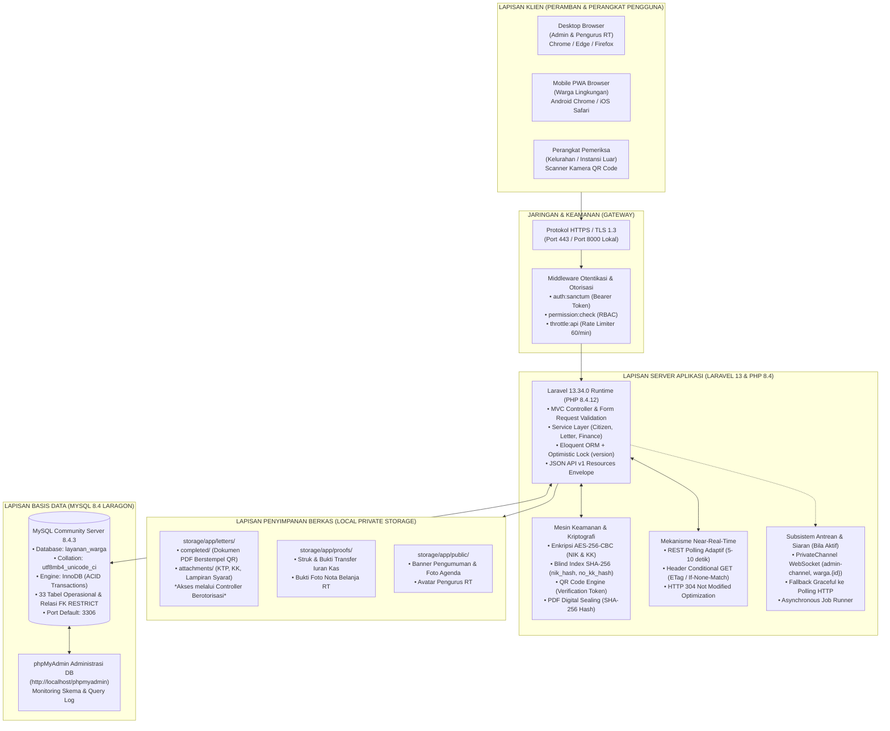

# Arsitektur Teknologi & Infrastruktur Sistem (Technology Architecture)
## TOGAF ADM: Phase D — Technology Architecture (Sprint 2 Baseline)
**Platform Layanan Publik Warga — Arsitektur Sistem PRISMA RT/RW**  
**Versi Dokumen:** 1.1.0-snapshot | **Tanggal:** 16 Oktober 2026

---

## 1. Diagram Arsitektur Teknologi (Mermaid Deployment Diagram)

Diagram berikut memetakan keterkaitan fisik antara lapisan peramban klien, server aplikasi Laravel 13, basis data MySQL 8.4 Laragon, media penyimpanan privat, dan kanal komunikasi real-time:

---

## 2. Komponen Teknologi & Standar Implementasi

| Komponen Arsitektur | Teknologi Terpilih | Versi Terverifikasi | Peran & Tanggung Jawab Teknis |
|---|---|---|---|
| **Runtime Bahasa** | PHP | `8.4.12` (VS17 x64 NTS) | Eksekusi backend, typed properties, constructor property promotion, null-safe operator. |
| **Framework Aplikasi** | Laravel Framework | `13.34.0` | Routing RESTful, IoC Container, Eloquent ORM, Sanctum API tokens, Blade Templating. |
| **Server Basis Data** | MySQL Server | `8.4.3` (Laragon 3306) | Penyimpanan relasional transaksional ACID, InnoDB engine, foreign keys restrict/cascade. |
| **Administrasi Database** | phpMyAdmin | `5.2.x` (Laragon) | Inspeksi skema, visualisasi tabel relasional, verifikasi indeks unik secara visual. |
| **Penyimpanan Berkas** | Local Filesystem Driver | Laravel `local` & `public` | Isolasi berkas identitas sensitif (KTP, KK, Surat) di folder privat `storage/app/`. |
| **Kriptografi & Privasi** | OpenSSL & Hash | AES-256-CBC & SHA-256 | Enkripsi data kependudukan (UU PDP No. 27/2022) dan pencarian blind index tanpa dekripsi. |
| **Generator QR & PDF** | BaconQrCode & DomPDF / PHPWord | Terintegrasi | Menghasilkan token QR verifikasi publik dan berkas cetak surat pengantar digital resmi. |
| **Komunikasi Real-Time** | REST Polling + WebSocket | Fallback Adaptif | Polling native `fetch()` berkala (5-10s) dengan respons conditional `304 Not Modified`. |

---

## 3. Matriks Perbedaan Lingkungan: Lokal Pengembangan vs Staging vs Produksi

Sesuai tata kelola TOGAF ADM, pemisahan lingkungan diatur ketat untuk menjamin data warga tidak tercampur atau bocor:

| Parameter Konfigurasi | Lingkungan Lokal Pengembangan (Current) | Lingkungan Staging (UAT Rehearsal) | Lingkungan Produksi (Target Release) |
|---|---|---|---|
| **Sistem Operasi** | Windows 11 (Laragon Architecture) | Ubuntu Linux 24.04 LTS / Docker | Ubuntu Linux 24.04 LTS Hardened |
| **Domain / URL Akses** | `http://127.0.0.1:8000` / `http://localhost` | `https://staging.layananwarga.id` | `https://layananwarga.id` / `https://rt04.id` |
| **Database Server** | MySQL 8.4.3 Laragon (Port 3306) | MySQL 8.4 / MariaDB Dedicated Container | Managed Cloud MySQL Cluster (Replicated) |
| **Nama Basis Data** | `layanan_warga` | `layanan_warga_staging` | `layanan_warga_prod` |
| **Karakteristik Data** | Data pengujian lokal & akun seeder | **100% Data Samaran / Fake Anonymized** | Data Riil Warga Terenkripsi Penuh |
| **Mode Debug (`APP_DEBUG`)** | `true` (Penelusuran stacktrace dev) | `false` (Simulasi produksi) | `false` (Wajib mati untuk keamanan) |
| **Tingkat Log (`LOG_LEVEL`)** | `debug` | `info` | `error` / `warning` (Tanpa log NIK/No KK) |
| **Koneksi Cache (`CACHE_STORE`)** | `file` / `array` | `redis` / `file` | `redis` (In-Memory Kinerja Tinggi) |
| **Koneksi Antrean (`QUEUE_CONNECTION`)** | `sync` | `database` / `redis` | `redis` didukung Horizon worker |
| **Siaran Event (`BROADCAST_CONNECTION`)** | `log` / `reverb` lokal | `reverb` / Pusher staging | `reverb` / WebPush VAPID aman |
| **Sertifikat SSL/TLS** | Self-signed / HTTP lokal | Let's Encrypt Wildcard TLS | Let's Encrypt / Commercial EV TLS |
| **Pencadangan Basis Data** | Manual script snapshot SQL | Skrip cron otomatis tiap 12 jam | Dump snapshot terenkripsi AES-256 off-site harian |
