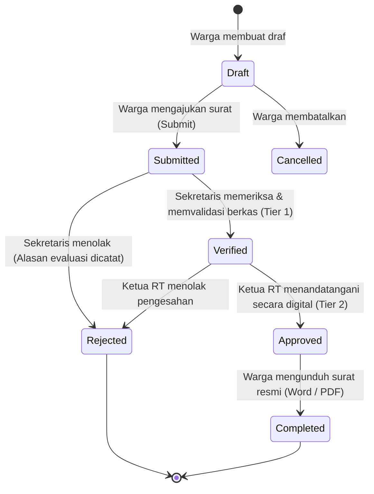
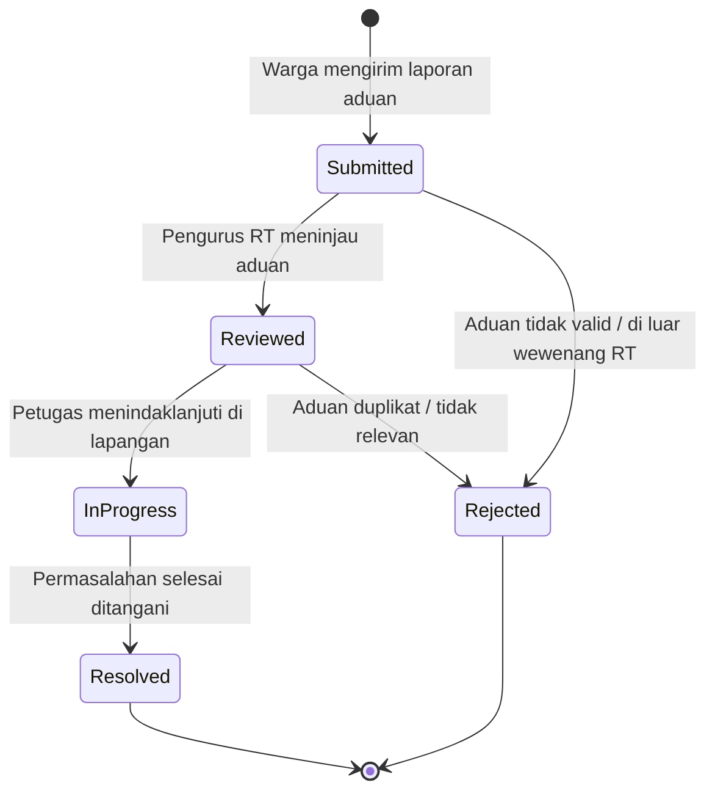

# Matriks Hak Akses Berbasis Peran (RBAC Matrix) & Arsitektur Bisnis
**Platform Layanan Publik Warga RT 01 / RW 05 Kemayoran**  
*TOGAF Phase B — Business Architecture (Sprint 1)*  
*Tanggal Evaluasi: 16 Oktober 2026*

---

## 1. Definisi 7 Aktor Sistem

| Aktor | Peran Sistem | Deskripsi Tanggung Jawab & Lingkup Data |
|---|---|---|
| **Publik / Tamu (Guest)** | Tidak terautentikasi | Mengakses informasi terbuka: warta/pengumuman, transparansi ringkasan kas agregat, kontak darurat, jadwal kegiatan, dan pelacakan tiket surat resmi via QR/kode tiket publik. |
| **Warga (Citizen)** | `warga` | Mengakses layanan mandiri warga: mengajukan permohonan surat pengantar, mengunduh surat resmi yang telah disahkan (Word/PDF), membayar & mengecek iuran kas pribadi, menyampaikan pengaduan lingkungan (dengan opsi anonim), dan memperbarui profil kontak pribadi. |
| **Sekretaris** | `sekretaris` | Mengelola antrean verifikasi berkas surat pengantar dari warga (Tier 1 Verification), memverifikasi keabsahan pendaftaran warga baru, mengelola master data kependudukan (Warga & KK), dan mempublikasikan warta pengumuman resmi. |
| **Bendahara** | `bendahara` | Mengelola pencatatan kas lingkungan RT (pemasukan & pengeluaran kanonikal), memverifikasi setoran iuran warga, menyusun draf laporan keuangan triwulan teragregasi, dan mengelola cadangan arsip kas (*backup store*). |
| **Petugas Keamanan** | `petugas_keamanan` | Mengelola pos kamling, jadwal ronda malam, menerima & menindaklanjuti laporan gangguan ketertiban/insiden keamanan warga, serta menyiagakan kontak darurat 24 jam. |
| **Ketua RT** | `ketua_rt` | Pengambil keputusan tertinggi lingkungan: mengesahkan (*approve/sign*) surat pengantar yang telah diverifikasi sekretaris (Tier 2 Final Approval), mengesahkan dan mempublikasikan laporan keuangan kuartal/triwulan, dan mengawasi seluruh operasional RT. |
| **Superadmin / Admin** | `superadmin`, `admin` | Administrator teknis sistem: konfigurasi permission, manajemen template jenis surat dinamis, audit log keamanan, pemeliharaan sistem, dan tata kelola akun. |

---

## 2. Matriks Hak Akses Sumber Daya (Resource Access Matrix)

Keterangan Hak Akses:
- **C** = Create (Membuat baru)
- **R** = Read (Melihat/Membaca data)
- **U** = Update (Mengubah/Memperbarui)
- **D** = Delete (Menghapus)
- **V** = Verify (Memverifikasi kelengkapan)
- **A** = Approve (Mengesahkan/Menyetujui)
- **P** = Publish (Mempublikasikan ke publik)
- **-** = Tidak memiliki akses (Forbidden / 403)

| Modul / Sumber Daya | Tamu (Guest) | Warga | Sekretaris | Bendahara | Keamanan | Ketua RT | Superadmin / Admin |
|---|---|---|---|---|---|---|---|
| **Warta & Pengumuman Publik** | R | R | C, R, U, P | R | R | R, P | C, R, U, D, P |
| **Kas Lingkungan: Ringkasan Publik** | R | R | R | R | R | R | R |
| **Kas Lingkungan: Catatan Buku Kas** | - | - | R | C, R, U | - | R | C, R, U, D |
| **Kas Lingkungan: Laporan Triwulan** | R (Publikasi) | R (Publikasi) | R | C, R, U (Draf) | - | R, A, P | C, R, A, P |
| **Iuran Warga: Tagihan & Setoran Pribadi** | - | R, C (Bayar) | - | C, R, U, V | - | R | C, R, U |
| **Surat Pengantar: Permohonan Milik Sendiri** | - | C, R (Self) | C, R (Self) | C, R (Self) | C, R (Self) | C, R (Self) | R |
| **Surat Pengantar: Antrean Verifikasi (Tier 1)** | - | - | R, V, U (Tolak) | - | - | R | R, V, U |
| **Surat Pengantar: Pengesahan Akhir (Tier 2)** | - | - | - | - | - | R, A, U (Tolak) | R, A, U |
| **Surat Pengantar: Lacak Tiket / QR Publik** | R (Publik) | R | R | R | R | R | R |
| **Pengaduan: Pengajuan Laporan** | - | **C (Login)** | C | C | C | C | C |
| **Pengaduan: Riwayat Milik Sendiri** | - | R (Self) | R (Self) | R (Self) | R (Self) | R (Self) | R (Self) |
| **Pengaduan: Penanganan & Update Status (All)** | - | - | R, U | - | R, U | R, U | C, R, U, D |
| **Laporan Keamanan: Buat Laporan Insiden** | - | C (Self) | C | C | C, R, U | C | C, R, U |
| **Jadwal Ronda & Kontak Darurat** | R | R | R, U | R | C, R, U | R | C, R, U, D |
| **Master Data Warga & KK** | - | - | C, R, U, V | - | - | R | C, R, U, D |
| **Profil Pribadi (Nama, Kontak, Alamat, DOB)** | - | R, U (Self) | R, U (Self) | R, U (Self) | R, U (Self) | R, U (Self) | R, U (Self) |
| **Audit Logs Sistem** | - | - | - | - | - | R | R |

---

## 3. Resolusi Keputusan Bisnis: Pengaduan Tamu vs Pengguna Terautentikasi (ADR-06)

### Latar Belakang & Masalah
Dalam rancangan awal draft tabel RBAC lama, tamu (*Guest*) ditulis memiliki hak `C` (Create) pada pengaduan. Namun, pada implementasi controller dan rute API (`/api/v1/complaints`), endpoint tersebut berada di bawah middleware `auth:sanctum` dengan policy `isWarga()`.

### Keputusan Arsitektur
1. **Pengajuan Pengaduan Mewajibkan Login:**  
   Pengaduan lingkungan resmi **wajib diajukan oleh pengguna login terverifikasi** (`Guest: -`, `Citizen: C`). Hal ini untuk mencegah spam bot, laporan palsu (*hoax*), dan pencemaran nama baik di lingkungan warga.
2. **Perlindungan Privasi Pelapor (Anonimitas):**  
   Untuk warga yang takut identitasnya diketahui tetangga, sistem menyediakan fitur **Pengaduan Anonim** via flag `is_anonymous = true`.  
   - Pada tingkat basis data: ID akun warga tetap tersimpan di `user_id` untuk akuntabilitas internal pengurus RT.
   - Pada tingkat tampilan & API publik: Nama, NIK, dan foto warga **disamarkan sepenuhnya** (*Masked / Anonymized*).

---

## 4. State Machine & Alur Siklus Hidup Layanan

### 4.1. Siklus Hidup Surat Pengantar (2-Tier Approval Workflow)

**Aturan Bisnis State Machine:**
1. Hanya surat berstatus `approved` atau `completed` yang dapat diunduh dokumen fisiknya (Word `.docx` dan PDF `.pdf`).
2. Surat berstatus `draft`, `submitted`, atau `verified` akan memunculkan status informatif alasan surat belum siap unduh.
3. Surat yang ditolak (`rejected`) mengunci unduhan dokumen dan menampilkan catatan evaluasi penolakan.

---

### 4.2. Siklus Hidup Pengaduan Warga

---

## 5. Kriteria Penerimaan yang Dapat Diuji (*Testable Acceptance Criteria*)

### Skenario 1: Isolasi Data Antar Warga (Data Confidentiality)
- **Given** Akun Warga A (User ID 2) dan Warga B (User ID 3) terdaftar di sistem.
- **When** Warga B mencoba membaca rincian surat pribadi milik Warga A via `GET /api/v1/letters/{id_milik_warga_A}`.
- **Then** Sistem menolak akses dengan respons `HTTP 403 Forbidden`.

### Skenario 2: Wewenang Verifikasi dan Pengesahan Surat (Separation of Duties)
- **Given** Surat diajukan dengan status `submitted`.
- **When** Sekretaris memanggil `POST /api/v1/admin/letters/{id}/verify`.
- **Then** Status surat berubah menjadi `verified`.
- **When** Sekretaris mencoba memanggil `POST /api/v1/admin/letters/{id}/approve`.
- **Then** Sistem menolak dengan `HTTP 403 Forbidden` karena pengesahan adalah wewenang eksklusif Ketua RT.

### Skenario 3: Penolakan Pengaduan Tanpa Autentikasi
- **Given** Tamu (Guest) tanpa token Sanctum.
- **When** Mengirim permintaan `POST /api/v1/complaints`.
- **Then** Sistem menolak dengan `HTTP 401 Unauthorized`.
